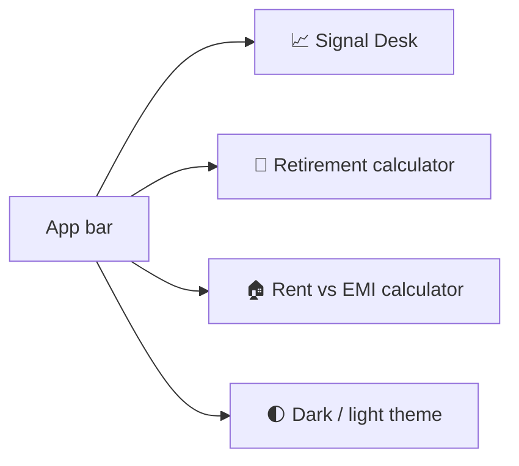
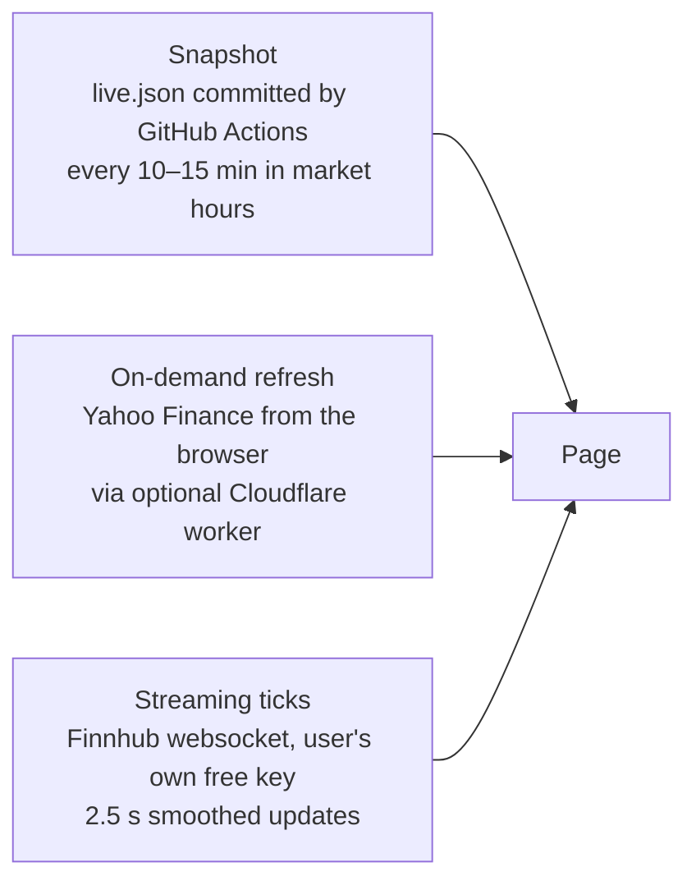
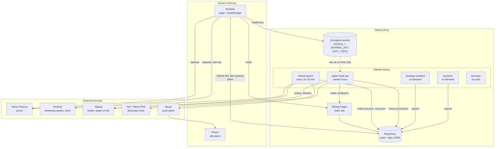
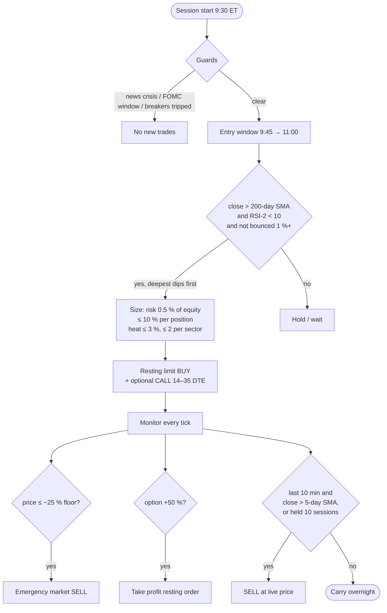
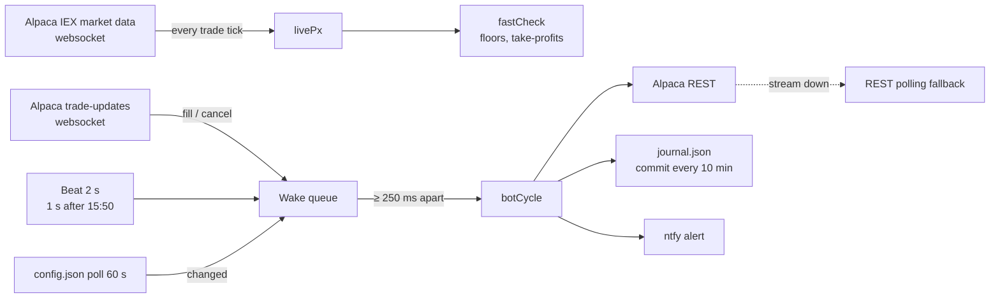
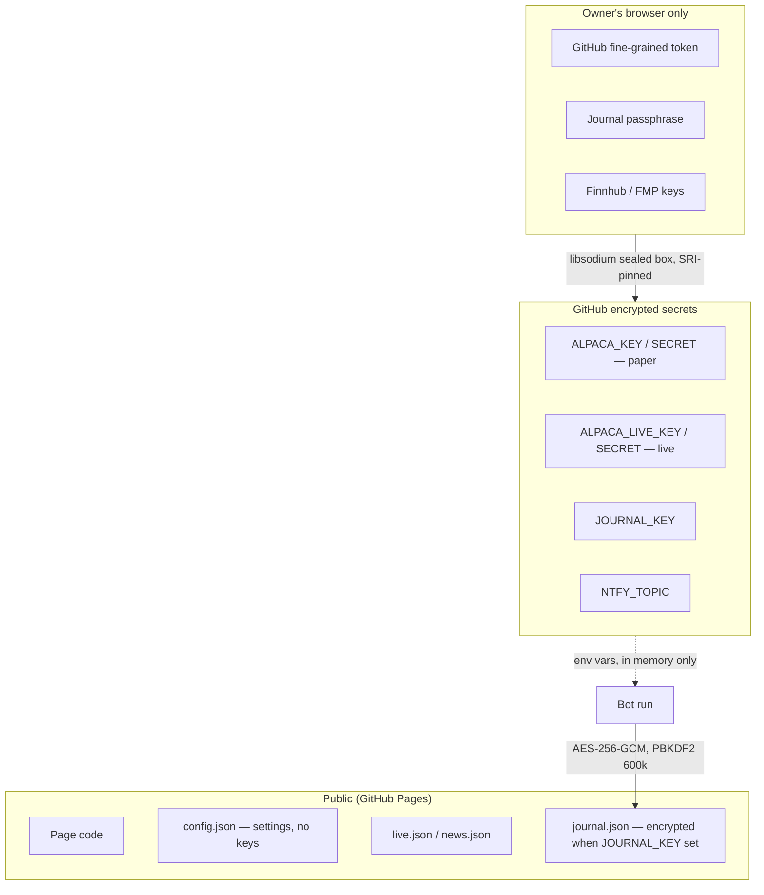

# Signal Desk — System Documentation

**Version:** 1.7 · **Last updated:** 2026-10-23 · **Status:** living document, updated with every change (see [§9](#9-change-log-and-maintenance))

Signal Desk is a personal stock-signal website with an attached rules-based trading bot.
This document is the single place that explains **what it does** (functional), **how it is
built** (architecture) and **how it works inside** (technical), so that anyone — the owner,
a family member, a developer or a future AI assistant — can understand and maintain it.

Everything in this document and in the system is **not financial advice**. The website places
no orders; the bot places orders only on a brokerage account whose keys its owner chose to give it.

---

## Table of contents
1. [What Signal Desk is](#1-what-signal-desk-is)
2. [Functional description](#2-functional-description)
3. [Architecture](#3-architecture)
4. [Technical reference](#4-technical-reference)
5. [The trading bot in depth](#5-the-trading-bot-in-depth)
6. [Security model](#6-security-model)
7. [Operations and runbook](#7-operations-and-runbook)
8. [Testing and quality](#8-testing-and-quality)
9. [Change log and maintenance](#9-change-log-and-maintenance)
10. [Glossary](#10-glossary)

---

## 1. What Signal Desk is

| Part | What it is | Where it runs | Cost |
|---|---|---|---|
| **Website** | One static HTML page with three apps: *Signal Desk* (stocks), *Retirement* calculator, *Rent vs EMI* calculator | GitHub Pages (`https://harimula.github.io/signal-desk/`) and a private copy on claude.ai | $0 |
| **Data refresh** | Fetches prices and news every 10–15 minutes during market hours, commits them to the repo | GitHub Actions | $0 |
| **Trading bot** | Event-driven rules engine trading an Alpaca account (paper by default) during US market hours | GitHub Actions | $0 |
| **Research** | 33-year backtest harness that chose the strategy, re-runnable on demand | GitHub Actions | $0 |

Design principles:
- **No servers to maintain.** Everything is static files plus scheduled GitHub Actions jobs.
- **No secrets anywhere public.** Broker keys live only in GitHub encrypted secrets; the page never sees them.
- **No vendor lock-in.** Plain Node.js (zero npm dependencies), plain HTML/JS, plain JSON data files. Nothing depends on Claude, Anthropic or any paid service.
- **Owner's data stays with the owner.** Watchlists, portfolios, keys for live quotes and calculator inputs are stored in the owner's own browser (`localStorage`); nothing is uploaded.

---

## 2. Functional description

### 2.1 The three apps



**Retirement** and **Rent vs EMI** are self-contained calculators (each an `iframe` with its own
HTML file). Inputs persist in the browser so refreshing the page never resets them. The Rent vs
EMI calculator includes a SIP (systematic investment) plan for the money left over after rent.

### 2.2 Signal Desk tabs

| Tab | Purpose | Key features |
|---|---|---|
| **USA stocks** | Signal board for ~40 US large caps + user tickers | Overview (market cards, best setups), Screener (sortable table: rating, score, price, day %, moving-average distance, analyst targets), Heat map, drill-down dialog per stock with chart, levels and an order ticket |
| **India stocks** | Same for NSE large caps | Same views, ₹ pricing, NSE hours |
| **Day trading** | Tight intraday plans | Per stock: Buy at / Sell at / Stop at, position size for a chosen amount, copy-ready order ticket, 45-day simulated record, **P/L drill-down per stock per day** |
| **Option trading** | CALL/PUT plans on the same setups | Strike/expiry suggestion, premium estimate, exit rules, daily and overall P/L like Day trading |
| **Bot trades** | Everything the bot did | Every trade with entry/exit time and P/L, daily and overall P/L, risk dashboard (heat, breakers, regime), performance vs research scorecard, live/stream indicator |
| **Bot settings** | Control panel for the bot and this device | Device sync (settings follow you, see §2.4), risk profile (Conservative/Balanced/Aggressive/Custom), capital split stocks vs options, strategy parameters, stock universe, news/event guards, paper/live mode, pause/resume/run-now, broker keys (sealed into GitHub secrets), journal passphrase |
| **News** | What is moving markets | Market brief by category, upcoming Fed/CPI/jobs schedule, tagged headlines, **news for the stocks in your portfolios** |
| **Portfolio (one tab per portfolio)** | Holdings with live P/L | Add/rename portfolios, holdings table, per-stock news |
| **My tickers** | User-added symbols | Fetched on demand, scored like the built-in universe |
| **Rules** | Every rule the page applies | Scoring table, rating bands, entry/stop/target construction |

### 2.3 Prices: three freshness levels



Price updates **morph the existing DOM** (no rebuild), so rows never jump, the scroll position
never moves, and a change shows as a brief green/red flash — like a broker app.

### 2.4 Settings follow you (device sync)

Everything the owner sets up — Finnhub/FMP keys, proxy URL, watchlist, portfolios, custom tickers, day-trade and option amounts, theme, auto-refresh choice, calculator inputs — is encrypted in the browser with the owner's passphrase (AES-256-GCM, PBKDF2-SHA256 × 200 000) and saved to the owner's own repo at `user/settings.enc.json` through the GitHub API. A new laptop or phone needs only the GitHub token and the passphrase (entered once in **Bot settings**); the rest arrives by itself. Pushes settle 8 s after a change and never happen more than once a minute, and are skipped entirely when the snapshot is unchanged; pulls happen on load and when the tab becomes visible again; last write wins by timestamp. Derived data rewritten on every render (`sd-dtlog`, `sd-oplog`, `sd-recs`) is excluded — syncing it produced a commit on every price tick. The token and passphrase never sync. Rent vs EMI and Retirement inputs are included.

### 2.5 Responsive behaviour

- Desktop: full tables, ‹ › arrows beside each panel to scroll wide tables.
- Phone/tablet (touch): full-width tables, company names hidden in favour of symbols, compact header, arrows hidden (swipe instead), calculators get one scroll surface.
- Dark/light theme toggle in the app bar reaches all three apps.
- The page checks for a newer build every few minutes and reloads to it without losing scroll position or inputs.

---

## 3. Architecture

### 3.1 System context



### 3.1.1 Portability — no repo name in the code

Nothing in the code names a particular account or repository. The page works out which repo it
belongs to from the GitHub Pages address it is served from (`<owner>.github.io/<repo>/`), and the
bot from `GITHUB_REPOSITORY`, which Actions sets for the repo it is running in. A copy served from
anywhere else (the claude.ai artifact) falls back to the `FALLBACK_REPO` constant near the top of
the page script — the one line to change when the project moves. Moving to another account or
repo name is therefore a copy plus re-enabling the services: see `MIGRATION.md`.

### 3.2 Repository layout

```
signal-desk/
├── index.html              the website (built; all three apps + app bar)
├── retire.html             Retirement calculator (iframe)
├── rentemi.html            Rent vs EMI calculator (iframe)
├── live.json               price snapshot written by refresh-prices
├── news.json               news feed written by refresh-prices
├── events.json             FOMC / CPI / jobs / PPI / minutes calendar through 2027
├── symbols.json            built-in universe (US + India)
├── ver.txt                 build stamp; the page polls it to self-update
├── docs/daytrading-rules.html  the day-trading rulebook (stocks, CALLs, PUTs) with how the bot applies each rule
├── docs/settings.html      owner-facing guide: what every Bot settings control does, defaults, when to change (linked from the tab)
├── vendor/qrcode.js       QR code generator (MIT), self-hosted so the CSP stays 'self'
├── tools/stamp.mjs         bumps the build stamp and rewrites the CSP script hashes (run after every index.html edit)
├── package.json  .nvmrc  eslint.config.js   npm scripts (test / lint / check / verify), Node 20, lint rules — no dependencies
├── favicon.ico  manifest.webmanifest   browser-tab icon; installable-app manifest
├── icons/                  logo.svg / logo.png, icon.svg, favicon, apple-touch, 192/512 and maskable PNGs
├── fetch.mjs               price fetcher (Yahoo) used by refresh-prices
├── news.mjs                news fetcher (RSS + Benzinga) used by refresh-prices
├── worker.js               optional Cloudflare worker: CORS proxy for Yahoo
├── bot/
│   ├── watchdog.mjs        dead-man's switch: alerts when the bot has not checked in during market hours (watchdog.yml)
│   ├── live.mjs            session runner: websockets, event loop, config hot-reload
│   ├── bot.mjs             decision cycle: entries, exits, floors, breakers, journal
│   ├── strategy.mjs        indicators and signals (SMA, RSI-2, exits)
│   ├── risk.mjs            sizing, heat, sector caps, regime, loss streak
│   ├── news.mjs            headline classifier, event guard, per-symbol risk
│   ├── config.mjs          presets, defaults, ranges, normalisation
│   ├── config.json         the control-panel settings (written by the page)
│   ├── journal.mjs         FIFO trade pairing from broker fills
│   ├── journal.json        trade journal (encrypted when JOURNAL_KEY is set)
│   ├── backtest.mjs        single-strategy backtest with costs and metrics
│   ├── research.mjs        4-strategy portfolio simulator, out-of-sample split
│   ├── research.json / research_report.md   research results (shown on Bot tab)
│   ├── backtest.json / backtest_report.md   backtest results
│   ├── test.mjs            39 unit tests (run in CI)
│   └── test-orders.mjs     end-to-end check against a fake broker: which orders one cycle places (CI)
├── .github/workflows/
│   ├── refresh.yml         refresh-prices
│   ├── trade.yml           paper-trade-bot
│   ├── research.yml        strategy-research
│   ├── backtest.yml        backtest
│   ├── research-day.yml    day-trading-research
│   ├── watchdog.yml        watchdog (dead-man's switch)
│   └── test.yml            bot-tests
├── MIGRATION.md            moving to another account or repo name
├── docs/
│   ├── ARCHITECTURE.md     this document
│   ├── index.html          the same documentation as a web page (/docs/)
│   └── architecture.pptx   architecture slides
├── BOT.md  SECURITY.md  ACCOUNTS.md  FAMILY.md  MIGRATION.md  README.md
```

### 3.3 Data flow

```mermaid
sequenceDiagram
  autonumber
  participant Y as Yahoo / RSS / Benzinga
  participant RF as refresh-prices (Actions)
  participant R as Repo / Pages
  participant P as Page (browser)
  participant B as Bot (Actions)
  participant A as Alpaca

  loop every 10–15 min, market hours
    RF->>Y: fetch daily bars, quotes, headlines
    RF->>R: commit live.json, news.json, ver.txt
  end
  P->>R: load page, live.json, news.json, bot/journal.json
  P->>P: score, rate, render; localStorage for user data
  P-->>R: (Bot settings) write bot/config.json via GitHub API
  loop every 5 min cron, one session per day
    B->>R: read bot/config.json (hot-reload every 60 s)
    B->>A: account, positions, orders, bars
    A-->>B: trade-updates + market-data websockets
    B->>A: limit orders (entries, take-profits), market exits
    B->>R: commit bot/journal.json every 10 min and at close
  end
```

### 3.4 Deployment and scheduling

| Workflow | Trigger | What it does | Limits |
|---|---|---|---|
| `refresh-prices` | cron `*/10 13-21 * * 1-5` (US) and `*/15 3-10 * * 1-5` (India), manual | `node fetch.mjs` → `live.json`; `node news.mjs` → `news.json`; commits | ~1 min |
| `paper-trade-bot` | cron `*/5 13-21 * * 1-5`, manual; `concurrency` so only one session runs | `node bot/live.mjs` for up to 345 min; exits early if `bot/STOP` exists | 358 min timeout |
| `strategy-research` | manual | `node bot/research.mjs` → `research.json`, `research_report.md` | 40 min |
| `backtest` | manual | `node bot/backtest.mjs` → `backtest.json`, `backtest_report.md` | 30 min |
| `day-trading-research` | manual, monthly (1st, 06:17 UTC) | `node bot/research-day.mjs` (Alpaca keys) → `research-day.json`, `research_day_report.md` | 120 min |
| `watchdog` | cron `*/15 13-20 * * 1-5`, manual | `node bot/watchdog.mjs`: journal older than 25 min in market hours → phone alert (hourly while down; skips holidays via the broker clock) | 3 min |
| `bot-tests` | push / PR | stamp check, ESLint, `node bot/test.mjs`, `node bot/test-orders.mjs`; `page` job: headless Chromium page tests | 10 / 12 min |

All actions are pinned to exact commit SHAs (`actions/checkout@11bd719… # v4.2.2`,
`actions/setup-node@49933ea… # v4.4.0`).

---

## 4. Technical reference

### 4.1 Website

- **Stack:** one HTML file, vanilla JavaScript, no framework, no build tooling in the repo (the owner's build script fills the price snapshot into the page template). External scripts: only libsodium (for sealing secrets), loaded from jsDelivr with Subresource Integrity hashes.
- **State:** `localStorage` keys prefixed `sd-` (watchlist, portfolios, custom tickers, theme, auto-refresh choice, Finnhub/FMP keys, GitHub token, journal passphrase) plus the calculators' own keys. All of it except the token and passphrase roams between devices through `user/settings.enc.json` in the repo (§2.4); a **setup link** can still carry quote keys to a device without the token.
- **Rendering:** `renderAll(bg)`. The foreground path rebuilds a tab; the background path (price ticks) morphs the existing DOM in place (`morphEl`/`morphKids`/`morphSet`, keyed by `data-s`), preserving `<details>` open state, row order and scroll offsets. Browser scroll anchoring is disabled; an interaction guard delays updates while the user is scrolling or typing.
- **Scoring:** each stock gets a score from trend (50/200-day averages), momentum, RSI, volume, distance to the chosen moving average, analyst targets and recent signals; the score maps to Top Buy / Buy / Hold / Sell / Top Sell bands. The Rules tab documents every weight.
- **Self-update:** the page polls `ver.txt`; when a newer build appears it reloads once, keeping tab and scroll.

### 4.2 Data files

| File | Written by | Shape |
|---|---|---|
| `live.json` | `fetch.mjs` | `{ at, rows: { SYM: [px, prevClose, …] }, bars: { SYM: [...] }, stamp }` — daily bars and latest quotes for the universe |
| `news.json` | `news.mjs` | `{ at, items: [{t, h, u, sum, s}], bySym: { SYM: [...] } }` — tagged headlines, per-ticker filtered |
| `events.json` | hand-maintained | `[{ date, time, type, title }]` — FOMC, CPI, JOBS, PPI, MINUTES |
| `bot/config.json` | Bot settings tab | see §5.4 |
| `bot/journal.json` | bot | plaintext `{ at, equity, day, trades, acts, … }` or encrypted `{ enc:1, kdf, iter, salt, iv, ct, at, sig, paper, stream, engine }` |
| `bot/research.json` | research workflow | per-strategy metrics (CAGR, Sharpe, max DD, OOS split) |
| `user/settings.enc.json` | the page (device sync) | `{ enc:1, kdf, iter, salt, iv, ct }` wrapping `{ v, at, dev, data: { key: value } }` |

### 4.3 Bot modules

| Module | Responsibility | Key exports |
|---|---|---|
| `live.mjs` | Process lifecycle for one market session; websocket subscriptions (trade updates + IEX market data); wake queue; 2 s beat (1 s after 15:50); polling fallback; config hot-reload; journal commit; stream reconnect on paper↔live switch | — |
| `bot.mjs` | One decision cycle: load bars, compute signals, apply guards, size, place/cancel orders, floors, take-profits, breakers, journal | `botCycle`, `fastCheck`, `applyConfig`, `pushPrice`, `endpoints`, `redact` |
| `strategy.mjs` | Indicators and signals | `sma`, `rsi2`, `rsi2Signal`, `rsi2Exit`, `replay` |
| `risk.mjs` | Money management | `stockQty`, `optionQty`, `regimeOf`, `lossStreak`, `openRisk`, `SECTOR` |
| `news.mjs` | Event and headline guards | `classify`, `loadEvents`, `guard`, `symbolRisk` |
| `config.mjs` | Settings schema | `PRESETS`, `DEFAULTS`, `RANGES`, `normalize`, `summary` |
| `journal.mjs` | Pair fills into round trips (FIFO) | `parseSym`, `buildJournal` |

Zero npm dependencies; Node 20+ (uses built-in `fetch`, `WebSocket`, `crypto.webcrypto`).

---

## 5. The trading bot in depth

### 5.1 Why RSI-2

`bot/research.mjs` simulated four strategies on 39 large US stocks, 1993 → 2026, with 0.05 %
costs per side, 10 % of equity per position, at most 6 positions, judged on the **last 30 % of
years (2016–2026), which were never used to choose anything**.

| Strategy | OOS CAGR | OOS Sharpe | OOS max drawdown |
|---|---|---|---|
| **RSI-2 mean reversion (chosen)** | **+16.4 %** | **1.45** | **−11.9 %** |
| Trend breakout | +7.2 % | 0.70 | −13.6 % |
| SPY buy & hold | +13.3 % | 0.79 | −34.1 % |
| Original intraday pullback rules (retired) | −4.1 % | −0.86 | −35.0 % |

Survivorship bias flatters all rows; treat them as an upper bound.

### 5.2 Rules



- **Entries:** 9:45–11:00 ET (after 10:15 on CPI/jobs days); limit orders at the broker.
- **Exits:** last 10 minutes once the close is above the 5-day average, or after 10 sessions. A 25 % hard floor is a disaster brake (fires within a second off the stream).
- **Options:** CALL nearest strike, 14–35 days to expiry, same dips; take-profit +50 % as a resting order, stop −50 %, closed 3 days before expiry. Skipped under the pattern-day-trader guard when equity < $25 000.
- **Puts (experimental, OFF by default):** with **Trade PUT options** ticked, the mirror rule buys a PUT on a stock *below* its 200-day average whose RSI-2 is above 90 (a sharp pop in a downtrend), skipped once the pop has already fallen 1 %+ today. Same option rules as the CALLs (14–35 days, nearest strike, spread ≤ 20 %, shared 4-option cap and risk budget); exits when the stock closes below its 5-day average, after 10 sessions, or on the option take-profit / stop / expiry rules. Never backtested on options; the research workflow tests a stock-short proxy.
- **Day trading (experimental, OFF by default; `docs/daytrading-rules.html`):** 5-minute IEX bars for the universe + SPY, refreshed every 55 s. Market filter: SPY vs its session VWAP. Setups: 15-minute opening-range breakout (fresh 5-min close through the range, on the VWAP side, relative volume ≥ 1.2×) and VWAP pullback-and-reclaim on a trend day (≥ 70 % of closes on one side of the running VWAP). Stop under the range (0.1 ATR) or 1.5 ATR, whichever is closer; VWAP setup 0.25 ATR beyond the pullback; target 2R; breakeven at +1R; time stop 60 min at < 0.3R; flat 15:50 (options 15:45); entries 09:45–15:30; max 3/day, 1 per stock, 2-loss streak stop, daily cap, news guard and PDT guard. Longs = shares (or CALL), shorts = PUT only (nearest expiry 1–7 days, ATM strike, spread ≤ 10 %, +50 % / −40 % option exits). Order ids `sd-d-`/`sd-dc-`/`sd-dp-` carry entry, stop, target, date and entry minute so management survives a restart; `dayState` holds the trailed stop in memory. Runs every beat before the swing entries, independent of the RSI-2 entry window.
- **Guards:** FOMC/CPI/jobs calendar windows, live headline scan (war, White House, Fed, crisis keywords — matched on whole words, so "Stewart" and "Software" are not war headlines; a single company halting is tagged `single` and skips only that ticker), SPY tone; daily (−3 %) and weekly (−6 %) loss caps; 3-loss streak pause; stale orders cancelled after 45 min.

### 5.3 Real-time engine



Measured in tests against a mock broker: fill → take-profit order 40 ms; crash tick → floor exit 110 ms.

**Journal continuity across runs.** Every run is a fresh process, and the panels the bot computes only while the market is open (watch list, market check, risk, day-trading block) plus the action log live in memory. At its first write the bot therefore reads the previous `bot/journal.json` back — decrypting it with `JOURNAL_KEY` when it is encrypted — and carries those panels forward until it has computed fresh ones; the action log is appended to (never re-appended) and capped at 80 entries. A run that starts at or after 16:00 ET exits at once if today's journal was already written at 15:55 or later (the day's session reached the close); otherwise it runs one closing cycle, writes the journal and sends the day summary. A previous journal written under a different passphrase is skipped with a log line, not a crash.

### 5.4 Settings (`bot/config.json`)

| Key | Meaning | Default |
|---|---|---|
| `mode` | `paper` or `live` (live also needs live keys and a typed confirmation) | paper |
| `preset` | conservative / balanced / aggressive / custom | balanced |
| `riskPct`, `optRiskPct` | % of equity lost if a stock / option trade hits its stop | 0.5 / 0.5 |
| `maxHeat` | % of equity at risk across everything open | 3 |
| `perSector`, `maxPositions`, `maxOptions` | caps | 2 / 6 / 4 |
| `dayCap`, `weekCap`, `streak` | circuit breakers (% loss, % loss, losses in a row) | 3 / 6 / 3 |
| `stockPct`, `optPct` | max % of equity per stock position / option budget | 10 / 2 |
| `stocks`, `options`, `puts` | enable each instrument (CALLs, PUTs) | true / true / **false** |
| `universe`, `scanSize`, `scanMinPrice` | `list` = the `symbols` below; `scan` = each morning rank every tradable US stock (NYSE/NASDAQ/ARCA/AMEX, no OTC, plain tickers) by 20-day average dollar volume on the IEX feed and watch the top `scanSize` priced ≥ `scanMinPrice` (`bot/scan.mjs`); the scan is re-used for the day, falls back to yesterday's or the list on failure | list / 200 / $5 |
| `dayTrade`, `dayStock`, `dayCalls`, `dayPuts` | day-trading master switch and instrument per side | false / true / false / true |
| `dayOrMin`, `dayMaxTrades`, `dayStreak`, `dayRiskPct`, `dayTarget`, `dayRvol`, `dayTimeStop` | opening-range minutes, trades/day, loss streak, risk %, target in R, min relative volume, time stop minutes | 15 / 3 / 2 / 0.5 / 2 / 1.2 / 60 |
| `stakeUsd` | the stake: with a value set, every size, loss limit and the PDT rule are computed as if the account held only that much (0 = whole account); the page shows P/L against it | 0 |
| `liveSizePct` | real-money ramp: all budgets and risk figures × this % while `mode` is live (paper always 100 %) | 25 |
| `dayOptTp`, `dayOptStop`, `dayOptDteMax`, `dayStart`, `dayEnd` | option take-profit %, option stop %, max days to expiry, entry window | 50 / 40 / 7 / 09:45 / 15:30 |
| `alertDetail` | phone alerts include size and limit price on buys; entry price, exit price and open profit on sells | true |
| `intraday` | experimental: stock/CALL/PUT signals use today's live price as a provisional close (`liveSignal` in strategy.mjs) instead of waiting for the close; yesterday's close still drives the 1 % bounce rule | **false** |
| `stockUnit`, `callUnit`, `putUnit` | size each sleeve in `pct` (% of account) or `usd` (fixed dollars) | pct |
| `stockPct`, `optPct`, `putPct` / `stockUsd`, `callUsd`, `putUsd` | money per trade for each sleeve, in the chosen unit | 10 / 2 / 1 % · $10,000 / $2,000 / $1,000 |
| `stockCap*`, `callCap*`, `putCap*` (`Pct` or `Usd`) | ceiling on everything that sleeve holds plus its waiting buy orders; 0 = no ceiling | 0 |
| `rsiThreshold`, `maxHold`, `entryEnd` | strategy parameters | 10 / 10 / 11:00 |
| `optTakeProfit`, `optStop`, `holdFloor`, `staleMin` | exits | 50 / 50 / 25 / 45 |
| `newsGuard`, `eventGuard`, `alerts` | guards and alerts | true |
| `symbols` | universe | 30 US large caps |

The bot re-reads this file every 60 s from the public site, so a change in the Bot settings
tab is in force within a minute. Keys are **not** in this file.

---

## 6. Security model



- **Keys never touch the page or the repo.** The Bot settings tab seals them with GitHub's public key in the browser; only a workflow run can read them.
- **Paper and live are separate credentials.** Live trading requires `mode: live` **and** live keys **and** the typed phrase; a paper key is rejected by the live endpoint.
- **Device settings and sign-in.** Holdings, watchlist, keys and the GitHub token are stored in the public repo as one AES-256-GCM blob (PBKDF2-SHA256, 600,000 rounds — OWASP 2023; older blobs carry their own count and still open) under the owner's passphrase (≥ 12 characters); without the passphrase it is opaque. Because the blob is public on the site, **any device can sign in with the passphrase alone** (header → 👤 Sign in): it downloads the blob, decrypts it, installs the token and data, and syncs from then on. **Sign out and wipe** clears the browser. The passphrase is therefore the account password — the owner's checklist asks for a long, unique one.
- **Private journal:** with `JOURNAL_KEY` set, the journal is AES-256-GCM encrypted and all numbers are scrubbed from Actions logs; the page decrypts locally with the passphrase.
- **Content-Security-Policy:** the page ships a CSP `<meta>` that allows only its own two inline scripts (whitelisted by SHA-256 hash), the SRI-pinned libsodium and the optional Firebase SDK; connections are limited to GitHub, the price and news APIs, the price relays and Firebase. A script that is not the page's own — injected through a bug, a poisoned feed or an extension — is refused by the browser. `tools/stamp.mjs` rewrites the hashes (and the build number) after every edit; CI fails if they are stale. Feed links are only clickable when they are `http(s)`; `referrer` is `strict-origin-when-cross-origin`.
- **Supply chain:** the only third-party scripts are pinned by hash; Actions are pinned to commit SHAs and watched by Dependabot; the bot has no npm dependencies.
- **Protective orders live at the broker:** every swing stock buy is an OTO order with a good-till-cancelled stop leg at the hard floor; every day-trade stock buy is a bracket (stop + target). Rule-based exits cancel the legs first, then sell at market; the day-trade breakeven rule moves the stop leg with a replace call; the bot's own stop check runs only where no leg exists. A dead-man's switch (`watchdog.yml`, every 15 min in market hours) alerts the phone when the journal has not been updated for 25 minutes; the bot sends an end-of-day summary; an optional `HEARTBEAT_URL` is pinged every minute.
- **Broker calls:** every request has a 15 s deadline; reads are retried with backoff on 429 / 5xx / network faults; order placement is never retried (the `client_order_id` and the in-process duplicate guard cover the slow-broker case). A cancelled run (SIGTERM) finishes its cycle, writes the journal and pushes it.
- **Broker API keys can trade but cannot withdraw funds** (verify in your own Alpaca settings).
- **Owner checklist** (`SECURITY.md`): 2FA everywhere (no SMS), sole collaborator on the repo, token scoped to one repo with ≤ 90-day expiry, random ntfy topic, never paste keys into chat or issues.

---

## 7. Operations and runbook

### 7.1 First-time setup (≈ 20 minutes)
1. Alpaca account → Paper → generate API keys.
2. GitHub fine-grained token: only this repo; Contents, Secrets, Actions: read & write; 90-day expiry.
3. Site → **Bot settings**: connect with the token, paste Alpaca paper keys, choose a risk profile, set a journal passphrase, Save.
4. Repo → Actions → enable workflows; Settings → Actions → Workflow permissions → Read and write.
5. 2FA on GitHub, Alpaca and email.

The bot starts on the next market morning. Nothing on the owner's devices needs to stay on.

### 7.2 Day-to-day
| Need | Where |
|---|---|
| See trades, P/L, risk | Bot trades tab |
| Change risk, universe, guards | Bot settings tab → Save (in force within 60 s) |
| Pause / resume / run now | Bot settings tab buttons (writes/removes `bot/STOP`, dispatches workflow) |
| Alerts on the phone | ntfy app subscribed to the `NTFY_TOPIC` |
| Re-run research or backtest | Actions tab → workflow → Run workflow |

### 7.3 Going live — the procedure

Going live is a decision the owner makes once the checklist in **Bot settings → 7. Mode** is green. The page computes it from real data; it never blocks the switch.

**The checklist (what "ready" means)**

| # | Check | Why | Where it is measured |
|---|---|---|---|
| 1 | ≥ 60 trading days of paper history | fills, slippage and the guards must be seen across different market weeks | first closed trade in the journal |
| 2 | ≥ 50 closed trades | fewer is noise; the research edge is a +0.57 % average on thousands of trades | journal |
| 3 | live expectancy > 0 and ≥ half the research figure (on 30+ swing trades) | the first sign an edge is not there live | Performance card → *Live vs research* |
| 4 | worst drawdown so far < 10 % of the account | the bot's limits are working | journal |
| 5 | protective stops at the broker | survives bot downtime: OTO stop leg on every swing buy (GTC, at the hard floor), bracket (stop + target) on every day-trade buy | code, since 2026-10-22 |
| 6 | phone alerts on + watchdog | you hear about every trade and every silence (watchdog alerts after 25 min without a check-in in market hours) | `NTFY_TOPIC` secret, `watchdog.yml` |
| 7 | live keys saved | `ALPACA_LIVE_KEY` / `ALPACA_LIVE_SECRET`, trading-only permissions | section 1 |
| 8 | live size ≤ 25 % | the ramp-up: every budget and risk figure is multiplied by `liveSizePct` in live mode | section 7 |
| 9 | experimental sleeves off or tiny | PUTs, intraday, day trading have no long record | sections 3, 4, 4b |

**Steps**

1. Checklist green (or you accept each red item knowingly).
2. On the Alpaca live account: enable options only if you intend to trade them; set the account's own daily loss limit if offered; confirm the API key cannot withdraw funds.
3. Bot settings: section 1 → paste the live keys → Save keys. Section 7 → Live size 25 → tick *Trade real money* → type `I UNDERSTAND THE RISK` → Save. The bot picks it up within a minute and reconnects to the live endpoint (`account switched to LIVE` in the log).
4. First live day: watch the Bot trades tab and the phone. Every entry should show *broker stop at …* in its line. Press **Pause — sell everything now** at the first sign of anything you do not understand.
5. Weekly: compare *Live vs research* and the drawdown. Monthly, if expectancy holds and the drawdown stays under 10 %, raise Live size: 25 → 50 → 75 → 100.
6. Never run two bots on one account; never leave `bot/STOP` in place by accident (it sells everything each cycle).

**What stays true even when "ready":** the research universe is today's survivors, so expect live results somewhat below the backtest; the IEX feed is a sample of the market (consider the consolidated feed for live money); GitHub Actions is a convenient runtime, not a guaranteed one — the broker-side stops exist because of that; taxes and wash sales are the owner's job (`SECURITY.md`).

### 7.4 Troubleshooting
| Symptom | Check |
|---|---|
| Bot tab says "No bot activity" | Actions → paper-trade-bot → latest run log; keys present? workflow enabled? |
| "What the bot is watching" card shows the fallback text | The journal on the site carries no watch block. Normal only for a brand-new setup or right after the journal passphrase was changed (the bot cannot read the previous entry); it fills in with the first check-in after 9:30 ET. Any other time: Actions → paper-trade-bot → latest run log for "previous journal could not be decrypted" |
| "Settings save failed" | Token expired or scoped wrong; regenerate |
| Prices stale | Actions → refresh-prices runs; press ↻ Refresh prices |
| Page shows lock screen | Enter the journal passphrase (same as `JOURNAL_KEY`) |
| Settings missing on a new device | Bot settings → connect GitHub, then enter the passphrase under *Sync across devices* |
| Live quotes not moving | Finnhub key saved on this device? Market open? |

---

## 8. Testing and quality

- `bot/test-orders.mjs`: serves a just-dipped stock and a just-popped stock from a fake broker and checks the exact orders one cycle places for each CALL/PUT switch combination (puts never appear unless ticked), money limits, market scan, journal continuity (a run that starts with the market closed keeps the previous encrypted entry's panels; rewrites never duplicate the action log; a foreign-passphrase entry is skipped), and — with synthetic 5-minute bars — the day-trading engine: ORB long → stock buy with levels in the id, market-down breakdown → PUT, daily maximum, flat at 15:50, stop at market, resting take-profit. Runs in CI.
- `bot/test.mjs`: 55 unit tests (indicators, journal encryption round trip, call and put signals, sizing, heat, regime, guards, journal pairing, config normalisation, RSS parsing, broker HTTP wrapper: retry, timeout, never-retry-an-order). Runs in CI on every push.
- `npm run verify` = `tools/stamp.mjs --check` (build number matches `ver.txt`, CSP hashes current, inline scripts parse) + ESLint on the bot and tools + both test files. CI (`bot-tests`) runs the same four steps on every push that touches the bot, the page or the tooling.
- `tools/page-test.mjs` (CI job `page`): headless Chromium walks every tab as a fresh visitor and as a connected owner with the Screener sub-view remembered, asserting no script errors and no CSP violations, then types into Bot settings and saves against a stand-in GitHub API.
- Accessibility: audited with axe-core in headless Chromium across every tab — landmarks (`header`, `nav`, `main`), proper `tablist`/`tab` roles, labelled inputs, and all text colours at WCAG AA contrast (≥ 4.5 : 1) in both themes.
- Integration tests against **mock brokers** (REST + websocket) with a fake clock, covering: duplicate-order prevention, take-profit timing, floor exits off streamed ticks, config hot-reload, paper↔live reconnect, PDT guard, encrypted journal and log redaction.
- Page checks in headless Chromium at desktop and phone widths for every tab, including scroll-position preservation during live ticks.
- Research/backtest workflows produce reproducible reports committed to the repo. `day-trading-research` (manual + monthly) runs `bot/research-day.mjs`: downloads every 5-minute IEX bar since 2016 for the universe + SPY (needs the paper Alpaca keys), records what `daySetup` would have said at every bar close, then evaluates a 288-point grid (opening range 15/30 min, relative volume 1.0–2.0, target 1.5–3R, time stop 45–90 min, morning-only vs full window, market filter on/off) with the bot's daily discipline applied in time order; writes `bot/research-day.json` (verdict, defaults vs best, variants, per-year) and `bot/research_day_report.md`. The Bot trades tab shows it; Bot settings §4b can copy the best values into the form.

---

## 9. Change log and maintenance

**Maintenance rule:** every change to the website, the bot or the workflows updates this document, `docs/index.html` and, when the architecture changes, `docs/architecture.pptx`, **in the same commit**. Any change to a bot setting (new, removed, renamed, new default or range, new behaviour) also updates the owner-facing **settings guide** `docs/settings.html` (linked from the Bot settings tab) in the same commit, without being asked. After any edit to `index.html` run `node tools/stamp.mjs` (new build number + CSP hashes), and `npm run verify` before pushing. The "Last updated" line at the top and the table below are part of that commit.

| Date | Change | Docs touched |
|---|---|---|
| 2026-10-23 | Watch card on phones: the BUY / CALL / PUT ticker lists were joined without spaces, so a long list could not wrap and ran past the card (and widened the page). Now a wrapping flex row in the mono font, with a count of stocks under each list. Checked at 390 px: no horizontal overflow. | docs/index.html |
| 2026-10-22 | **Journal continuity fix** (reported: *"In bot trading I don't see the watching card"*). Root cause from the run records: the day's session ended 16:00:04 ET, the run queued behind it started 16:00:21 ET with the market closed and, unable to read its own encrypted previous journal, rewrote it from an empty memory — no watch list, no market check, no risk panel, no day block, empty action log (same thing every morning 9:20–9:30). Fix: `previousJournal()` decrypts the last entry with `JOURNAL_KEY` and `writeJournal` carries `watch`/`env`/`risk`/`day` forward until fresh ones exist; action log appended once (also fixes a duplication bug: every rewrite re-appended the whole process log); `live.mjs` exits at once when started after the close and today's journal is already from ≥ 15:55 ET (no second day summary); page shows the card in a fallback form when a journal has no watch block. Tests: crypto round trip (unit), closed-market restart keeps panels, three rewrites never duplicate the log, foreign-passphrase journal is skipped (order checks: 42). | ARCHITECTURE §5.3, §7.4, §8; docs/index.html |
| 2026-10-22 | Engine speed and health: the cycle's four account reads run in parallel (`Promise.all`); `engine` block in the journal (and in the plaintext envelope) with cycle time, slowest cycle, broker latency, calls, errors in the last hour; shown as a line on the Bot trades tab. Decision recorded: one process for stocks and options — two bots on one account would double or fight over positions; independence comes from the per-instrument switches and money sleeves | §5.3, §5.5 |
| 2026-10-22 | **Design system pass:** IBM Plex Sans + Plex Mono (tickers), token palette — light: cool paper / ink navy / cobalt actions; dark: deep navy with an amber accent — flat cards (`--radius` 10), stat strip with hairline dividers, sticky tabs, settings page with a sticky section index, consistent 36 px controls, focus rings, reduced-motion respected; status strip and footer are landmarks (axe-core: zero findings, every tab, both themes, desktop and phone). **Stake** (`stakeUsd`): the practice account trades as the owner's real stake (sizes, loss limits, PDT, dashboard, end-of-day report) | §2, §4.1, §5.4 |
| 2026-10-22 | **Real-money readiness:** protective stops/targets at the broker (OTO leg on swing buys, bracket on day-trade buys; exits cancel legs first; breakeven via replace; bot stop check only where no leg exists); `watchdog.yml` dead-man's switch + end-of-day summary alert + optional heartbeat ping; `liveSizePct` ramp (25 % default) applied to every budget in live mode; go-live checklist computed from real data in Bot settings §7 with a Live size field; *Live vs research* expectancy line on the Performance card; PBKDF2 raised to 600k rounds (bot journal, page sync); §7.3 rewritten as the go-live procedure | §5.2, §5.4, §6, §7.3, §8 |
| 2026-10-22 | Day-trading **research** on all available intraday history (5-min IEX bars since 2016): `bot/research-day.mjs` replays the live rules, parameter grid, verdict; workflow `day-trading-research` (manual + monthly); results card on the Bot trades tab; “Put these values in the form” in §4b; `dayOrMin` setting; rulebook gains an Evidence section | §3.2, §5.4, §8 |
| 2026-10-22 | **Day trading** (experimental, off): `bot/daytrade.mjs` + `dayTradeCycle` in bot.mjs (5-min bars, SPY-VWAP market filter, ORB and VWAP-pullback setups, risk sizing, stop/target/breakeven/time-stop/flat exits, PUTs for shorts, optional CALLs, daily limits, PDT guard); Bot settings §4b; watch card “⚡ Day trading” block (setups, open day trades); Performance split same-day vs swing; rulebook `docs/daytrading-rules.html`; 7 unit tests, 9 order checks | §3.2, §5.2, §5.4, §5.5, §8 |
| 2026-10-22 | Phone header: one control row (Sign in · refresh mode · Refresh), clock and duplicate live dot hidden, tiles and key/value rows wrap so the page never scrolls sideways | §2.5 |
| 2026-10-22 | **Sign in anywhere with the passphrase** (header 👤 Sign in): the GitHub token now travels inside the encrypted sync blob (v2), a new device reads the public blob with the passphrase alone and installs token + data; older v1 blobs are re-saved automatically; **Sign out and wipe this device**; `https://*.github.io` added to CSP connect-src for the artifact copy; CI page test covers A-syncs → B-signs-in → B-signs-out | §2.4, §6, §8 |
| 2026-10-22 | Commodity price strip removed from the Portfolio tab at the owner's request (commodity holdings and the USD/INR tile stay) | §2.2 |
| 2026-10-22 | **Link a phone by QR code** (Bot settings → Sync across devices): the desktop renders a QR (self-hosted `vendor/qrcode.js`, MIT) whose link carries the GitHub token, journal passphrase and price keys in the URL fragment; scanning it installs them on the phone, cleans the address bar, shows a "linked" banner and the first sync pull follows. Same `#setup=` receiver as the price-key setup link, now UTF-8 safe | §2.4, §3.2, §6 |
| 2026-10-22 | Live quotes (FMP, Finnhub REST, Finnhub stream) now also cover the owner's own symbols (portfolio / My tickers), not just the built-in universe; the page merges every row the daily snapshot has that it lacks; common ETFs (GLD, IAU, SLV, USO, UNG, GDX, QQQ, IWM, DIA, TLT, VTI, VOO) added to `symbols.json` | §2.3, §4.2 |
| 2026-10-22 | Portfolio: **commodities** (gold, silver, WTI/Brent crude, natural gas, copper, platinum via Yahoo continuous futures in `symbols.json`; gold in grams / 10 g and silver per kg priced in ₹ from the troy-ounce quote × USD→INR), and an **Everything together** tile showing the whole portfolio in both USD and INR at an owner-set USD→INR rate (`sd-fx`, synced) or the live `USDINR=X` quote | §2.2, §4.2 |
| 2026-10-22 | Fix: the watch list was only built after the entry gates (loss cap, entry window, news pause), so a paused or after-3 PM session published no card. Now built every cycle (every 20 s while gated) with an `idle` reason shown on the card | §5.5 |
| 2026-10-22 | Settings guide `docs/settings.html` (every control, default, range, when to change, common setups), linked from the Bot settings tab; maintenance rule extended: keep it current with every settings change | §3.2, §9 |
| 2026-10-22 | Watch card shows trigger prices: for every watched stock the close that would push RSI-2 under the buy level (`rsi2Trigger`, bisection) and, with puts on, over the put level; for every holding the exit level (average of the last 4 closes = the 5-day-average crossing, `rsi2ExitLevel`), hard floor, and for options take-profit, stop and expiry | §5.2, §5.5, §8 |
| 2026-10-22 | Phone alerts carry prices and profit (`alertDetail`, on by default, switch in Guards): buys show size and limit price, sells show entry, exit and P/L | §5.4 |
| 2026-10-22 | **Fix: Bot settings Save hung forever.** With the Screener sub-view remembered, every redraw of a non-market tab ran the Screener binding and threw (`MK[tab].stocks`), which aborted the save before it reached GitHub. Binding now limited to the market tabs. Added a page error strip (bottom of the page, with line number), save made independent of redraw errors, and `tools/page-test.mjs` in CI to catch this class of bug | §2.2, §8 |
| 2026-10-22 | Bot settings: live-price redraws no longer touch the settings tab; step log under the Save bar; after a failed save, a **Copy settings** → paste on github.com fallback that needs no API access | §2.2 |
| 2026-10-22 | Bot settings page: 12 s limit on every GitHub call with a live seconds counter, plain-language diagnosis of failures (network block / expired token / missing permission / rate limit), **Test connection** button (latency, token expiry, calls left), save uses the known file version and re-reads only on conflict, settings load in parallel and only on first visit (no background refresh clobbering edits), typed edits no longer redraw the form (cursor and scroll stay), “unsaved changes” marker | §2.2, §4.1 |
| 2026-10-22 | **Market scan** universe option: the bot ranks every tradable US stock by trading volume each morning and watches the top N (default 200) instead of a fixed list; per-symbol news checks and the price stream narrow to candidates + held names in scan mode; Settings §6 radio; watch card shows the scan | §3.2, §5.2, §5.4, §8 |
| 2026-10-22 | Industry-standards pass: CSP with hashed inline scripts (`tools/stamp.mjs`), referrer/description/color-scheme meta, http(s)-only feed links, no inline event handlers; broker HTTP timeout + retry/backoff (never for orders), graceful SIGTERM shutdown; accessibility fixes (landmarks, tablist roles, labels, AA contrast in both themes); `package.json` scripts, `.nvmrc`, ESLint, Dependabot, CI runs stamp check + lint + both test files | §3.2, §6, §8, §9 |
| 2026-10-22 | **Intraday signals** option (off by default): same RSI-2 rules evaluated on the live price during the day; order test proves a stock that only dips intraday is bought with it on and ignored with it off | §5.2, §5.4 |
| 2026-10-22 | Bot trades tab: **What the bot is watching** card — the journal now carries a `watch` block (every watched stock's price, RSI-2, above/below 200-day, and who qualifies for stock buy / CALL / PUT); end-to-end test covers it | §5.5, §8 |
| 2026-10-22 | Capital allocation settings: each of stocks, CALLs and PUTs sized in % of account or fixed dollars, with a per-trade amount and an optional total ceiling per sleeve | §5.4 |
| 2026-10-22 | PUT options added as an experiment, OFF by default (**Trade PUT options** switch): RSI-2 mirror rule, shared option caps, put exits; short-side strategy added to the research workflow; end-to-end order test with a fake broker (runs in CI) | §3.2, §5.2, §5.4, §8 |
| 2026-10-22 | War keywords tightened: bare "missile", "troops" and "nuclear" no longer pause trading (defense contracts, power plants); conflict phrases such as "missile strike", "airstrikes", "nuclear weapon" still do | §5.2 |
| 2026-10-22 | Settings save: 25-second limit on GitHub calls (no more endless "Saving…") and automatic retry when another commit lands at the same moment | §4.1 |
| 2026-10-22 | News guard reads headlines only (not story summaries) for the market-wide pause and the page's tags, so a bank-loan story that mentions "the war" no longer stops trading for 30 minutes | §5.2 |
| 2026-10-22 | Passphrase diagnostics: failed unlock and the reveal box both show a character count (and flag odd characters / stray spaces) so a phone and a PC can be compared without exposing the passphrase | §4.1 |
| 2026-10-22 | Bot settings: "Show / copy the passphrase saved on this device" so a working passphrase can be pasted onto a phone instead of retyped | §4.1 |
| 2026-10-22 | Phone unlock fix: passphrase boxes stop auto-capitalising/auto-correcting; journal unlock also tries the trimmed / capitalisation / Unicode variants a phone keyboard can introduce; "Show what I type" option | §4.1 |
| 2026-10-22 | Branding: Signal Desk logo, browser-tab icon and installable app icons (home-screen install on phone and desktop); web app manifest | §3.2 |
| 2026-10-22 | News guard: whole-word keyword matching ("Stewart"/"Software" no longer read as war), single-name events skip only that ticker, everyday idioms ("war chest", "bidding war") ignored; page and bot use the same rule | §5.2 |
| 2026-10-22 | Sync fix: exclude derived per-render keys, 1-minute minimum gap, skip when unchanged (was committing every ~20 s during market hours) | §2.4 |
| 2026-10-22 | Moved to `harimula/signal-desk`; page fallback repo and docs re-pointed | §3.1.1 |
| 2026-10-22 | Portability: repo name derived from the Pages URL (page) and `GITHUB_REPOSITORY` (bot); MIGRATION.md added | §3.1.1 |
| 2026-10-22 | Device sync: settings, quote keys, watchlist, portfolios and calculator inputs roam between devices through an encrypted file in the repo; Rent vs EMI inputs now persist | §2.4, §4.1, §4.2, §6 |
| 2026-10-21 | Documentation set created: ARCHITECTURE.md, docs/index.html, architecture.pptx; docs link on the page | all |
| 2026-10-21 | Mobile layout: full-width tables, symbol-only column, compact header; arrows hidden on touch screens | §2.4 |
| 2026-10-21 | Security round: separate live keys, encrypted journal + redacted logs, PDT guard, SRI-pinned scripts, pinned Actions, SECURITY.md, FAMILY.md | §6 |
| 2026-10-21 | Real-time engine: trade-updates + market-data websockets, event-driven cycles, 2 s/1 s beat, polling fallback; stream indicator on Bot tab | §5.3 |
| 2026-10-21 | Bot settings control panel (config.json hot-reload, sealed secrets, pause/resume/run) | §2.2, §5.4 |
| 2026-10-21 | Strategy switched to RSI-2 after 4-strategy research; idempotent orders; 29 tests + CI | §5.1, §8 |
| 2026-10-21 | Risk engine, regime filter, pro backtest, alerts | §5.2 |
| 2026-10-21 | News tab, per-portfolio news, news/event guard, events calendar | §2.2 |
| 2026-10-21 | Bot trades tab; options (CALL/PUT) + stock trades; early take-profit; every-second monitoring | §2.2, §5 |
| 2026-10-21 | Paper-trading bot + 40-year backtest workflow | §3, §5 |
| 2026-10-21 | Day trading order tickets, P/L drill-down per stock per day; Option trading tab | §2.2 |
| 2026-10-21 | Flicker-free live prices (DOM morphing), scroll preservation, theme toggle, self-update | §2.3, §4.1 |
| 2026-10-21 | App switcher: Signal Desk / Retirement / Rent vs EMI (with SIP plan) | §2.1 |

---

## 10. Glossary

| Term | Meaning |
|---|---|
| **RSI-2** | 2-period Relative Strength Index; below 10 marks a sharp short-term dip |
| **SMA** | Simple moving average (e.g. 200-day) |
| **OOS** | Out-of-sample: years held back from strategy selection, used only to judge |
| **CAGR / Sharpe / max DD** | Yearly growth rate / return per unit of volatility / worst peak-to-trough loss |
| **Heat** | Total % of equity at risk across all open positions and pending orders |
| **Regime** | Market state (e.g. SPY above/below its 200-day) used to allow or block entries |
| **PDT** | Pattern Day Trader rule: under $25 000, max 3 same-day round trips in 5 business days |
| **DTE** | Days to expiry of an option |
| **Paper trading** | Simulated account with fake money and real prices |
| **Sealed box** | Public-key encryption (libsodium) used to store secrets in GitHub without the browser ever being able to read them back |
| **ntfy** | Free push-notification service used for bot alerts |
