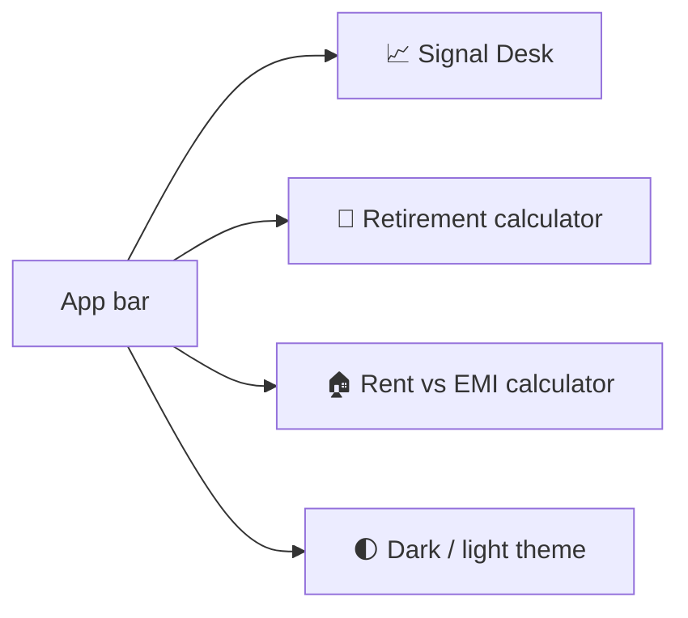
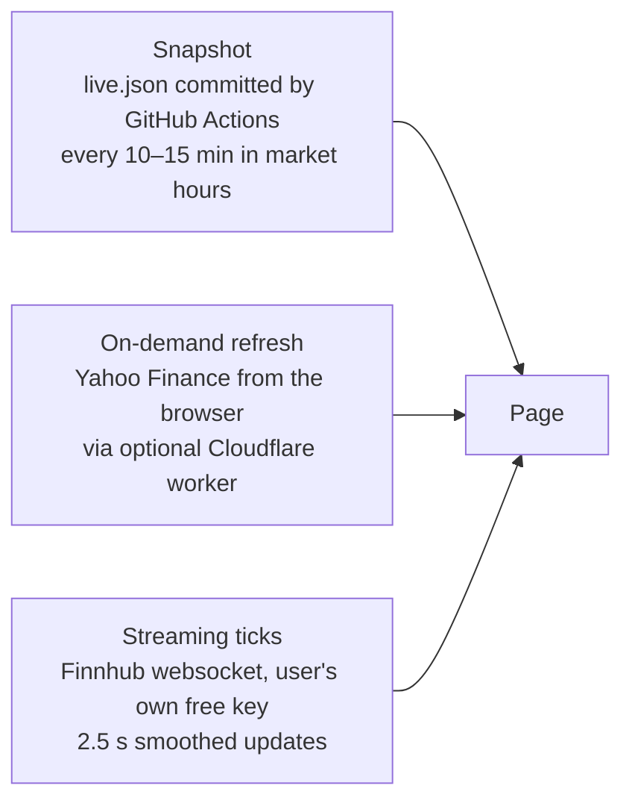
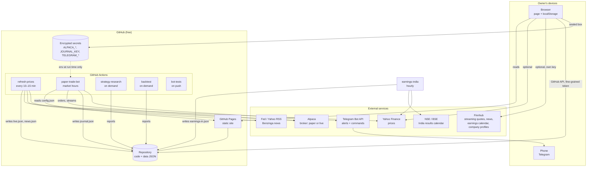
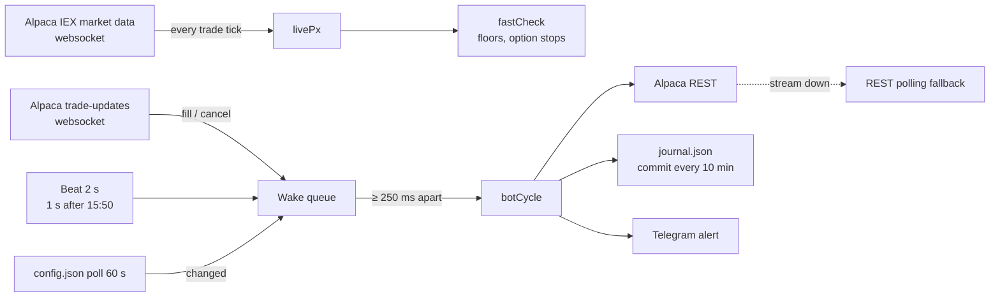
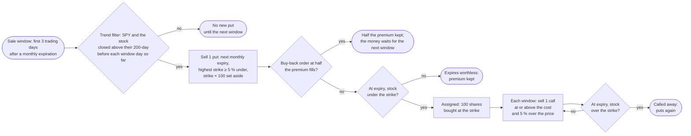
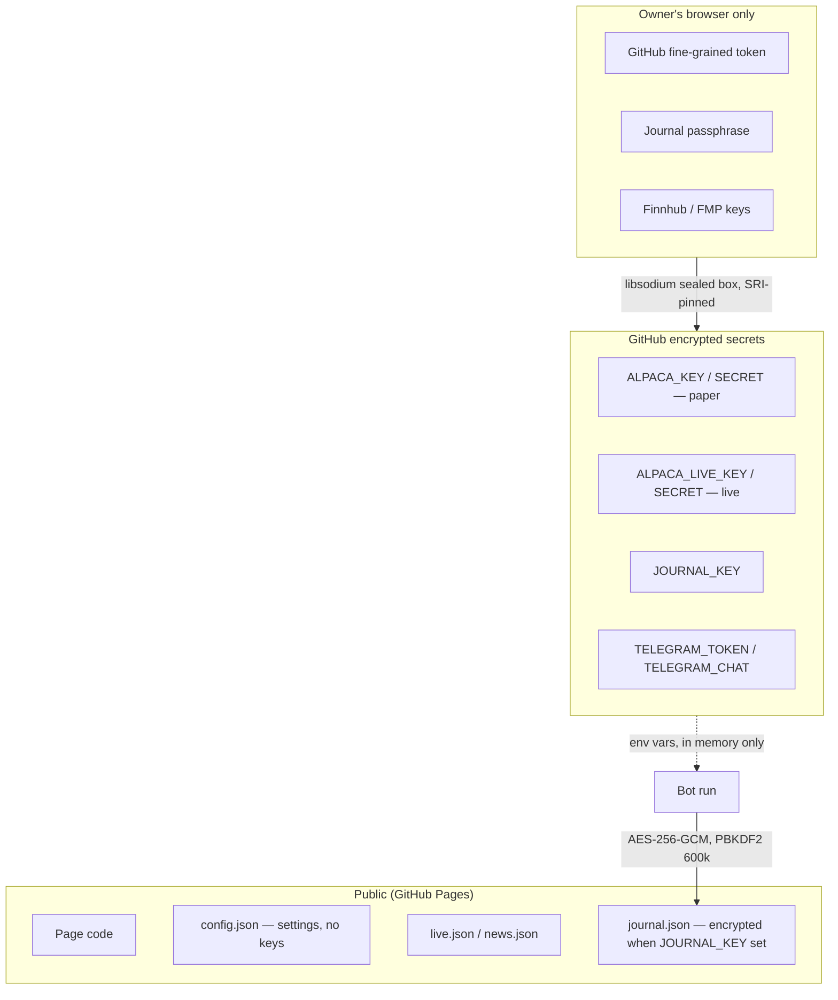

# Signal Desk — System Documentation

**Version:** 2.0 · **Last updated:** 2026-10-29 · **Status:** living document, updated with every change (see [§9](#9-change-log-and-maintenance))

Signal Desk is a personal stock-signal website with an attached rules-based trading bot.
This document is the single place that explains **what it does** (functional), **how it is
built** (architecture) and **how it works inside** (technical), so that anyone — the owner,
a family member, a developer or a future AI assistant — can understand and maintain it.

Everything in this document and in the system is **not financial advice**. The website places
no orders; the bot places orders only on a brokerage account whose keys its owner chose to give it.

---

## Table of contents
1. [What Signal Desk is](#1-what-signal-desk-is)
2. [Functional description](#2-functional-description)
3. [Architecture](#3-architecture)
4. [Technical reference](#4-technical-reference)
5. [The trading bot in depth](#5-the-trading-bot-in-depth)
6. [Security model](#6-security-model)
7. [Operations and runbook](#7-operations-and-runbook)
8. [Testing and quality](#8-testing-and-quality)
9. [Change log and maintenance](#9-change-log-and-maintenance)
10. [Glossary](#10-glossary)

---

## 1. What Signal Desk is

| Part | What it is | Where it runs | Cost |
|---|---|---|---|
| **Website** | One static HTML page with three apps: *Signal Desk* (stocks), *Retirement* calculator, *Rent vs EMI* calculator | GitHub Pages (`https://harimula.github.io/signal-desk/`) and a private copy on claude.ai | $0 |
| **Data refresh** | Fetches prices and news every 10–15 minutes during market hours, commits them to the repo | GitHub Actions | $0 |
| **Trading bot** | Event-driven rules engine trading an Alpaca account (paper by default) during US market hours | GitHub Actions | $0 |
| **Research** | 33-year backtest harness that chose the strategy, re-runnable on demand | GitHub Actions | $0 |

Design principles:
- **No servers to maintain.** Everything is static files plus scheduled GitHub Actions jobs.
- **No secrets anywhere public.** Broker keys live only in GitHub encrypted secrets; the page never sees them.
- **No vendor lock-in.** Plain Node.js (zero npm dependencies), plain HTML/JS, plain JSON data files. Nothing depends on Claude, Anthropic or any paid service.
- **Owner's data stays with the owner.** Watchlists, portfolios, keys for live quotes and calculator inputs are stored in the owner's own browser (`localStorage`); nothing is uploaded.

---

## 2. Functional description

### 2.1 The three apps



**Retirement** and **Rent vs EMI** are self-contained calculators (each an `iframe` with its own
HTML file). Inputs persist in the browser so refreshing the page never resets them. The Rent vs
EMI calculator includes a SIP (systematic investment) plan for the money left over after rent.

### 2.2 Signal Desk tabs

A **USA / India switch** (with flags) beside the Signal Desk name chooses the market (remembered per device). The tabs left of the divider — Stocks, Day trading, Option trading, Bot trades, Bot settings — show the chosen market; the tabs right of it are shared.

| Tab | Purpose | Key features |
|---|---|---|
| **Stocks** (USA) | Signal board for ~40 US large caps + user tickers | Overview (market cards, best setups), Screener (sortable table: rating, score, price, day %, moving-average distance, analyst targets), Heat map, drill-down dialog per stock with chart, levels and an order ticket |
| **Stocks** (India) | Same for NSE large caps | Same views, ₹ pricing, NSE hours |
| **Day trading** | Tight intraday plans | Per stock: Buy at / Sell at / Stop at, position size for a chosen amount, copy-ready order ticket, 45-day simulated record, **P/L drill-down per stock per day** |
| **Option trading** | CALL/PUT plans on the same setups | Strike/expiry suggestion, premium estimate, exit rules, daily and overall P/L like Day trading |
| **Bot trades** | Everything the chosen bot did (USA: live practice account; India: the simulation) | Every trade with entry/exit time and P/L, daily and overall P/L (the day card shows $ and %, profit or loss, and names the last trading day before the open), a strip of won trades / lost trades / overall so far ($ and % of the account before the bot's trades), risk dashboard (heat, breakers, regime), performance vs research scorecard, live/stream indicator |
| **Bot settings** | Control panel for the chosen bot and this device (USA: sections 1–8; India: Connection, Sync, India bot) | Device sync (settings follow you, see §2.4), risk profile (Conservative/Balanced/Aggressive/Custom), capital split stocks vs options, strategy parameters, stock universe, news/event guards, paper/live mode, pause/resume/run-now, broker keys (sealed into GitHub secrets), journal passphrase |
| **News** | What is moving markets | Market brief by category, upcoming Fed/CPI/jobs schedule, tagged headlines, **news for the stocks in your portfolios** |
| **Earnings** | Who reports when, and what they report | Finnhub earnings calendar (last week, this week, next week; read from the browser with the device's free Finnhub key, every 15 min while open): per company the date, the session (before the open / after the close / during the day / not announced), fiscal quarter, EPS and revenue estimates, actual figures and surprise %. **Coming up for your stocks** (portfolios, watchlist ★, My tickers, the bot's positions when its journal is open on the device, next 14 days). Two views: **Big companies** (the default) — a board of the week, one column per day (today outlined in gold), each split into before the open / during the day / after the close; big = sales of $5B+ a quarter (in dollars) or one of the 100 most-traded US stocks (`bot/scan.json`); the largest ($20B+ or the 25 most traded) and the owner's own get a full tile (gold = still to report, green = beat, red = missed, grey = in line — EPS against the estimate), the others a ticker chip; last / this / next week tabs — and **Full calendar**: day chips (today, next trading day, this / next / last week), company chips (yours & the bot's, big companies, all), a search box, big companies on a gold band with a “Big” label. Tiles, chips and rows of followed stocks open the stock's detail view. Without a key the tab explains how to add one **India** (the market switch on India): the same board and full calendar from `earnings-in.json` — no key needed; big = the Nifty 100 and the page's own India stocks, full tiles for the Nifty 50 and the owner's Indian stocks; dates are the board meetings that approve the results (the hour is not known in advance), quarters shown by their months (Jul–Sep 2026), EPS and revenue in rupees and crores. |
| **Portfolio (one tab per portfolio)** | Holdings with live P/L | Add/rename portfolios, holdings table, per-stock news |
| **My tickers** | User-added symbols | Fetched on demand, scored like the built-in universe |
| **Rules** | Every rule the page applies | Scoring table, rating bands, entry/stop/target construction |

### 2.3 Prices: three freshness levels



Price updates **morph the existing DOM** (no rebuild), so rows never jump, the scroll position
never moves, and a change shows as a brief green/red flash — like a broker app.

### 2.4 Settings follow you (device sync)

Everything the owner sets up — Finnhub/FMP keys, proxy URL, watchlist, portfolios, custom tickers, day-trade and option amounts, theme, auto-refresh choice, calculator inputs — is encrypted in the browser with the owner's passphrase (AES-256-GCM, PBKDF2-SHA256 × 200 000) and saved to the owner's own repo at `user/settings.enc.json` through the GitHub API. A new laptop or phone needs only the GitHub token and the passphrase (entered once in **Bot settings**); the rest arrives by itself. Pushes settle 8 s after a change and never happen more than once a minute, and are skipped entirely when the snapshot is unchanged; pulls happen on load and when the tab becomes visible again; last write wins by timestamp. Derived data rewritten on every render (`sd-dtlog`, `sd-oplog`, `sd-recs`) is excluded — syncing it produced a commit on every price tick. The token and passphrase never sync. Rent vs EMI and Retirement inputs are included.

### 2.5 Responsive behaviour

- Desktop: full tables, ‹ › arrows beside each panel to scroll wide tables.
- Phone/tablet (touch): full-width tables, company names hidden in favour of symbols, compact header, arrows hidden (swipe instead), calculators get one scroll surface.
- Dark/light theme toggle in the app bar reaches all three apps.
- The page checks for a newer build every few minutes and reloads to it without losing scroll position or inputs.

---

## 3. Architecture

### 3.1 System context



### 3.1.1 Portability — no repo name in the code

Nothing in the code names a particular account or repository. The page works out which repo it
belongs to from the GitHub Pages address it is served from (`<owner>.github.io/<repo>/`), and the
bot from `GITHUB_REPOSITORY`, which Actions sets for the repo it is running in. A copy served from
anywhere else (the claude.ai artifact) falls back to the `FALLBACK_REPO` constant near the top of
the page script — the one line to change when the project moves. Moving to another account or
repo name is therefore a copy plus re-enabling the services: see `MIGRATION.md`.

### 3.2 Repository layout

```
signal-desk/
├── index.html              the website (built; all three apps + app bar)
├── retire.html             Retirement calculator (iframe)
├── rentemi.html            Rent vs EMI calculator (iframe)
├── live.json               price snapshot written by refresh-prices
├── news.json               news feed written by refresh-prices
├── earnings-in.mjs         India earnings calendar: NSE results meetings (BSE fallback) + Yahoo EPS → earnings-in.json
├── earnings-in.json        written hourly by earnings-india; read by the Earnings tab when India is selected
├── events.json             FOMC / CPI / jobs / PPI / minutes calendar through 2027
├── symbols.json            built-in universe (US + India)
├── ver.txt                 build stamp; the page polls it to self-update
├── docs/daytrading-rules.html  the day-trading rulebook (stocks, CALLs, PUTs) with how the bot applies each rule
├── docs/settings.html      owner-facing guide: what every Bot settings control does, defaults, when to change (linked from the tab)
├── tips.js               hover help for every page: label → explanation dictionary + one tooltip engine
├── vendor/qrcode.js       QR code generator (MIT), still used by the old #setup= link receiver only
├── tools/stamp.mjs         bumps the build stamp and rewrites the CSP script hashes (run after every index.html edit)
├── tools/research-data.mjs  downloads price history for the win-rate study to the branch research-data (workflow research-data.yml)
├── tools/winrate-study.mjs  win-rate study of the stock rule (entries, exits, hold, stop, market filter; CALLs with model prices)
├── tools/spy-study.mjs     SPY quick-options replay on minute prices since 2023 (model option prices, checked against real ones)
├── tools/spy-why.mjs       read-only check of recent days: why the SPY quick trades did or didn't trade (workflow spy-why.yml)
├── tools/wheel-study.mjs   cash-secured puts and covered calls replayed on real option prices since Feb 2024 (workflow wheel-study.yml)
├── tools/covered-call-study.mjs   the dip-buy rule with and without a covered call on the same 100 shares, trade by trade on real option prices (workflow covered-call-study.yml)
├── tools/option-check.mjs  CALL / PUT exit rules replayed on real option prices for a sample of the bot's signals (workflow option-check.yml)
├── package.json  .nvmrc  eslint.config.js   npm scripts (test / lint / check / verify), Node 22 (needed for WebSocket), lint rules — no dependencies
├── favicon.ico  manifest.webmanifest   browser-tab icon; installable-app manifest
├── icons/                  logo.svg / logo.png, icon.svg, favicon, apple-touch, 192/512 and maskable PNGs
├── fetch.mjs               price fetcher (Yahoo) used by refresh-prices
├── news.mjs                news fetcher (RSS + Benzinga) used by refresh-prices
├── worker.js               optional Cloudflare worker: CORS proxy for Yahoo
├── bot/
│   ├── watchdog.mjs        dead-man's switch: alerts when the bot has not checked in during market hours (watchdog.yml)
│   ├── live.mjs            session runner: websockets, event loop, config hot-reload
│   ├── bot.mjs             decision cycle: entries, exits, floors, breakers, journal
│   ├── strategy.mjs        indicators and signals (SMA, RSI-2, exits)
│   ├── risk.mjs            sizing, heat, sector caps, regime, loss streak
│   ├── news.mjs            headline classifier, event guard, per-symbol risk
│   ├── config.mjs          presets, defaults, ranges, normalisation
│   ├── config.json         the control-panel settings (written by the page)
│   ├── journal.mjs         FIFO trade pairing from broker fills
│   ├── journal.json        trade journal (encrypted when JOURNAL_KEY is set)
│   ├── jcrypt.mjs          journal encryption shared by both bots (AES-256-GCM, PBKDF2 600k)
│   ├── india.mjs           India bot — simulation of the NSE research, two sleeves (trend breakout, RSI-2)
│   ├── india-journal.json  India simulation state and record (encrypted)
│   ├── config-in.json      India bot settings (stake, strategies, split, sizes)
│   ├── scan.json           last good market scan (tickers only), fallback while today's scan runs
│   ├── backtest.mjs        single-strategy backtest with costs and metrics
│   ├── research.mjs        4-strategy portfolio simulator, out-of-sample split
│   ├── research.json / research_report.md   research results (shown on Bot tab)
│   ├── backtest.json / backtest_report.md   backtest results
│   ├── spyopt.mjs          SPY quick options: signal, exits, order ids
│   ├── wheel.mjs           the wheel: cash-secured puts and covered calls — monthly cycle, strikes, trend filter, order ids, bookkeeping
│   ├── daytrade.mjs        day-trading signals (opening range, VWAP)
│   ├── scan.mjs            market scan: the most-traded stocks on NYSE/Nasdaq (ETFs and funds left out)
│   ├── msgpack.mjs         MessagePack codec for Alpaca's options stream (in-house, no dependency)
│   ├── telegram.mjs        Telegram alerts and read-only commands
│   ├── research-in-ideas.mjs  India 5-year research with tax (breakout, momentum, momentum + safety switch)
│   ├── research-day.mjs    day-trading research on 5-minute bars
│   ├── winrate_report.md   the win-rate study's results (2026-10-27)
│   ├── wheel_report.md     the wheel study's results (2026-10-29)
│   ├── covered_call_report.md   covered calls on the dip buys — study results (2026-10-30; not built into the bot)
│   ├── test.mjs            117 unit tests (run in CI)
│   ├── test-orders.mjs     219 end-to-end checks against a fake broker: which orders the bot places (CI)
│   └── test-india.mjs      15 India simulation checks (CI)
├── .github/workflows/
│   ├── refresh.yml         refresh-prices
│   ├── earnings-in.yml     earnings-india (hourly: India earnings calendar → earnings-in.json)
│   ├── trade.yml           paper-trade-bot
│   ├── research.yml        strategy-research
│   ├── backtest.yml        backtest
│   ├── research-day.yml    day-trading-research
│   ├── research-data.yml   research-data (price history for the win-rate study → branch research-data)
│   ├── option-check.yml    option-check (CALL / PUT exits on real option prices → branch research-data)
│   ├── spy-why.yml         spy-why (manual: the SPY quick-trade rules replayed on the last four trading days → branch research-data)
│   ├── wheel-study.yml     wheel-study (manual: cash-secured puts and covered calls on real option prices → branch research-data)
│   ├── covered-call-study.yml   covered-call-study (manual: the dip-buy rule with and without a covered call → branch research-data)
│   ├── watchdog.yml        watchdog (dead-man's switch)
│   ├── research-in.yml     india-research
│   ├── india-sim.yml       india-bot (simulation, after the NSE close)
│   └── test.yml            bot-tests
├── MIGRATION.md            moving to another account or repo name
├── docs/
│   ├── ARCHITECTURE.md     this document
│   ├── index.html          the same documentation as a web page (/docs/)
│   └── architecture.pptx   architecture slides
├── BOT.md  SECURITY.md  ACCOUNTS.md  FAMILY.md  MIGRATION.md  README.md
```

### 3.3 Data flow

```mermaid
sequenceDiagram
  autonumber
  participant Y as Yahoo / RSS / Benzinga
  participant RF as refresh-prices (Actions)
  participant R as Repo / Pages
  participant P as Page (browser)
  participant B as Bot (Actions)
  participant A as Alpaca

  loop every 10–15 min, market hours
    RF->>Y: fetch daily bars, quotes, headlines
    RF->>R: commit live.json, news.json, ver.txt
  end
  P->>R: load page, live.json, news.json, bot/journal.json
  P->>P: score, rate, render; localStorage for user data
  P-->>R: (Bot settings) write bot/config.json via GitHub API
  loop every 5 min cron, one session per day
    B->>R: read bot/config.json (hot-reload every 60 s)
    B->>A: account, positions, orders, bars
    A-->>B: trade-updates + market-data websockets
    B->>A: limit orders (entries, take-profits), market exits
    B->>R: commit bot/journal.json every 10 min and at close
  end
```

### 3.4 Deployment and scheduling

| Workflow | Trigger | What it does | Limits |
|---|---|---|---|
| `refresh-prices` | cron `*/10 13-21 * * 1-5` (US) and `*/15 3-10 * * 1-5` (India), manual | `node fetch.mjs` → `live.json`; `node news.mjs` → `news.json`; commits | ~1 min |
| `paper-trade-bot` | cron `45,50,55 12 * * 1-5` (early start, waits until 9:20 ET) + `*/5 13-21 * * 1-5`, manual; `concurrency` so only one session runs | `node bot/live.mjs` for up to 345 min; at every check `bot/STOP` (or the running session's git-ignored mirror `bot/STOP.local`) cancels everything and sells; a session started before 9:25 ET hands over at 9:25 (the next one's 345 min then end after the SPY window, about 3:10 PM, not at noon); a session that reaches its end before the close dispatches its successor first, opens nothing new in its last 10 min and ends with a manage-only check | 358 min timeout |
| `earnings-india` | cron `17 3-18 * * *` (hourly, 8:47 AM–11:47 PM India time, every day — Indian companies also report on Saturdays), on pushes that change `earnings-in.mjs` or the workflow, manual | `node earnings-in.mjs` → `earnings-in.json`; commits only when the rows changed or the file is 6 hours old | ~30 s |
| `journal-refresh` | manual; shares the trading queue | pulls, then `node bot/bot.mjs` with `BOT_READONLY=1`: reads the account and rewrites the journal; places, changes and cancels nothing, even with the market open or the Pause set | 10 min |
| `strategy-research` | manual | `node bot/research.mjs` → `research.json`, `research_report.md` | 40 min |
| `strategy-research-india` | manual | `BT_MARKET=IN node bot/research.mjs` → `research-in.json`, `research_in_report.md`: the same strategies on the Nifty 100 (Yahoo `.NS` history), Nifty 50 benchmark/regime, 0.15 %/side costs | 40 min |
| `india-bot-simulation` | cron `40 10 * * 1-5` + backup `10 12 * * 1-5` (after the NSE close), manual | `node bot/india.mjs`: the India bot in **simulation** — processes each completed NSE day once (fills yesterday's plans at today's open, exits at today's close, plans tomorrow), writes the encrypted `bot/india-journal.json`, one Telegram summary per day | 15 min |
| `backtest` | manual | `node bot/backtest.mjs` → `backtest.json`, `backtest_report.md` | 30 min |
| `day-trading-research` | manual, monthly (1st, 06:17 UTC) | `node bot/research-day.mjs` (Alpaca keys) → `research-day.json`, `research_day_report.md` | 120 min |
| `watchdog` | cron `*/15 13-20 * * 1-5`, manual | `node bot/watchdog.mjs`: journal older than 25 min in market hours → phone alert (hourly while down; skips holidays via the broker clock) | 3 min |
| `bot-tests` | push / PR | stamp check, ESLint, `node bot/test.mjs`, `node bot/test-orders.mjs`; `page` job: headless Chromium page tests | 10 / 12 min |

All actions are pinned to exact commit SHAs (`actions/checkout@11bd719… # v4.2.2`,
`actions/setup-node@49933ea… # v4.4.0`).

---

## 4. Technical reference

### 4.1 Website

- **Stack:** one HTML file, vanilla JavaScript, no framework, no build tooling in the repo (the owner's build script fills the price snapshot into the page template). External scripts: only libsodium (for sealing secrets), loaded from jsDelivr with Subresource Integrity hashes.
- **State:** `localStorage` keys prefixed `sd-` (watchlist, portfolios, custom tickers, theme, auto-refresh choice, Finnhub/FMP keys, GitHub token, journal passphrase) plus the calculators' own keys. All of it except the token and passphrase roams between devices through `user/settings.enc.json` in the repo (§2.4); a **setup link** can still carry quote keys to a device without the token.
- **Rendering:** `renderAll(bg)`. The foreground path rebuilds a tab; the background path (price ticks) morphs the existing DOM in place (`morphEl`/`morphKids`/`morphSet`, keyed by `data-s`), preserving `<details>` open state, row order and scroll offsets. Browser scroll anchoring is disabled; an interaction guard delays updates while the user is scrolling or typing.
- **Scoring:** each stock gets a score from trend (50/200-day averages), momentum, RSI, volume, distance to the chosen moving average, analyst targets and recent signals; the score maps to Top Buy / Buy / Hold / Sell / Top Sell bands. The Rules tab documents every weight.
- **Self-update:** the page polls `ver.txt`; when a newer build appears it reloads once, keeping tab and scroll.
- **Earnings tab (`earningsView`, `ernLoad`):** `GET https://finnhub.io/api/v1/calendar/earnings?from=…&to=…` three times (last, this and next week, Monday–Sunday in New York time) with the device's Finnhub key (`sd-fh`); rows merged by symbol + date (`sym, date, hour bmo/amc/dmh, quarter, year, epsEstimate/epsActual, revenueEstimate/revenueActual`). Re-read every 15 min while the tab is open (actuals arrive during the day); a failed read is retried after a minute. Chips and the “show all” button are delegated listeners; the search box redraws only `#ernList`, so it keeps its focus. Remembered per device: `sd-ernr` (days), `sd-ernf` (companies). Lists over 300 rows show a “Show all” button. **Big companies board** (`ernBoardRows`, `ernBoardHTML`, `ernTile`, `ernChip`): big = `ernIsBig` (dollar sales ≥ $5B, else rank ≤ 100 in `bot/scan.json` — the bot's most-traded list, read at most hourly by `ernScanLoad`); full tile = `ernIsTop` ($20B+ or rank ≤ 25) or one of the owner's stocks; two share classes with the same day, session and estimates show once (the more traded). Result colour from `ernState` (EPS actual vs estimate to the cent, else sales). **Company profiles** (`ernCoWant` / `ernCoStep`): `GET /api/v1/stock/profile2?symbol=…` for the big companies on screen, one every 2.5 s (`ERN_CO_MS`) and only while the tab is open, at most 150 a visit; a 429 waits a minute, 403/404 are not asked again; kept 120 days in `localStorage['ern-co-v1']` (no `sd-` prefix: never synced) as `[name, estimateCurrency, time]`. Names fill in when the page does not know the company; figures in another currency show its code (CNY 20B) and do not count toward size; a sales figure over $300B a quarter is treated as not dollars (`ernCur` = '?'). The view (`sd-ernv`) and board week (`sd-ernbw`) are remembered per device; the Earnings view keys `sd-ernr`, `sd-ernf`, `sd-ernv`, `sd-ernbw` are in `SYNC_LOCAL` (view state, not synced). **India** (`ernIN()` = the market switch on India): `ernLoadIN` reads `earnings-in.json?t=<10-min bucket>` (same origin) every 15 min while the tab is open; rows carry `cur: 'INR'`, `rk` (size rank) and `nm` (company); `ernData()` picks the market's rows, `ernToday()` the day in New York or India, `ernAttr` opens `SYM.NS` in the India detail view. Big = `rk > 0`, full tile = `rk ≤ 50` or the owner's; one group a day on the board (no session); a past meeting without numbers is “Reported”; tags from Indian holdings, `.NS` watchlist stars and Indian My tickers. A file older than 26 hours shows a warning. Server side: `earnings-in.mjs` (NSE `event-calendar?index=equities&from_date&to_date` after NSE's home page sets cookies; BSE `Corpforthresults` when NSE fails; Yahoo `quoteSummary` `calendarEvents,earningsHistory` with a crumb; unit tests in `bot/test.mjs`).

### 4.2 Data files

| File | Written by | Shape |
|---|---|---|
| `live.json` | `fetch.mjs` | `{ at, rows: { SYM: [px, prevClose, …] }, bars: { SYM: [...] }, stamp }` — daily bars and latest quotes for the universe |
| `news.json` | `news.mjs` | `{ at, items: [{t, h, u, sum, s}], bySym: { SYM: [...] } }` — tagged headlines, per-ticker filtered |
| `earnings-in.json` | `earnings-in.mjs` | `{ at, src: 'NSE'\|'BSE', from, to, rows: [{s, n, d, p, k, eE?, eA?, rE?}], y: { SYM: {at, d, eE, rE, h: [[quarter end, actual, estimate]]} } }` — results meetings from two weeks back to three ahead: symbol, company, meeting day, quarter end, size rank (1–100 Nifty 100 in index order, 101+ the page's own India stocks, 0 = not big), EPS estimate / actual and revenue estimate (INR) for the big ones; `y` keeps Yahoo's answers so each company is asked at most every 6 hours (hourly around its report day) |
| `events.json` | hand-maintained | `[{ date, time, type, title }]` — FOMC, CPI, JOBS, PPI, MINUTES |
| `bot/config.json` | Bot settings tab | see §5.4 |
| `bot/journal.json` | bot | plaintext `{ at, equity, day, trades, acts, … }` or encrypted `{ enc:1, kdf, iter, salt, iv, ct, at, sig, paper, stream, engine }` |
| `bot/research.json` | research workflow | per-strategy metrics (CAGR, Sharpe, max DD, OOS split) |
| `user/settings.enc.json` | the page (device sync) | `{ enc:1, kdf, iter, salt, iv, ct }` wrapping `{ v, at, dev, data: { key: value } }` |

### 4.3 Bot modules

| Module | Responsibility | Key exports |
|---|---|---|
| `live.mjs` | Process lifecycle for one market session; websocket subscriptions (trade updates + IEX market data); wake queue; 2 s beat (1 s after 15:50); polling fallback; config hot-reload; journal commit; stream reconnect on paper↔live switch | — |
| `bot.mjs` | One decision cycle: load bars, compute signals, apply guards, size, place/cancel orders, floors, take-profits, breakers, journal | `botCycle`, `fastCheck`, `applyConfig`, `pushPrice`, `endpoints`, `redact` |
| `strategy.mjs` | Indicators and signals | `sma`, `rsi2`, `rsi2Signal`, `rsi2Exit`, `replay` |
| `risk.mjs` | Money management | `stockQty`, `optionQty`, `regimeOf`, `lossStreak`, `openRisk`, `sideDayPl`, `SECTOR` |
| `news.mjs` | Event and headline guards | `classify`, `loadEvents`, `guard`, `symbolRisk` |
| `config.mjs` | Settings schema | `PRESETS`, `DEFAULTS`, `RANGES`, `normalize`, `summary` |
| `telegram.mjs` | Alerts to the owner's Telegram chat; polls `getUpdates` every 3 s (off the decision path) and answers `/status /money /positions /watch /pause /resume /help` from `TELEGRAM_CHAT` only; never trades on a command | `tgOn`, `tgSend`, `tgPoll`, `parseCommand` |
| `journal.mjs` | Pair fills into round trips (FIFO): bought lots, and sold ("short") option lots of the wheel, closed by the buy-back or by an option event (expiry, assignment, exercise) at 0 | `parseSym`, `buildJournal`, `optionEvents` |
| `wheel.mjs` | The wheel's pure rules (§5.5): monthly expirations and the sale window, strikes, take-profit price, the trend filter as tested, one sale per stock per cycle, order ids, and the bookkeeping that rebuilds what the wheel holds from the broker's picture | `wheelCycle`, `putStrike`, `callStrike`, `wheelTpPrice`, `trendThrough`, `soldFor`, `wheelReconcile`, `WHEEL_DEFAULTS` |

Zero npm dependencies; Node 22+ (uses built-in `fetch`, `WebSocket` with headers, `crypto.webcrypto`; Node 20 has no WebSocket).

---

## 5. The trading bot in depth

### 5.1 Why RSI-2

`bot/research.mjs` simulated four strategies on 39 large US stocks, 1993 → 2026, with 0.05 %
costs per side, 10 % of equity per position, at most 6 positions, judged on the **last 30 % of
years (2016–2026), which were never used to choose anything**.

| Strategy | OOS CAGR | OOS Sharpe | OOS max drawdown |
|---|---|---|---|
| **RSI-2 mean reversion (chosen)** | **+16.4 %** | **1.45** | **−11.9 %** |
| Trend breakout | +7.2 % | 0.70 | −13.6 % |
| SPY buy & hold | +13.3 % | 0.79 | −34.1 % |
| Original intraday pullback rules (retired) | −4.1 % | −0.86 | −35.0 % |

Survivorship bias flatters all rows; treat them as an upper bound.

### 5.2 Rules

```mermaid
flowchart TD
  S([Session start 9:30 ET]) --> G{Guards}
  G -->|news crisis / FOMC window / breakers tripped| W[No new trades]
  G -->|clear| E[Entry window 9:45 → 11:00]
  E --> C{close > 200-day SMA<br/>and RSI-2 < 10<br/>and not bounced 1 %+}
  C -->|yes, and market filter passes:<br/>SPY above its 200-day (if on);<br/>market leaders first (or deepest dips)| SZ[Size: risk % of equity<br/>≤ stock % per position<br/>heat cap, ≤ 2 per sector]
  SZ --> O[Resting limit BUY<br/>+ optional CALL 14–35 DTE]
  C -->|no| H[Hold / wait]
  O --> M[Monitor every tick]
  M --> F{price ≤ −25 % floor?}
  F -->|yes| X1[Emergency market SELL]
  M --> TP{option at its<br/>take-profit?}
  TP -->|yes| X2[Resting limit order fills<br/>never a market sale]
  M --> L{last 10 min and<br/>exitRule bounce: close > 5-day SMA<br/>exitRule profit: close ≥ buy + 0.5 %<br/>or held maxHold sessions}
  L -->|yes| X3[SELL at live price]
  L -->|no| N([Carry overnight])
```

- **Entries:** 9:45–11:00 ET (after 10:15 on CPI/jobs days); limit orders at the broker.
- **Exits:** in the last 10 minutes by the setting `exitRule`: `bounce` (default, the 33-year research rule) sells once the close is above the 5-day average; `profit` sells once the close is at least `exitProfitPct` % (default 0.5) above the position's average buy price (`profitExit()` in strategy.mjs). Either way a position is sold after `maxHold` sessions whatever the price, the `stockTp` take-profit works at any time, and the 25 % hard floor is a disaster brake held at the broker. Win-rate study 2026-10-27 (`tools/winrate-study.mjs`): `profit` + 15-session hold + market filter won ~82 % of trades over 33 years vs ~65 % for `bounce`, at a similar CAGR (+10.3 % vs +10.6 %; 2016–26 +6.4 % vs +4.3 %), worst fall −18 % vs −25 %, with larger average losses (−5.9 % vs −2.7 %). Report: `bot/winrate_report.md`.
- **Market filter (setting `marketFilter`, default off):** no new dip buys — stocks or CALLs — while SPY's last completed close (IEX daily bars, `spyPrev`) is below its 200-day SMA (`marketAbove200()`); unknown history counts as below. PUTs, the SPY sleeve and day trading are not affected; open positions are managed as usual. The reason goes to `G.reasons` ("Market filter: …") and `watch.idle`.
- **Options:** CALL nearest strike, nearest expiry from `optDays` (14) to `optDays` + 21 days out, same dips (blocked by the market filter like stock buys); take-profit `optTakeProfit` % as a resting limit order priced with `tickUp()` (rounded **up** to the option's price step, so it never sells under the target; the real-price study likewise needed a trade at or above it), stop `optStop` %, closed 3 days before expiry. `optTakeProfit()` in bot.mjs never cancels that order to sell at market (a market sale goes at the bid, under a +5 % target or even at a loss): with no order resting it places one — marketable when the price is already past the target — and an `sd-x-` order left at an older setting is cancelled and replaced at the next check; a sell the owner placed by hand is left alone; nothing is placed or moved on the buy day under the pattern-day-trader guard. Under `optExit` = `target` a CALL/PUT daily loss limit only stops new options; under `bounce` it also closes the open ones. `maxOptions` counts swing CALLs and PUTs (`sd-q-`/`sd-p-`, held or being bought) only — not SPY quick trades, day trades or options bought by hand. Entry API load: no contract or quote lookup once the slots, the money (`slBudget` < $1) or the heat cap are used up; a candidate turned down after a lookup (no contract, no quote, spread, budget, heat) is skipped for 10 minutes (`optSkip`). `optExit` = `bounce` (default) also sells at the close when the stock closes above its 5-day average (PUT: below) or after `maxHold` sessions; `target` sells only at the take-profit, the stop, `maxHold` or expiry. A new option needs a bid/ask spread under min(20 %, stop / 2, take-profit). Size and heat use the stop in force (`optionQty(stopPct)`, `openRisk(optStopFor)`; SPY options at `spyStop`), no longer a fixed −50 %. Real-price check 2026-10-27 (`tools/option-check.mjs`, 278 CALL signals since March 2024): `target` +5 % / −90 % won 83.5 % (+0.9 %/trade), the original +50 % / −50 % bounce 54 %; PUTs 66 % at best, −8 %/trade. Skipped under the pattern-day-trader guard when equity < $25 000.
- **Puts (experimental, OFF by default; the owner's are off with a 0 % share since 2026-10-27):** with **Trade PUT options** ticked, the mirror rule buys a PUT on a stock *below* its 200-day average whose RSI-2 is above 100 − `rsiThreshold` (a sharp pop in a downtrend), skipped once the pop has already fallen 1 %+ today. Same option rules as the CALLs: `optDays` to `optDays` + 21 days out, nearest strike, the same spread rule, `maxOptions` shared with the CALLs, their own money share (`putSharePct`) and loss limit; exits by the same `optExit` rule (under `bounce` also when the stock closes below its 5-day average), after `maxHold` sessions, or on the option take-profit / stop / expiry rules. Not affected by the market filter. On real option prices (2026-10-27, `tools/option-check.mjs`) no setting won more than 66 %, and every one lost money on average.
- **Day trading (experimental, OFF by default; `docs/daytrading-rules.html`):** 5-minute IEX bars for the universe + SPY, refreshed every 55 s. Market filter: SPY vs its session VWAP. Setups: 15-minute opening-range breakout (fresh 5-min close through the range, on the VWAP side, relative volume ≥ 1.2×) and VWAP pullback-and-reclaim on a trend day (≥ 70 % of closes on one side of the running VWAP). Stop under the range (0.1 ATR) or 1.5 ATR, whichever is closer; VWAP setup 0.25 ATR beyond the pullback; target 2R; breakeven at +1R; time stop 60 min at < 0.3R; flat 15:50 (options 15:45); entries 09:45–15:30; max 3/day, 1 per stock, 2-loss streak stop, daily cap, news guard and PDT guard. Longs = shares (or CALL), shorts = PUT only (nearest expiry 1–7 days, ATM strike, spread ≤ 10 %, +50 % / −40 % option exits). Order ids `sd-d-`/`sd-dc-`/`sd-dp-` carry entry, stop, target, date and entry minute so management survives a restart; `dayState` holds the trailed stop in memory. Runs every beat before the swing entries, independent of the RSI-2 entry window.
- **Guards:** FOMC/CPI/jobs calendar windows, live headline scan (war, White House, Fed, crisis keywords — matched on whole words, so "Stewart" and "Software" are not war headlines, and the defense department's name since 2025 ("Department of War", in every defense-contract story) is not war news, and since 2026-10-30 "escalat*" and "attack on" count as war only next to a conflict word ("Boeing strike escalates" and a short seller's "attack on" a company are business news); a single company halting is tagged `single` and skips only that ticker), SPY tone; daily (−3 %) and weekly (−6 %) loss caps; 3-loss streak pause — a trade counts on the day it is sold, swing trades included: today's fills get an opening buy from the order history for every sale whose buy was on an earlier day (`withOpenings()`; also used by the day summary); stale entry orders (stock, CALL and PUT, `sd-[sorqp]-`) cancelled after `staleMin` (45 min); no entry order rests while the market is closed (any `sd-` buy is cancelled — from 9:20 before the open, every 5 min while closed — since a dip-buy is good-till-cancelled for its broker stop).
- **Whose position it is:** a position is managed only through the bot's own latest buy of that symbol (`latestBuy()`), and only for the quantity that buy still accounts for (`ownQty()`: its filled quantity less every sale of the symbol filled after it, capped at what is held; a short is never managed). A position bought by hand after the bot sold its own is left alone (logged once a day); if the owner adds shares to a bot position, exits sell the bot's part only. Applies to swing stocks and options, the SPY sleeve, day trades and the legacy loops.
- **Never overnight:** a day trade (`sd-d*`) or a SPY quick trade still open from an earlier day — its session died before the 3:45/3:50 flat — is sold at the next open, also with day trading or SPY switched off.

### 5.3 Real-time engine



Measured in tests against a mock broker: fill → take-profit order 40 ms; crash tick → floor exit 110 ms.

**SPY tick entries** (`spyWatch()` → `onTick` → `spyEnter()`): the stream only listens while the last full check found the break *armed* — the last completed 5-minute bar closed in the market's direction on at least average volume (`spySignal().armed`) — and `spyEnter()` re-runs `spySignal()` on the tick price, only once the cached 5-minute bars hold the bar that completed at the last 5-minute mark (`spyBarsNow()` / `spyLatestIn()`; the bars endpoint publishes a bar 2–3 s after it ends, so `load5m` re-reads every 3 s until it is in, then keeps them 55 s; the full check also enters nothing until then — "waiting for the 5-minute bar that just closed"), so an entry is exactly the signal the study tested. Before 2026-10-27 the tick path skipped the bar test; on 60 days of real option prices those extra trades won 78.6 % (−1.75 % a trade) against 82.3 % (+0.16 %) for the studied rule. The take-profit order of each SPY trade is remembered by its buy's order id (`spyState`), so a later trade in the same contract gets its own, and one that disappears is placed again after 2 minutes; a bot take-profit that covers only part of the trade (placed while the buy was still filling) is cancelled and replaced for the whole quantity — the same for swing CALLs/PUTs in `optTakeProfit()`. A SIGTERM (`onSignal`) ends new entries at once (`setSessionEnd(Date.now())`). **Entry price** (`spyLim`): the ask at most (mid + 2 %, capped at the ask) — the bot never pays over the asked price by default. With **`spyFastFill`** ("Pay up to get in quickly", the owner's setting since 2026-10-30): two price steps *over* the ask, so a tick of movement while the order is in flight cannot make it miss, and an entry still unfilled after 45 s is re-offered **once** (`spyReprice`) at the then-asked price plus the same cushion — never more than 4 % over the first offer, never after the 3:20 same-day cutoff, one re-offer per contract per day, and only after the cancel of the first order is confirmed (a buy that filled in the same instant is never bought twice; a partly filled one is re-offered for the unfilled part only). A price sprinting past the 4 % cap is let go on purpose — the 3-minute rule then bins the order.

**Polling beside the loop.** `pollConfig()` and `pollStop()` run beside the main loop with a 5-second deadline each (`AbortSignal.timeout`), so a slow GitHub can never hold up exits; fetched settings are applied between two checks, never in the middle of one. The page's Pause is mirrored to the git-ignored `bot/STOP.local` (bot.mjs checks it next to `bot/STOP`); the journal publish no longer deletes an untracked `bot/STOP` to pull, which could drop the Pause for up to 15 s when a pull failed.

**Session hand-off.** `setSessionEnd(sessionEndFor(born, LIFE))`: a session born between 6:00 and 9:25 ET (the early start that waits for the open, or the 9:20 schedule) ends at **9:25** and hands over to a fresh session, whose 345 minutes then last to about 3:10 PM — so the day's one mid-session hand-off falls after the SPY window (until 3:00 PM) instead of around noon (on 2026-10-29 the noon hand-off, 11:56–12:06, took the day's only clean SPY setup). Every other session runs its whole life. The morning alert comes from the session that sees the open (a journal written only before 9:30 does not count as today's first). In its last 10 minutes a session opens nothing new (stocks, CALLs, PUTs, SPY, day trades, tick entries; `noNew` shows on Bot trades). A session that reaches its time limit before the close dispatches its successor (two tries) *before* its final check, and that final check is manage-only (`botCycle({ manageOnly: true })`): exits and take-profit orders, no entries — nothing new is left unwatched while the next session starts.

**Alerts.** A buy or sell alert (green / red dot) is held back only when the identical text went out in the last minute; other alerts are held back for 20 minutes when only their numbers changed (two SPY trades differ only in numbers, so the old number-masking rule dropped the second). With **`alertOnFill`** (the owner's setting since 2026-10-30) the placement lines wait instead (`fillWhy`, by client order id) and the phone hears ✅ when the broker reports the order **filled** — from the trade stream (`noteFill` in live.mjs's handler) or, as a fallback, from the order history (only fills after this session started, so a restart never repeats the previous session's messages; `fillSeen` keeps each announced once). An order that dies after a partial fill is announced with ⚠️ and the quantities; one that dies unfilled stays quiet — the page's log keeps every attempt.

**Journal continuity across runs.** Every run is a fresh process, and the panels the bot computes only while the market is open (watch list, market check, risk, day-trading block) plus the action log live in memory. At its first write the bot therefore reads the previous `bot/journal.json` back — decrypting it with `JOURNAL_KEY` when it is encrypted — and carries those panels forward until it has computed fresh ones; the action log is appended to (never re-appended) and capped at 80 entries. A run that starts at or after 16:00 ET exits at once if today's journal was already written at 15:55 or later (the day's session reached the close); otherwise it runs one closing cycle, writes the journal and sends the day summary. A previous journal written under a different passphrase is skipped with a log line, not a crash.

### 5.4 Settings (`bot/config.json`)

| Key | Meaning | Default |
|---|---|---|
| `mode` | `paper` or `live` (live also needs live keys and a typed confirmation) | paper |
| `preset` | conservative / balanced / aggressive / custom | balanced |
| `riskPct`, `optRiskPct` | % of equity lost if a stock / option trade hits its stop | 0.5 / 0.5 |
| `maxHeat` | % of equity at risk across everything open | 3 |
| `perSector`, `maxPositions`, `maxOptions` | caps (`maxOptions`: swing CALLs + PUTs only) | 2 / 6 / 4 |
| `dayCap`, `weekCap`, `streak` | circuit breakers (% loss, % loss, losses in a row) | 3 / 6 / 3 |
| `split`, `callSharePct`, `putSharePct`, `optDayCap` | money split: stocks (100 − CALLs − PUTs), CALLs and PUTs each own a share of the stake, their own daily loss limit (stocks `dayCap` on the stock money; CALLs and PUTs `optDayCap` on their own money) and losing streak | on / 30 / 10 / 10 |
| `spyOn`, `spySharePct`, `spyTradePct`, `spyTp`, `spyStop`, `spyHoldMin`, `spyMaxTrades`, `spyMaxOpen`, `spyStreak`, `spyDayCap`, `spyDte`, `spyFastFill`, `spyStart`, `spyEnd` | SPY quick-options sleeve (bot/spyopt.mjs): on, share of the stake, % of it per trade, exits, brakes, trades open at once (each from its own fresh break), expiry (0 = the same day, allowed since 2026-10-30: in and out by 3:20 PM, since the broker takes no orders on a same-day SPY contract after 3:30 PM; searched to `spyDte` + 1 trading days, earliest taken: a holiday never leaves it empty), pay up to get in quickly (two price steps over the ask + one 45-s re-offer capped at 4 % over the first), window | on / 5 / 100 / 15 / 15 / 10 / 6 / 3 / 2 / 25 / 1 / **off** / 09:50 / 15:30 |
| `wheelOn`, `wheelSharePct`, `wheelOtmPct`, `wheelTp`, `wheelStop`, `wheelTrend`, `wheelMinPrice`, `wheelMaxPrice`, `wheelMaxPositions`, `wheelAnytime` | the wheel (§5.5): on, its share of the stake (taken off the stock share like SPY's; used only while on, and the share that gives way when the shares pass 100 %), how far under / over the price the put / call is sold (%), buy-back at this % of the premium earned (0 = hold to expiry), stop on a put at this × the premium (0 = off; under 1.5 raised to 1.5), trend filter, share-price range, stocks at once, and sales between the monthly windows at the nearest monthly expiry ≥ 7 days out (the study measured the windows only) | **false** / 10 / 5 / 50 / 0 / true / $15 / $150 / 3 / **false** |
| `pickBy` | which dips to buy first when slots are short: `leaders` (60-day return vs SPY) or `dip` (deepest RSI-2) | leaders |
| `stockTp`, `holdFloor` | stock take-profit % (0 = off) and stop % (broker-side) | 10 / 25 |
| `stockPct`, `optPct` | max % of equity per stock position / option budget | 10 / 2 |
| `stocks`, `options`, `puts` | enable each instrument (CALLs, PUTs) | true / true / **false** |
| `universe`, `scanSize`, `scanMinPrice` | `list` = the `symbols` below; `scan` = each morning rank every tradable US stock (NYSE/NASDAQ/ARCA/AMEX, no OTC, plain tickers) by 20-day average dollar volume on the IEX feed and watch the top `scanSize` priced ≥ `scanMinPrice` (`bot/scan.mjs`); the scan is re-used for the day, falls back to yesterday's or the list on failure | list / 200 / $5 |
| `dayTrade`, `dayStock`, `dayCalls`, `dayPuts` | day-trading master switch and instrument per side | false / true / false / true |
| `dayOrMin`, `dayMaxTrades`, `dayStreak`, `dayRiskPct`, `dayTarget`, `dayRvol`, `dayTimeStop` | opening-range minutes, trades/day, loss streak, risk %, target in R, min relative volume, time stop minutes | 15 / 3 / 2 / 0.5 / 2 / 1.2 / 60 |
| `stakeUsd` | the stake: with a value set, every size, loss limit and the PDT rule are computed as if the account held only that much (0 = whole account); the page shows P/L against it | 0 |
| `liveSizePct` | real-money ramp: all budgets and risk figures × this % while `mode` is live (paper always 100 %) | 25 |
| `dayOptTp`, `dayOptStop`, `dayOptDteMax`, `dayStart`, `dayEnd` | option take-profit %, option stop %, max days to expiry, entry window | 50 / 40 / 7 / 09:45 / 15:30 |
| `alertDetail` | phone alerts include size and limit price on buys; entry price, exit price and open profit on sells | true |
| `alertOnFill` | Telegram hears about an order only when it fills (✅ real size and price; ⚠️ a partial that died); an attempt that dies unfilled stays quiet | **false** |
| `intraday` | stock/CALL/PUT signals use today's live price as a provisional close (`liveSignal` in strategy.mjs) instead of waiting for the close; yesterday's close still drives the 1 % bounce rule | **false** |
| `stockUnit`, `callUnit`, `putUnit` | size each sleeve in `pct` (% of account) or `usd` (fixed dollars) | pct |
| `stockPct`, `optPct`, `putPct` / `stockUsd`, `callUsd`, `putUsd` | money per trade for each sleeve, in the chosen unit | 10 / 2 / 1 % · $10,000 / $2,000 / $1,000 |
| `stockCap*`, `callCap*`, `putCap*` (`Pct` or `Usd`) | ceiling on everything that sleeve holds plus its waiting buy orders; 0 = no ceiling | 0 |
| `rsiThreshold`, `maxHold`, `entryEnd` | strategy parameters | 10 / 10 / 11:00 |
| `exitRule`, `exitProfitPct` | when a stock is sold at the close: `bounce` (close above the 5-day average) or `profit` (first close at least `exitProfitPct` % above the buy price; range 0.1–5) | bounce / 0.5 |
| `marketFilter` | no new dip buys (stocks and CALLs) while SPY closed below its 200-day average | false |
| `optTakeProfit`, `optStop`, `holdFloor`, `staleMin` | exits | 50 / 50 / 25 / 45 |
| `optExit`, `optDays` | swing CALL/PUT sell rule (`bounce` also on the stock's 5-day-average bounce; `target` only at take-profit, stop, max hold or expiry) and the shortest time to expiry of a new one (7–60 days; window to +21) | bounce / 14 |
| `newsGuard`, `eventGuard`, `alerts` | guards and alerts | true |
| `symbols` | universe | 30 US large caps |

The bot re-reads this file every 60 s from the public site, so a change in the Bot settings
tab is in force within a minute. Keys are **not** in this file.

### 5.5 The wheel (cash-secured puts and covered calls)

Off by default (`wheelOn` false); the owner switches it on in Bot settings → 4d and gives it a share in 3. Rules in
`bot/wheel.mjs` (pure), run by `wheelLane()` in `bot/bot.mjs`. Study and results: `bot/wheel_report.md` (32 monthly
rounds on real option prices, February 2024 – October 2026).



- **Money.** Its own share of the stake (`wheelSharePct`, 10 % when switched on, × `liveSizePct` in live mode), taken off the stock share. *Set aside* (`wheelSetAside()`) = strike × 100 for every sold put and every put sale still working (or sent in the last 90 s and not listed yet), plus the market value of the shares it holds; a put is sold only when its strike × 100 fits in what is free. In the split the wheel keeps at least what it has set aside — switched off with a put still open, or above its share after its shares rose, the stock share shrinks by that much until it is gone. With the split off (one shared pool) the other parts are not kept off its money, as with the SPY sleeve. No daily loss limit and no losing-streak rule (a put runs for weeks; the study held every trade to its own exit). Its positions are left out of the heat cap, the sector count and the other parts' streaks; a position counts as the wheel's only when its memory holds it (a contract it bought back today, with no position left, too — for today's fills).
- **Sale window** (`wheelCycle()`): the first three trading days after a monthly expiration (the third Friday, or the trading day before it when that Friday is a holiday), from the broker's calendar (`/v2/calendar`, read once a day). Outside it the wheel only manages what it holds, and its card names the next window and the expiry it will sell — unless `wheelAnytime` is on: then free money and uncovered shares are put to work between windows too, at the nearest monthly expiration at least 7 days out (under 7 days to it, the following one), with the trend filter read from the close before that day and still one sale per stock per expiry (`soldFor`). The windows' rhythm continues unchanged on top.
- **Puts.** In the window, at most every 20 s, over the bot's universe in its order (with the market scan: most traded first): not SPY, not a stock another part holds, has an order for or sent a buy for in the last 90 s (the broker may not list it yet), not one already in the wheel or sold this cycle (`soldFor()`: one sale per stock per cycle, as tested — money freed by an early buy-back waits for the next window), priced `wheelMinPrice`–`wheelMaxPrice`, no single-company headline (`symbolRisk`, against the shared cache and against the candidate's own headlines, read per stock and kept 10 minutes — wheel candidates are rarely on the RSI-2 watch list, so the shared cache alone misses them under a market scan), and with `wheelTrend` SPY and the stock closed above their 200-day averages before each day of the window so far (`trendThrough()`: one close under ends new puts until the next window, as the study applied it; the card names the day). At most 6 contract lookups per check and `wheelMaxPositions` stocks at once. The contract (`wheelContract()`): the next monthly expiration, the highest strike at least `wheelOtmPct` % under the live price, standard contracts only, a quote with bid ≥ $0.05 and a spread under 15 % of its middle. One contract, a day limit order at the middle of the quote rounded to the price step (never under the bid), `position_intent: sell_to_open`, id `sd-wp-<OCC>-<yyyymmdd>-<rid>`; one sale per stock at a time (a 90-second guard per stock and kind, since the broker may not list an order placed seconds earlier). A sale unfilled after 15 minutes is cancelled and priced again at the next check — not in the same one (until the cancel lands it can still fill). The stock is claimed at once, so the dip-buy, CALL/PUT and day-trade parts keep out of it in the same check.
- **Covered calls.** On the shares a put delivered, in the window: one contract per 100 shares, the next monthly expiration, the lowest strike at or above both their cost (strike − premium) and `wheelOtmPct` % over the price (`callStrike()`), id `sd-wc-…`. The count allows for calls held, sold this cycle and still working, so an early buy-back is not followed by a second call in the same window.
- **Take-profit.** For every sold option, at any time of day: a good-till-cancelled `buy_to_close` limit at (100 − `wheelTp`) % of the premium, rounded **down** to the price step (`tickDown`), id `sd-wb-…`; replaced when the setting or the quantity changes (`send()`'s six-hour duplicate guard for buys is cleared whenever the wheel cancels its own buy-back, so a replacement goes out while a buy-back the broker is slow to list is never doubled; the stop's market buy-back is told apart by its own id). Not placed on the day of the sale while the pattern-day-trader count is near its limit (a sale and buy-back on the same day is a day trade). `wheelTp` 0 = hold to expiry. A buy-back with nothing left to buy back (assigned or called away early) or with `wheelTp` set to 0 is cancelled.
- **Stop** (`wheelStop`, off by default): a put whose price reaches `wheelStop` × its premium is bought back at market (`wheelBuyBack()`): its take-profit order is cancelled first and the cancel confirmed (`cancelConfirmed()`, shared with `closeOut()`), then only what is still sold is bought back. Puts only, as tested (the shares under a covered call that tripled have risen).
- **Expiry and assignment.** The broker expires, assigns and exercises after the close of the expiration day; the bot sees the result at its next check. `wheelReconcile()` compares the positions and the last 45 days of orders with the wheel's memory: a sold option that is gone was bought back (a filled buy after the sale), assigned (put: the stock's shares grew by 100 per contract, not counting shares that orders bought or sold since the option was first seen — an assignment has no order; cost = strike − premium), called away (call: they shrank by as much) or expired worthless (its date has passed); anything else is kept and counted (a broker hiccup) and dropped after 30 checks. A short position is taken as the wheel's only when the latest sale of that contract was its own `sd-wp` / `sd-wc` sale (never one sold again by hand). The day-loss halts are not suspended by a wheel buy-back: a sold option that vanished is matched with its buy fill (`missingFill` keeps the side). Each change goes to the log and the phone ("Wheel: KO put 65 expired worthless — the $90 premium is kept").
- **Memory.** `mem.wheel` (`{ opts, shares, done }`) in the encrypted journal carries the sold options, the wheel's shares and the options that ended in the last 60 days from session to session. If it is lost (a new passphrase — nothing remembered at all), it rebuilds itself from the broker: sold options from the `sd-wp` / `sd-wc` sales in the order history; shares adopted — before any sold option is measured against them — when they sit at the strike (± 1 %) of a sold put that is gone, was not bought back, and no buy order of that stock (any part, or by hand) came after the sale; and the 100 shares under each covered call it still has open (cost: the account's average price, when the put is older than the order history). With the memory intact nothing is ever adopted, so shares bought by hand near an old strike stay the owner's.
- **The other parts keep out.** Entries (stocks, CALLs, day trades) skip the wheel's stocks; floors, take-profits, `fastCheck` and the closed-market sweep skip its positions and buy-backs; the "sell for something not held" cleanup ignores its sales (a sale to open holds nothing yet). It never touches an option sold by hand.
- **Pauses.** New sales wait while the market check holds entries (a headline pause, the Fed hour, a Telegram `/pause`) or the session is ending; buy-backs and the bookkeeping carry on.
- **Switched off.** Nothing new is sold and a working sale is cancelled at once; what is open keeps its buy-back order and runs to expiry; shares it holds stay in the account, and so does its claim on the money it has set aside. The market calendar is not read while it is off (and after a failed read, not again for 10 minutes), so no check ever waits on it.
- **Journal and page.** Sold options are recorded as sold lots (`buildJournal`), closed by the buy-back or — from the broker's non-trade activities `OPEXP` / `OPASN` / `OPEXC` / `OPTRD` (`optionEvents`) — by the expiry or assignment at 0, with the shares bought or sold at the strike (a bought option of another part that expires closes at 0 the same way). Bot trades shows the **Wheel** card (what it holds, the premium, the buy-back level, what happens next), a Wheel part in the money split and its detail sheet, "Option sold" rows in Open now, and "bought back … · sold first …" in the closed trades. The journal's `wheel` panel: money, set aside, free, window, options, shares, working orders and rules.

---

## 6. Security model



- **Keys never touch the page or the repo.** The Bot settings tab seals them with GitHub's public key in the browser; only a workflow run can read them.
- **Paper and live are separate credentials.** Live trading requires `mode: live` **and** live keys **and** the typed phrase; a paper key is rejected by the live endpoint.
- **Device settings and sign-in.** Holdings, watchlist, keys and the GitHub token are stored in the public repo as one AES-256-GCM blob (PBKDF2-SHA256, 600,000 rounds — OWASP 2023; older blobs carry their own count and still open) under the owner's passphrase (≥ 12 characters); without the passphrase it is opaque. Because the blob is public on the site, **any device can sign in with the passphrase alone** (header → 👤 Sign in): it downloads the blob, decrypts it, installs the token and data, and syncs from then on. **Sign out and wipe** clears the browser. The passphrase is therefore the account password — the owner's checklist asks for a long, unique one.
- **Telegram:** the bot answers only the chat id stored in `TELEGRAM_CHAT`, ignores messages older than 30 minutes, keeps the token out of every error and log line, and has no buy or sell command — the strongest command is `/pause` (no new entries).
- **Private journal:** with `JOURNAL_KEY` set, the journal is AES-256-GCM encrypted and all numbers are scrubbed from Actions logs; the page decrypts locally with the passphrase.
- **Content-Security-Policy:** the page ships a CSP `<meta>` that allows only its own two inline scripts (whitelisted by SHA-256 hash), the SRI-pinned libsodium and the optional Firebase SDK; connections are limited to GitHub, the price and news APIs, the price relays and Firebase. A script that is not the page's own — injected through a bug, a poisoned feed or an extension — is refused by the browser. `tools/stamp.mjs` rewrites the hashes (and the build number) after every edit; CI fails if they are stale. Feed links are only clickable when they are `http(s)`; `referrer` is `strict-origin-when-cross-origin`.
- **Supply chain:** the only third-party scripts are pinned by hash; Actions are pinned to commit SHAs and watched by Dependabot; the bot has no npm dependencies.
- **Protective orders live at the broker:** every swing stock buy is an OTO order with a good-till-cancelled stop leg at the hard floor; every day-trade stock buy is a bracket (stop + target). Rule-based exits cancel the legs first, then sell at market; the day-trade breakeven rule moves the stop leg with a replace call; the bot's own stop check runs only where no leg exists. A dead-man's switch (`watchdog.yml`, every 15 min in market hours) alerts the phone when the journal has not been updated for 25 minutes; the bot sends an end-of-day summary; an optional `HEARTBEAT_URL` is pinged every minute.
- **Broker calls:** every request has a 15 s deadline; reads are retried with backoff on 429 / 5xx / network faults; order placement is never retried (the `client_order_id` and the in-process duplicate guard cover the slow-broker case). A cancelled run (SIGTERM) finishes its cycle, writes the journal and pushes it.
- **Broker API keys can trade but cannot withdraw funds** (verify in your own Alpaca settings).
- **Owner checklist** (`SECURITY.md`): 2FA everywhere (no SMS), sole collaborator on the repo, token scoped to one repo with ≤ 90-day expiry, Telegram connected through the page only, never paste keys into chat or issues.

---

## 7. Operations and runbook

### 7.1 First-time setup (≈ 20 minutes)
1. Alpaca account → Paper → generate API keys.
2. GitHub fine-grained token: only this repo; Contents, Secrets, Actions: read & write; 90-day expiry.
3. Site → **Bot settings**: connect with the token, paste Alpaca paper keys, choose a risk profile, set a journal passphrase, Save.
4. Repo → Actions → enable workflows; Settings → Actions → Workflow permissions → Read and write.
5. 2FA on GitHub, Alpaca and email.

The bot starts on the next market morning. Nothing on the owner's devices needs to stay on.

### 7.2 Day-to-day
| Need | Where |
|---|---|
| See trades, P/L, risk | Bot trades tab |
| Change risk, universe, guards | Bot settings tab → Save (in force within 60 s) |
| Pause / resume / run now | Bot settings tab buttons (writes/removes `bot/STOP`, dispatches workflow) |
| Alerts on the phone | Telegram: Bot settings → 1 → Connect Telegram; commands /status /money /positions /watch /pause /resume |
| Re-run research or backtest | Actions tab → workflow → Run workflow |

### 7.3 Going live — the procedure

Going live is a decision the owner makes once the checklist in **Bot settings → 7. Mode** is green. The page computes it from real data; it never blocks the switch.

**The checklist (what "ready" means)**

| # | Check | Why | Where it is measured |
|---|---|---|---|
| 1 | ≥ 60 trading days of paper history | fills, slippage and the guards must be seen across different market weeks | first closed trade in the journal |
| 2 | ≥ 50 closed trades | fewer is noise; the research edge is a +0.57 % average on thousands of trades | journal |
| 3 | live expectancy > 0 and ≥ half the research figure (on 30+ swing trades) | the first sign an edge is not there live | Performance card → *Live vs research* |
| 4 | worst drawdown so far < 10 % of the account | the bot's limits are working | journal |
| 5 | protective stops at the broker | survives bot downtime **for stocks**: OTO stop leg on every swing buy (GTC, at the hard floor), bracket (stop + target) on every day-trade buy. Options (CALLs, PUTs, SPY) have only a resting take-profit at the broker; their stops, time stops and end-of-day flats are bot-side — if the bot cannot run, close them in the Alpaca dashboard (SECURITY.md runbook) | code, since 2026-10-22 |
| 6 | phone alerts on + watchdog | you hear about every trade and every silence (watchdog alerts after 25 min without a check-in in market hours) | `TELEGRAM_TOKEN` + `TELEGRAM_CHAT` secrets (Bot settings → 1), `watchdog.yml` |
| 7 | live keys saved | `ALPACA_LIVE_KEY` / `ALPACA_LIVE_SECRET`, trading-only permissions | section 1 |
| 8 | live size ≤ 25 % | the ramp-up: every budget and risk figure is multiplied by `liveSizePct` in live mode | section 7 |
| 9 | experimental sleeves off or tiny | PUTs, intraday, day trading have no long record | sections 3, 4, 4b |

**Steps**

1. Checklist green (or you accept each red item knowingly).
2. On the Alpaca live account: enable options only if you intend to trade them; set the account's own daily loss limit if offered; confirm the API key cannot withdraw funds.
3. Bot settings: section 1 → paste the live keys → Save keys. Section 7 → Live size 25 → tick *Trade real money* → type `I UNDERSTAND THE RISK` → Save. The bot picks it up within a minute and reconnects to the live endpoint (`account switched to LIVE` in the log).
4. First live day: watch the Bot trades tab and the phone. Every entry should show *broker stop at …* in its line. Press **Pause — sell everything now** at the first sign of anything you do not understand.
5. Weekly: compare *Live vs research* and the drawdown. Monthly, if expectancy holds and the drawdown stays under 10 %, raise Live size: 25 → 50 → 75 → 100.
6. Never run two bots on one account; never leave `bot/STOP` in place by accident (it sells everything each cycle).

**What stays true even when "ready":** the research universe is today's survivors, so expect live results somewhat below the backtest; the IEX feed is a sample of the market (consider the consolidated feed for live money); GitHub Actions is a convenient runtime, not a guaranteed one — the broker-side stops exist because of that; taxes and wash sales are the owner's job (`SECURITY.md`).

### 7.4 Troubleshooting
| Symptom | Check |
|---|---|
| Bot tab says "No bot activity" | Actions → paper-trade-bot → latest run log; keys present? workflow enabled? |
| "What the bot is watching" card shows the fallback text | The journal on the site carries no watch block. Normal only for a brand-new setup or right after the journal passphrase was changed (the bot cannot read the previous entry); it fills in with the first check-in after 9:30 ET. Any other time: Actions → paper-trade-bot → latest run log for "previous journal could not be decrypted" |
| "Settings save failed" | Token expired or scoped wrong; regenerate |
| Prices stale | Actions → refresh-prices runs; press ↻ Refresh prices |
| Page shows lock screen | Enter the journal passphrase (same as `JOURNAL_KEY`) |
| Settings missing on a new device | Bot settings → connect GitHub, then enter the passphrase under *Sync across devices* |
| Live quotes not moving | Finnhub key saved on this device? Market open? |
| The wheel sold nothing in its window | Bot trades → **Wheel** card: the line under it says why — switched off, outside the window (the next one is named), the trend filter (with the day SPY closed under its 200-day average), paused, no money left, or no stock passing (price range, money for one put, above its 200-day average, a usable quote). The session log names each stock it turned down ("… — the wheel looks again later"). |
| SPY quick trades never trigger | Actions → **spy-why** → Run workflow. `research-data/spy-why.json` on the `research-data` branch lists, for each of the last four trading days, the market-check pauses and the headlines behind them, the 5-minute bars that armed the rule, every break of the 15-minute high or low (taken, or inside a pause), and the quote spread of the contracts the bot would buy now. An account part (orders, session log lines) is added only when the workflow sets `SEAL_PUB`, and then sealed to that key. |

---

## 8. Testing and quality

- `bot/test-orders.mjs`: serves a just-dipped stock and a just-popped stock from a fake broker and checks the exact orders one cycle places for each CALL/PUT switch combination (puts never appear unless ticked), money limits, market scan, journal continuity (a run that starts with the market closed keeps the previous encrypted entry's panels; rewrites never duplicate the action log; a foreign-passphrase entry is skipped), and — with synthetic 5-minute bars — the day-trading engine: ORB long → stock buy with levels in the id, market-down breakdown → PUT, daily maximum, flat at 15:50, stop at market, resting take-profit. Runs in CI.
- `bot/test.mjs`: 117 unit tests (indicators, the profit exit and market filter, stop-based option size, journal encryption round trip, call and put signals, sizing, heat, regime, guards, journal pairing, config normalisation, RSS parsing, broker HTTP wrapper: retry, timeout, never-retry-an-order; take-profit rounding `tickUp`, the bot's own quantity `ownQty`, swing opening buys `withOpenings`, the SPY "armed" test; the session hand-off; the wheel: monthly expirations and the sale window, strikes, the trend filter as tested, one sale per cycle, bookkeeping — bought back, expired, assigned, called away, adopted — sold-option lots in the journal and the wheel's day P/L, its settings). Runs in CI on every push.
- `bot/test-orders.mjs` also covers (2026-10-27 audit, 178 checks; each new one fails on the old code): take-profit orders never replaced by a market sale, older-setting orders replaced, the owner's own orders left alone, rounding up; hand positions after a bot sale left alone and added shares never sold; CALL lookups not repeated and not made without money; loss limit under `target`; `maxOptions` vs SPY trades; swing trades in the streak; the closed-market sweep; stale PUT buys; all-parts-stopped with PUTs off; SPY row exits; the unarmed tick; no SPY entry until the just-closed 5-minute bar is in; take-profits covering part of a position replaced; the hand-off (last 10 minutes, manage-only final check); SPY take-profit per buy; the Pause mirror; SPY switched off with a buy working; two SPY sale alerts; trades carried over from an earlier day; the SPY expiry window; the read-only journal refresh. The fake broker gained `stepMs` (time moves between checks), `histAfter`/`openAfter`, `manageOnly`, `sessionEndIn`, `stopLocal` and `readonly`.
- `bot/test-orders.mjs`, the wheel (2026-10-29; 203 checks in all): the put in the window (5 % under, next monthly expiry, middle of the quote, sold to open), one contract within its money, nothing outside the window (the next window named), off = nothing; the take-profit buy-back (GTC, half the premium, rounded down) and its row; adopted shares get a covered call at or above their cost; no other part sells, floors or enters a wheel stock; the closed-market sweep keeps its buy-back; a working sale is not cancelled as a sell for nothing held; an expiry is noted and the next window sells again; `/pause`; the trend filter (SPY under before the window or on its first day, all closes above), switched off; the stop (puts at market, never a covered call); switched off cancels a working sale; not enough money; one sale per stock per cycle for puts and calls.
- `npm run verify` = `tools/stamp.mjs --check` (build number matches `ver.txt`, CSP hashes current, inline scripts parse) + ESLint on the bot and tools + both test files. CI (`bot-tests`) runs the same four steps on every push that touches the bot, the page or the tooling.
- `tools/page-test.mjs` (CI job `page`, 137 checks): headless Chromium walks every tab as a fresh visitor and as a connected owner with the Screener sub-view remembered, asserting no script errors and no CSP violations, then types into Bot settings and saves against a stand-in GitHub API; a wheel journal fixture checks its card, Open now, the money split, the detail sheet and the closed sold-put row, and section 4d's settings and share.
- Accessibility: audited with the **full** axe-core rule set (2026-10-23; earlier passes ran a subset) in headless Chromium across every tab, both themes, and both calculators — zero violations; landmarks (`header`, `nav`, `main`), proper `tablist`/`tab` roles, labelled inputs, and all text colours at WCAG AA contrast (≥ 4.5 : 1) in both themes.
- Integration tests against **mock brokers** (REST + websocket) with a fake clock, covering: duplicate-order prevention, take-profit timing, floor exits off streamed ticks, config hot-reload, paper↔live reconnect, PDT guard, encrypted journal and log redaction.
- Page checks in headless Chromium at desktop and phone widths for every tab, including scroll-position preservation during live ticks.
- Research/backtest workflows produce reproducible reports committed to the repo. `day-trading-research` (manual + monthly) runs `bot/research-day.mjs`: downloads every 5-minute IEX bar since 2016 for the universe + SPY (needs the paper Alpaca keys), records what `daySetup` would have said at every bar close, then evaluates a 288-point grid (opening range 15/30 min, relative volume 1.0–2.0, target 1.5–3R, time stop 45–90 min, morning-only vs full window, market filter on/off) with the bot's daily discipline applied in time order; writes `bot/research-day.json` (verdict, defaults vs best, variants, per-year) and `bot/research_day_report.md`. The Bot trades tab shows it; Bot settings §4b can copy the best values into the form.

---

## 9. Change log and maintenance

**Maintenance rule:** every change to the website, the bot or the workflows updates this document, `docs/index.html` and, when the architecture changes, `docs/architecture.pptx`, **in the same commit**. Any change to a bot setting (new, removed, renamed, new default or range, new behaviour) also updates the owner-facing **settings guide** `docs/settings.html` (linked from the Bot settings tab) in the same commit, without being asked. After any edit to `index.html` run `node tools/stamp.mjs` (new build number + CSP hashes), and `npm run verify` before pushing. The "Last updated" line at the top and the table below are part of that commit.

| Date | Change | Docs touched |
|---|---|---|
| 2026-10-30 | **SPY entries: "Pay up to get in quickly"** (owner, 11:01 AM: *"Why are you not able to take the SPY order quickly. Why we loose it. Can you speed up to get the order quickly"* — both morning 0DTE PUT attempts had offered the then-asked price, which kept climbing away; the 3-minute rule binned them). The miss is never reaction time (the tick entry fires within ~1 s); it is a standing limit under a running price. New setting `spyFastFill` (default off — the studies offered the ask at most; **his on**): entries offer **two price steps over the ask** (`spyLim`; a cent or two per contract on SPY), and one still unfilled after **45 s** is re-offered once (`spyReprice`) at the then-asked price plus the cushion, **never more than 4 % over the first offer**, never after the 3:20 same-day cutoff, one re-offer per contract per day, cancel confirmed first so an order that filled in that instant is never bought twice (a partial is re-offered for the unfilled part only). A price sprinting past the cap is let go on purpose — chasing it is how you buy the top. Exits unchanged. Settings 4c gains the switch; the 4c "How it trades" text no longer says "never same-day" (stale since the morning's spyDte 0). Unit tests 117 (+1), broker checks 219 (+3: the cushion, the re-offer with confirmed cancel, the cap letting a sprint go). | §5.3, §5.4; docs/settings.html (4c) |
| 2026-10-30 | **Telegram: message only when an order fills** (owner, 10:36 AM: *"I need to get only full fill notifications to telegram"* — the morning's two SPY buy attempts never filled, were cancelled by the 3-minute rule, and had each sent a message; a SHOP wheel sale was re-priced by the 15-minute rule the same way). New setting `alertOnFill` (default off; **his on**): the 🟢/🔴 placement lines wait by client order id and the phone hears **✅ with the real size and price** when the broker reports the fill — from the trade stream, with an order-history fallback that only announces fills from after this session's start (a restart never repeats messages) and never twice; a partial fill that then dies is a ⚠️ with the quantities; an unfilled attempt stays quiet. Resting orders (wheel buy-backs, take-profits) announce the moment they fill, even days later. The page's session log keeps every attempt either way. Bot settings 5 gains the switch; guide and hover help updated. Unit tests 116 (+1), broker checks 216 (+2). | §5.3, §5.4; docs/settings.html (5) |
| 2026-10-30 | **SPY split card: "in use" now counts a working buy** (owner, 10:23 AM, comparing the page with Telegram). The money-split SPY card summed only filled positions ("in use $0") while the SPY panel below counted the buy order still working ("in use $1,804") — same words, two numbers. The card now shows the larger of the two, like the panel. (The Telegram/page "mismatch" itself was the system working: a buy alert marks the order going out; one SPY buy and one wheel SHOP sale did not fill, were cancelled by their 3- and 15-minute rules and re-placed — only the filled ones are trades, so the page's counts were right.) | docs/index.html |
| 2026-10-30 | **Wheel: sell between windows** (owner, 9:02 AM: *"Even you can take the profits and exit the cash secured trades right no need to wait until expiry"* — after asking why the first sales had to wait for Nov 23). New setting `wheelAnytime` (default **off**: the study measured the monthly windows only; the owner's is **on**): with it, free money and uncovered shares are put to work on any day, at the nearest monthly expiration at least 7 days out (under 7 days, the next one), one sale per stock per expiry as before; strikes, the buy-back at half, the trend filter (read from the close before the day) and the price range are unchanged. The early buy-back at half the premium was already in force for every sold option — this closes the other half of the question, the weeks of idle cash between windows. Bot settings 4d gains the switch; hover help and the settings guide explain the trade-off. Unit tests 115, broker checks 214 (+3: the Friday sale at the November monthly, the ≥ 7-day rollover to December, off = waits). | §5.4, §5.5; docs/settings.html (4d) |
| 2026-10-30 | **Wheel spread across companies** (owner, 8:14 AM: *"Regarding the when 40% need to take different companies cash secured puts not on one stocks. And same as covered calls. I will keep spy for now same day expiry."*). `wheelMaxPositions` 1 → 3 (the tested default): the 40 % share now sells cash-secured puts on up to three different companies, most traded first, each fully cash-secured inside the share; covered calls need no setting of their own — they are always sold per company, on the shares that company's put delivered. SPY stays on same-day expiry at his choice. Settings guide updated with the money math at $50–$300. | §5.4; docs/settings.html (4d) |
| 2026-10-30 | **The owner reshaped the wheel from the page, and a save collision was repaired.** Between 7:06 and 7:10 AM the owner saved from Bot settings: wheel share 10 → **40 %**, CALLs 20 → **10 %** (split stocks 40 / CALLs 10 / PUTs 0 / SPY 10 / wheel 40), wheel price range $15–$150 → **$50–$300**, stocks at once 3 → **1**. His 7:10 save came from a page loaded before the same-day-expiry deploy, so it returned `spyDte` to 1 — re-applied to **0** here with every one of his values kept. The same minutes produced a push race: a rebase autostash left conflict markers in `bot/config.json` on commit `6e127ac` (~4 minutes on main, until his next save replaced the file). The running bot was never affected: a file that does not parse — and, since this morning's audit, one that is not shaped like a settings file — is ignored and the old settings stay in force. The settings guide's "yours:" values follow his new split. Found on the way: typing a new **Wheel share** did not redraw the allocation bar and note until the next redraw (`ST_REDRAW` lacked it) — fixed. His 7:19 AM save, from a reloaded page, kept same-day expiry itself and shortened the SPY window to **2:00 PM**; a second push race briefly put markers back, and `bot/config.json` was then restored to exactly his 7:19 save. | §5.4; docs/settings.html (3, 4c, 4d) |
| 2026-10-30 | **SPY quick options: same-day expiry allowed, and the owner switched to it** (owner: *"I need to change spy setting to same day expiry and option to change if that don't work I will change it"*). `spyDte` range 1–5 → **0**–5; with 0 the contract search starts today (SPY has an expiry every trading day). Alpaca takes **no orders at all** on a same-day SPY contract after 3:30 PM ET (their 0DTE cutoff; 3:15 for single stocks), so with 0 the sleeve neither opens a trade after **3:20 PM** (`SPY0_CUTOFF` in `spyPlaceInner`) nor holds one past 3:20 — `spyManage` and the quote lane cap `spyFlat` for a contract that expires today, with the reason spelled out ("expires today: flat by 3:20 PM"). Owner's `spyDte` 1 → 0; entries already stop at 3:00 PM. Honest framing given: the +5 % / −35 % / 60-min settings were tested on next-day expiry only — same-day is untested and decays fastest; the setting stays in 4c to switch back. Settings guide and hover help updated; the Bot trades SPY card says "expiring the same day (flat by 3:20 PM)". Unit tests 115 (+1), broker checks 211 (+3). | §5.4; docs/settings.html (4c) |
| 2026-10-30 | **Covered calls on the dip buys — study** (owner: *"Yes but covered calls is different right"* → would calls on the stock part's own 100-share positions pay?). New read-only `tools/covered-call-study.mjs` + workflow `covered-call-study.yml` (manual, and once on a change to either): the owner's stock rule on 100 shares (RSI-2 < 25 above the 200-day average, SPY above its own, sell at the first close ≥ +0.5 %, 15 sessions, −25 % floor), replayed trade by trade since February 2024 against the same buy plus one covered call — lowest strike 5 % or 10 % over, nearest monthly expiration ≥ 7 days out, held to expiry or bought back at half the premium; the shares frozen while the call is open (the floor still sells, buying the call back first; over the strike at expiry they go at the strike). Same price model as the wheel study (day's average ± half a 4 % spread, premium ≥ $0.05); signals spaced per stock; stocks $15–$120 at the signal (12 % of $100,000 holds 100+ shares only under ~$120). Output `research-data/covered-call-study.json`. **Result** (83 + 145 paired trades): the call added ~+0.5 %/trade (5 % over, bought back at half) but held each trade twice as long (win rate 80.7 → 78.3 % and 86.9 → 77.9 %; per session the plain rule earned more on the scan list), the edge went negative in 2026, and a frozen trade sometimes rode a quick +2–6 % win down through the −25 % floor (NBIS −20.3 % against +5.8 % plain). ~1 standard error from zero. **Not built into the bot** — full tables and caveats in `bot/covered_call_report.md`. | §3.2 |
| 2026-10-30 | **Second full audit** (owner: *"And make full audit to the bot and fix the issues if you find any"*). Two independent reviewers over the whole bot (order and money paths; session runner, state, data and guards), every finding reproduced against the real engine before fixing. **Fixed (7):** (1) a swing CALL or PUT could be bought twice seconds apart — the broker had not listed the first order yet and a moved price picked the next strike, so every snapshot guard missed it; a lane now remembers each stock it sent a buy for, for 90 s (`laneSent`), and skips it. (2) The same doubling in the day-trade option entry. (3) The same lag let other lanes buy a stock whose order was seconds old while the wheel looked at it — the wheel now treats those stocks as busy. (4) When what the wheel holds outgrows the room the other shares leave, CALLs, PUTs and SPY now shrink together instead of the five budgets passing 100 % of the stake (stocks still give way first, to 0). (5) "escalat*" and "attack on" paused all new trades for 30 minutes on routine business headlines ("Boeing strike escalates", a short seller's "attack on" a company); they count as war only next to a conflict word (`WAR_CONTEXT`). (6) Under `universe: scan` the symbol-news guard was silently void for wheel candidates (the shared cache covers only the watch list and held stocks); the wheel now reads each candidate's own headlines (10-minute cache), and day setups found last check join the next shared refresh. (7) A wheel take-profit buy-back cancelled at the broker by hand was not re-placed for up to six hours (`send()`'s duplicate guard); it comes back at the next check. **Hardened (3):** the settings hot-reload ignores a fetched file that is not a settings file (a GitHub error body would have reset every setting to its default for a minute); a wake-queue reason (a floor, a fill) gated by the SPY fast lane or the 250 ms spacing is kept for the next pass instead of dropped; an old wheel trade in a contract another part holds no longer books that position to the wheel (only its working orders and contracts it traded today). **Came up clean:** the full-stop flow with sold options (the broker buys shorts to close), ownership of hand positions, sizing and rounding, PDT, the session hand-off around the DST weekend, double-session prevention (workflow concurrency), order-history pagination, journal restore with a foreign key, Telegram (no command trades), the calendar around Thanksgiving and Christmas. Unit tests 114 (+1), broker checks 208 (+5), page checks 137. | §5.2, §5.5, §8 |
| 2026-10-30 | **Wheel switched on at 10 %** (owner: *"Please enable, covered calls and cash secured puts on my bot with industry standards which make profitable and push the changed."*). `wheelOn` true, `wheelSharePct` 10 → split stocks 60 / CALLs 20 / PUTs 0 / SPY 10 / wheel 10. The tested rules stay the defaults, which are also the common practice: puts at the monthly expiry about five weeks out, 5 % under the price, bought back at half the premium (the usual "take the profit at 50 %" rule), trend filter on, no stop, stocks $15–$150 (his scan floor makes it $50–~$105 at 10 %), at most 3 at once. First sale window Mon–Wed, Nov 23–25 (puts expiring Fri, Dec 18); until then the wheel only shows its card. Settings guide "yours:" values and examples updated. | §5.4, §5.5; docs/settings.html (3, 4d) |
| 2026-10-29 | **The wheel in the bot — cash-secured puts and covered calls, switched off** (owner: *"Can you do covered calls and cash secured puts or else it's a too much ask?"*; after the study below, `bot/wheel_report.md`: 5 % under and bought back at half, 92 % of puts made money and about +7.9 % a year on the 39 large companies' money in use with the trend filter, vs +15.7 % holding them and +17.5 % SPY; worst month April 2025, −6.8 %). New part **Wheel** (§5.5). New `bot/wheel.mjs`: monthly expirations and the sale window (`wheelCycle`), strikes, take-profit price, the trend filter as the study applied it (`trendThrough`: the close before each window day so far above the 200-day average, for SPY and the stock), one sale per stock per cycle (`soldFor`), order ids `sd-wp-` / `sd-wc-` / `sd-wb-`, and `wheelReconcile` (bought back / expired / assigned / called away / adopted, from positions and 45 days of orders). `wheelLane()` in bot.mjs: in the first three trading days after a monthly expiration, one put per stock at the highest strike ≥ 5 % under the price, next monthly expiry, day limit at the middle of the quote (bid ≥ $0.05, spread < 15 %), cancelled after 15 min; strike × 100 set aside from its own share; covered calls on shares a put delivered at or above their cost and 5 % over the price; a GTC `buy_to_close` at half the premium (rounded down; not on the sale day near the PDT limit); the stop (off) buys puts back at market — puts only, as tested; changes to the log and the phone. Settings `wheelOn` **false**, `wheelSharePct` 10 (off the stock share, only while on; gives way when the shares pass 100 %), `wheelOtmPct` 5, `wheelTp` 50, `wheelStop` 0 (0 or ≥ 1.5), `wheelTrend` true, `wheelMinPrice` / `wheelMaxPrice` $15 / $150, `wheelMaxPositions` 3. The other parts leave its stocks, options and orders alone (stock, CALL and day-trade entries, floors, take-profits, `fastCheck`, the closed-market sweep, the sell-for-nothing-held cleanup; heat, sectors, streaks); its own money line in the split, no daily loss limit. Journal: sold ("short") option lots closed by the buy-back or, from the broker's non-trade activities `OPEXP` / `OPASN` / `OPEXC` / `OPTRD` (`optionEvents`), by the expiry or assignment at 0 with the shares at the strike — the same events now also close a *bought* CALL, PUT or SPY option that expired, at 0 (it used to drop out of the record without a trade); `sideDayPl` counts the wheel apart; memory `mem.wheel`; panel `wheel`. Page: Bot settings 3 (Wheel share in the split, bar and note) and new 4d (switch, trend filter, six settings); Bot trades: Wheel card, Wheel part in the money split and its detail sheet, "Option sold" / "Stock (wheel)" rows, closed sold options as "bought back … · sold first …", money set aside in the money line; hover help for every new label. An independent review before the push found 12 defects, each reproduced against the real engine and fixed (a second pass on the fixes found 5 more — a lost memory rebuilt after an open covered call was measured, a sale not yet listed not claimed for the other parts, the wheel's own partly bought-back call refused, an older memory measured from the upgrade time, buy-backs relying only on the 90-second guard — also fixed): a covered call re-sold in the same check that cancelled its unfilled sale (two could fill: a naked call); a wheel buy-back suspending every part's day-loss halt for 10 minutes; the dip-buy / CALL / day-trade parts buying a stock the wheel had just sold a put on; shares another part or the owner bought taken for an assignment, or adopted with the memory intact; a replaced take-profit held back six hours by `send()`'s duplicate guard; the calendar read on every check even when off (with retries); a second put on the same stock when the strike moved before the first was listed; buy-backs left resting after an early assignment or with `wheelTp` 0; the money it set aside handed to stocks when switched off, and live mode ignoring `liveSizePct`; a long option of another part in a contract the wheel once traded counted as the wheel's; a sale filled in pieces around its buy-back paired as a long trade; OPTRD priced from its "price" field (Alpaca's example shows one unlike the strike) instead of cash ÷ quantity. Owner's settings unchanged (no wheel keys → off). Unit tests 113 (+17), broker checks 203 (+24), page checks 137 (+8). | §3.2, §4.3, §5.4, §5.5, §7.4, §8; docs/index.html; docs/settings.html (3, 4d); BOT.md |
| 2026-10-29 | **Cash-secured puts and covered calls — study first** (owner: *"Can you do covered calls and cash secured puts or else it's a too much ask?"*). Before any bot change, new read-only `tools/wheel-study.mjs` + workflow `wheel-study.yml` (manual, and once on a change to either) replay "the wheel" on real option prices — the daily bars of each contract, available from February 2024: on the first trading day after a monthly expiration, sell the put expiring at the next one X % under the last close (fully cash-secured); if the stock closes under the strike at expiry the shares are bought, then a call is sold each month at a strike at or above both the cost (strike − premium) and X % above the price until the shares are called away. Sold at the contract's average traded price that day less half an assumed 4 % spread (the first of the cycle's first three days on which one of the three strikes nearest the target traded); take-profit at half the premium and stop at three times it filled at the target or a gapped open. Variants: X = 0 / 5 / 10 %, hold / take-profit / take-profit + stop, with or without the trend filter (SPY and the stock above their 200-day averages). Lists: the research list's 39 large companies (any price) and up to 60 of the bot's scan stocks priced $15–$150 when the put is sold. Each stock its own account (fractional contracts); results per trade, as a monthly portfolio (average of the stocks holding a position), by year and in April 2025, beside holding the same stocks and SPY. Raw (unadjusted) stock prices from the broker are compared with strikes; cycles across a split are skipped. Output `research-data/wheel-study.json` on the `research-data` branch. | §3.2 |
| 2026-10-29 | **SPY quick trades: why none on Wednesday and Thursday, and two fixes** (owner: *"Spy was never triggering. Yesterday and today"*). The replay (`spy-why`, below) on the bot's own 1- and 5-minute bars and headlines: since the 2026-10-27 audit the SPY sleeve only takes the setup its study tested (a 5-minute bar closed in SPY's direction on at least the day's average volume, then a break of the 15-minute high or low; the live-tick path used to buy any fresh break, 11–15 a day). That setup came 1, 3, 4 and 2 times on Mon–Thu (study average ~4 a day); Wednesday's four all fell in the Fed blackout (1:30–3:00 PM); Thursday's two fell in a headline pause (10:35, Iranian attacks on Qatar's LNG — genuine) and in the noon session hand-off (12:00). **Fixes:** (1) a session born between 6:00 and 9:25 ET ends at 9:25 (`sessionEndFor()` in bot.mjs, used by live.mjs; successor dispatched as before, not on a day the market stays closed), so the next session's 345 minutes end about 3:10 PM and the one mid-day hand-off — 10 minutes without new trades — falls after the SPY window instead of around noon; the morning alert comes from the session that sees the open. (2) "Department of War" / "War Department" (the defense department's name since 2025, in every defense-contract story) is no longer war news (`IDIOMS` in news.mjs, now exported; the page's `EV_IDIOMS`): "Appian's Defense Cloud Achieves … Authorization From U.S. Department Of War" had paused all new trades 11:02–11:16. (3) Wording: a Telegram /pause now shows as "paused from Telegram" on the SPY, day-trade and watch cards (the pause also sets the market-check block, which was named first) and in the log. Settings unchanged. 2 unit tests, 1 broker check. | §3.4, §5.2, §5.3 |
| 2026-10-29 | **Why the SPY quick trades did not trade — replay tool** (owner: *"Spy was never triggering. Yesterday and today"*). New read-only `tools/spy-why.mjs` + workflow `spy-why.yml` (manual, and once on a change to either; no orders, no settings): for each of the last four trading days it replays the market check (`guard()` on that day's Alpaca headlines — the latest 50 of the last 3 hours, as the bot reads them — and events.json) and the SPY entry rule (`spySignal` + `spyFresh` with the saved settings) on every minute's high and low from the bot's own IEX 1- and 5-minute bars: the rule in force since the 2026-10-27 audit (the last 5-minute bar closed in SPY's direction on at least the day's average volume, then a break of the 15-minute high or low) beside the live-tick rule before it (any fresh break on the right side of VWAP). It lists the pauses and the headlines and keywords behind them, the bars that armed the rule, the volume of each hour's bars against the day's average, and the indicative quote spread of the contracts the bot would buy now. Output: `research-data/spy-why.json` on the `research-data` branch (main untouched). The account part — the SPY orders of those days and how they ended, daily equity, the sessions' own (redacted) log lines — is added only with `SEAL_PUB` (a public key) set in the workflow, sealed to it (RSA-OAEP + AES-256-GCM) so that only the holder of the private half can read it; a one-off key was used for the first run and then removed. | §3.2, §7.4 |
| 2026-10-29 | **Bot trades: won / lost / overall strip** (owner, with a screenshot of the summary: *"add another row: how much money profited by won money and %, how much money we lost on loose money and %, what is the today are we in profit or loss money and %"*). Under the six summary boxes a strip of three (`.lv.lvres`, its own grid so the top row keeps its width on desktop): **Won trades** (sum of closed trades with P/L > 0), **Lost trades** (P/L ≤ 0, as the win rate counts them) and **Overall so far** (closed + open P/L, "in profit" / "in loss") — each in dollars and as a % of the account before the bot's trades (equity − closed − open; the stake when one is set), with the number of trades; each opens a sheet (`drillBody` keys `won`, `lost`, `net`): trades, average, what they made or lost on the money they used (Σ P/L ÷ Σ qty × entry × multiplier), biggest, by part, every trade. The day card now shows its % (of the previous close) and the word profit or loss; before the open (and at weekends) it and Realized are named after the journal's last session ("Wed 28 Oct", "Realized Wed 28 Oct") instead of calling yesterday Today — both computed for that day; the Today sheet words follow. Hover help for the new labels. Page tests 125 (+3; the drill check now opens 24 labels). | ARCHITECTURE.md §2.2, §9; docs/index.html |
| 2026-10-28 | **India earnings calendar — after the first live run** (1,411 results meetings from NSE, 90 big companies, Yahoo figures for 100). A meeting that was moved stays listed on its old day too (Tata Steel: 27 Oct and 7 Nov): `onePerQuarter()` keeps one meeting per company and quarter — the meeting held once the EPS is in, otherwise the latest date. Company names that NSE sends in capitals are title-cased. Board tiles leave out a figure line with nothing in it (“No figures yet” when neither EPS nor sales is known). Unit tests 94 (+1). | ARCHITECTURE.md §9; docs/index.html |
| 2026-10-28 | **Earnings follows the USA / India switch** (owner: *"If I switch to India why your are showing same earnings calender"* — the tab only knew US companies). With India selected the tab reads `earnings-in.json`, built hourly by the new workflow `earnings-india` (`earnings-in.mjs`): NSE's results calendar — the board meetings that approve quarterly results, two weeks back to three ahead (one request after NSE's home page sets cookies; BSE's forthcoming-results list when NSE does not answer) — plus Yahoo Finance's EPS estimate and reported EPS (and the revenue estimate) for the big companies, each asked at most every 6 hours, hourly around its report day. Reachability of all three from GitHub's runners was checked first with a throw-away probe on a temporary branch (`probe/in-earnings`, files removed; the proxy here cannot delete the branch). On the page: heading “Earnings — India” / “Earnings — USA”; India needs no Finnhub key; big = the Nifty 100 (index order) and the page's own India stocks, full tiles for the Nifty 50 and the owner's; one group a day (the hour is not announced); a past meeting without numbers shows as Reported; ₹ and crores (₹73,048 cr, ₹3.21 lakh cr); quarters by their months (Jul–Sep 2026, since company years differ); the full calendar drops the revenue-actual columns (not in the sources) and names the first column “Meeting”; “Yours” lists Indian holdings, `.NS` watchlist stars and Indian My tickers; a warning when the file is over 26 hours old. Tiles, chips and rows open the India detail view (`SYM.NS`). Day headers wrap their count (six-day weeks). Tests: unit 93 (+4 for the parser, quarter, size rank and Yahoo merge), page 122 (+7 India checks with a stubbed file; no Finnhub call in India); axe clean on the India board and list. | ARCHITECTURE.md §2.2, §3.1, §3.2, §3.4, §4.1, §4.2, §9; docs/index.html |
| 2026-10-28 | **Earnings: Big companies board** (owner: *"Make the Big Companies with eye catche Background or separate tab for big companies which ever looks good"*). The Earnings tab now opens on a **Big companies** view: the week as a board, one column per weekday (a weekend day only when a big company reports then; today outlined in gold), each split into before the open, during the day and after the close. Big = sales of $5B+ a quarter in dollars, or one of the 100 most-traded US stocks (the bot's daily `bot/scan.json`); the largest ($20B+ or the 25 most traded) and the owner's own stocks get a full tile — ticker, result, name, EPS and sales (estimates until the report, then the figures with their surprise), tags — coloured gold (still to report), green (beat), red (missed) or grey (in line); the other big companies are ticker chips with their numbers on hover, tap or focus. Last / this / next week tabs; two share classes of one company show once. The table is now the **Full calendar** view, where big companies sit on a gold band with a “Big” label (the company chip is renamed “Big companies” and uses the same rule; it was revenue ≥ $1B or a followed stock); “Biggest this week” left the top card (the board replaces it). Company names for companies the page does not follow come from Finnhub's company profile (`/stock/profile2`, one lookup every 2.5 s while the tab is open, kept 120 days on the device, never synced); its `estimateCurrency` marks figures in another currency, shown with their code (CNY 20B) and not counted as size; a sales figure over $300B a quarter is treated as not dollars until then. The Earnings view choices (`sd-ernr`, `sd-ernf`, new `sd-ernv`, `sd-ernbw`) no longer sync between devices (view state, like the open tab). Hover help for the views and the session labels. Page tests: the earnings block now has 21 checks (board, tiles and chips, colours, names, today, week tabs, chart on tap, gold band, currencies, remembered view, phone layout; Finnhub, profiles and the most-traded list are stubbed). | ARCHITECTURE.md §2.2, §3.1, §4.1, §9; docs/index.html |
| 2026-10-28 | **Earnings tab** (owner: *"Please add Earnings calendar a Tab in Signal Desk and Provide Earning Details with data and Time etc"*). New tab after News: the Finnhub earnings calendar for last week, this week and next week, read in the browser with the device's free Finnhub key (the live-prices key; Finnhub was already allowed by the CSP). Per company: report date, session (before the open / after the close / during the day / not announced — Finnhub gives the session, not the minute), fiscal quarter, EPS and revenue estimate, actual and surprise %. “Coming up for your stocks” (portfolios, watchlist, My tickers and, when the journal is open on the device, the bot's positions) for the next 14 days, and the week's biggest reports; filters for days and companies, a search box, rows of followed stocks open their detail view; without a key, a card with a button to the Live-prices setup. Hover help for the nine columns; the Live-prices setup line now names the Earnings tab. 9 page checks (Finnhub stand-in: three weekly reads, order, sessions, numbers and surprise, the filters, the coming-up card, search focus, hover help, last week, no key; no script errors or CSP violations). | §2.2, §3.1, §4.1 |
| 2026-10-27 | **Full audit of the bot** (owner: *"Go with your setting and make full audit of the bot"*; settings unchanged). Three independent reviews (bot runtime and orders; SPY sleeve and session runner; page), each finding checked before fixing. **Bot (26 fixes):** (1) a swing CALL/PUT at its take-profit was sold **at market** whenever its plpc reached the target, even with the resting limit order in place — at the bid, under a +5 % target or at a loss; now `optTakeProfit()` leaves it to the resting order, places a (marketable) one when none rests, replaces an `sd-x-` order left at an older setting, leaves the owner's own orders alone, and keeps the PDT same-day guard; (2) take-profit prices are rounded **up** (`tickUp`/`tickStep`: swing options, legacy options, SPY) — nearest-tick could sell under the target; (3) positions bought by hand after the bot sold its own were taken over through an older bot buy in the 45-day history: `latestBuy()` + `ownQty()` (the bot's filled quantity less every later sale, capped at what is held, shorts never) in the swing, legacy, SPY and day-trade paths, and exits sell the bot's part only; (4) CALL entries made two broker calls per candidate every 2-second check (≈ 350 calls/min seen live): no lookups once the option places, money (`slBudget` < $1) or heat are used up, turned-down candidates skipped for 10 min (`optSkip`), the contract call no longer aborts the whole check on an error, and the dip/pop lists are logged by name (`act(m, key)`) instead of on every RSI change; (5) under `optExit` = `target` a CALL/PUT loss limit closed the open options the study held — now it only stops new ones; (6) `maxOptions` counted SPY quick trades, day trades and hand options — swing CALLs/PUTs only now, logged when full; (7) the losing-streak brake never saw swing trades (only same-day round trips were paired): `withOpenings()` adds the opening buy from the order history (also the day summary, which now pages all fills); (8) a good-till-cancelled dip-buy left by a session that ended before 3:55 PM could fill at the next open: every `sd-` buy is cancelled while the market is closed (from 9:20, every 5 min); (9) the older order pages were re-read only every 5 min, leaving a gap when new orders pushed the 500-order page edge: re-read when the edge moves; (10) SPY rows on Bot trades used the CALL rules: `exitBy: 'spy'`, SPY take-profit/stop, `holdMin`; (11) "all daily loss limits hit" never showed with PUTs off: a part that is off or has no money counts as done; (12) `fastCheck` used a fixed −50 % and the take-profit: now each option's own stop only; (13) stale PUT buys (`sd-p-`) were never cancelled; (14) the SPY tick entry skipped the bar-direction/volume test (real-price replay: 78.6 % / −1.75 % vs 82.3 % / +0.16 %): `spySignal().armed`, `spyWatch` requires it, `spyEnter` re-runs `spySignal`, and neither it nor the full check enters until the bar that completed at the last 5-minute mark is in (`spyLatestIn`; `load5m` re-reads every 3 s until then — a bar is published 2–3 s after it ends); (15) the final check of a session could open trades left unwatched during the hand-off: `botCycle({ manageOnly })`, nothing new in a session's last 10 min (`setSessionEnd`, `noNew`), successor dispatched first (two tries); (16) `pollConfig`/`pollStop` had no deadline and ran inside the loop: 5-s `AbortSignal.timeout`, beside the loop, settings applied between checks; (17) a SPY take-profit was remembered per symbol forever (`tpPlaced`; a `'refused'` counted as placed): now per buy id, re-placed after 2 min, refused retried after 1 min; (18) the journal publish deleted an untracked `bot/STOP` to pull, so a failed pull dropped the Pause for up to 15 s: the mirror is now the git-ignored `bot/STOP.local`, the `rm` lines are gone from live.mjs and trade.yml, and the pulls use `--autostash`; (19) a failed SPY quote exit kept the symbol locked for 60 s (`spySelling`): freed at once; (20) SPY switched off left a working buy to fill unwatched: cancelled at once; (21) Telegram trade alerts that differed only in numbers (two SPY trades) were merged for 20 min: trade alerts are held back only for an identical text within a minute; (22) a SPY trade or day trade still open from an earlier day was managed by today's clock (or not at all): sold at the next open; (23) the day before a market holiday the SPY contract search was empty: it reaches `spyDte` + 1 trading days; (24) a 406 (connection limit) halved the stream's symbol list like a 405: 405 only; (25) the halt alert said open SPY options / CALLs "are closed" when a streak (SPY) or the `target` rule keeps them: worded per case; (26) `journal-refresh` could trade if started while the market was open, and ran on a stale checkout: it pulls first and runs with `BOT_READONLY=1` (no order placed, changed or cancelled, Pause untouched). **Page:** saved sell-rule choices load into the form; radio clicks mark the form unsaved and survive tab changes; the first Save click after typing is no longer swallowed (profit %, risk numbers → Custom); out-of-range profit % / option expiry refused with both named; day trading off no longer resets its hidden window on Save; Bot trades: the profit level, the market-filter reason, CALLs under "take-profit, stop or time limit", SPY quick trades with their own exits, PUTs at 0 % / off shown as switched off (also in the drill-down), a 0 % stock take-profit left out, no NaN from an older journal; hover help for every new label and table heading. **Docs:** the PUT bullet (§5.2) matched none of the code (fixed 14–35 days, 20 % spread, a 4-option cap, 10 sessions, bounce exit only); §5.4 lacked `spyMaxOpen`; settings guide: options loss limit, take-profit orders, max option positions, losing streak, stale entries, SPY tick entry, SPY expiry, SPY off, Pause. **Second look:** an independent review of these changes before the push found no order-safety problem and five small ones, all fixed: the bars could be read in the 2–3 s before the just-closed bar is published (now waited for, see 14); a race could throw in the SPY take-profit bookkeeping; after a SIGTERM the tick lane could still open a SPY trade (now no new entries at once); a swing buy filled in part with no `filled_at` got today's date in `withOpenings` (now its own time); `ownQty` counted sales from the buy's completion instead of its submission. Also: a take-profit placed while a buy was still filling, covering only part, is replaced for the whole position (swing and SPY), and the "bought by hand" note no longer appears for a later day trade or a short. **Tests:** 4 unit (89), 30 broker (178, each failing on the old code), page 93. | §3.4, §5.2, §5.3, §5.4, §8 |
| 2026-10-27 | **80 %+ win-rate settings for stocks, CALLs and SPY** (owner: *"Make my setting to get 80% or more probability win rate for stocks, calls and SPY"*). Stocks (profit exit, ~82 %) and CALLs (`target` +5 % / −90 %, 83.5 % on real prices) already qualified. SPY with the owner's −20 % stop won 75.4 % (real 76.9 %); spy-study grid at +5 % / 60 min: −30 % 80.4 % but under 80 % in 2024 and 2026, **−35 % 81.8 % (real 82.3 %; 80.0–83.5 % every year; CALLs 81.1 %, PUTs 82.6 %)**, −40 % 82.4 %. `spyStop` 20 → 35. | §5.4 |
| 2026-10-27 | **Owner's split: stocks 70 %, CALLs 20 %, PUTs 0 % (off), SPY 10 %** (owner: *"allocate 0% puts, 10% spy and 20% to call and 70% to stocks"*, after the PUT results). `puts` false, `putSharePct` 5 → 0, `spySharePct` 5 → 10; one SPY trade is now 20 % of $10 000. Settings guide updated. | §5.4 |
| 2026-10-27 | **CALLs and PUTs set for an 80 % CALL win rate** (owner: *"How can I make calls and puts to 80%"*). Real-price check (`option-check.yml`, 278 CALL / 140 PUT signals since March 2024, the contract the bot would have bought, daily bars, VWAP entry + 1 %): CALL `target` +5 % / −90 % (14-day window) **83.5 % won, +0.89 %/trade** (model on the same signals 82.0 %, −0.09 %); +10 % / −90 % 80.6 %; 30-day window 79.9 % / 78.3 %; original +50 % / −50 % bounce 54.0 %, −0.75 %. PUTs: 34.3 % (−14.5 %/trade) originally, 65.7 % (−7.9 %) at best — no setting reaches 80 %. **Code:** settings `optExit` (`bounce` \| `target`) and `optDays` (7–60, default 14 = the old window); the option spread guard also requires a spread under the take-profit; option size and portfolio heat use the stop in force instead of a fixed 50 % (risk.mjs `optionQty(stopPct)`, `openRisk(optStopFor)`), so a −90 % stop buys fewer contracts for the same 1 % risk. Page: “When to sell a CALL or PUT” radios and “Option expiry, at least”; Open now / held rows describe the target exit; tips. **Owner's settings:** `optExit` target, `optTakeProfit` 50 → 5, `optStop` 50 → 90, `optDays` 14; the owner's own 15:46 SPY change (stop 60 → 20, 20 trades a day) kept. 2 unit, 5 broker, 3 page checks. | §5.2, §5.4 |
| 2026-10-27 | **CALL / PUT win-rate check on real option prices** (owner: *"How can I make calls and puts to 80%"*). New `tools/option-check.mjs` + manual workflow `option-check.yml`: samples the bot's own CALL (400) and PUT (200) signals since March 2024 from the `research-data` daily prices, looks up the contract the bot would have bought (Alpaca contracts API, expired ones included), replays exit rules on that contract's real daily bars next to the model on the same signals (`optionExitModel()`, factored out of `optionTrades()` in winrate-study.mjs, which also gained PUT signals, `bsPut`, `triggerAbove` and the `opts` grid), and pushes `research-data/option-check.json` to the `research-data` branch. | §3.2 |
| 2026-10-27 | **SPY quick options set for an 80 % win rate** (owner: *"How to make SPY to 80% win rate — make the settings based on it"*). Wider search with `tools/spy-study.mjs` (new `GRID` mode: model on 947 days + real option prices on the last 60, average win/loss and the yearly result as % of the SPY share): with a 10 % take-profit no setting reached 80 %; **+5 % / −60 % / 60 min** won 83.5 % (real 83.0 %; 82–85 % in each year 2023–26; CALLs 82.6 %, PUTs 84.4 %) at about break-even per trade (−0.04 % model, +0.07 % real; standard error ±0.2 %), average win +6.1 %, average loss −30.8 %. Owner's `spyTp` / `spyStop` / `spyHoldMin` 10 / 40 / 15 → 5 / 60 / 60; the rest of the owner's 13:28 settings untouched (split 70/20/5/5, Aggressive preset). Report §4, settings guide 4c. `runDay`, `calibrate`, `loadReal`, `realPricer` exported for scripted runs. **Fix:** `spyManage` left a trade to its resting take-profit order whenever one existed, so after the take-profit setting was lowered an open trade waited for the old, higher order; now it defers only to an order at the current level (within max(1.5¢, 0.5 % of entry) for rounding) and otherwise sells at market through `closeOut` (which cancels the old order first). 2 broker checks. | §5.4 |
| 2026-10-27 | **Wording fixes after the owner turned CALLs, PUTs and SPY back on** (70/20/5/5). Bot trades → Open now described a swing CALL/PUT as "sells with the stock's exit … one night at most": wrong since swing options exist (that was the old intraday option rule) and ambiguous once stocks sell by the profit rule. Now: "sells at +50 % or −50 %, when the stock closes above (PUT: below) its 5-day average (max N days), or 3 days before expiry" — options keep the bounce exit whatever `exitRule` says. The settings line in the session log (`summary()` in config.mjs) now counts the SPY share (it showed 75/20/5 for a 70/20/5/5 split). | §5.2 |
| 2026-10-27 | **Win rate: new sell rule, market filter, option parts off** (owner: *"Please look into win rate it less than 50% I need to take it to 80% based on it change the settings and modify the bot logic"*). Live that morning: 19 closed trades, 42 % won (stocks 5/8, PUTs 1/6, SPY 2/5). Study (`tools/winrate-study.mjs`, `tools/spy-study.mjs`, report `bot/winrate_report.md`) on the `research-data` price history: every bounce-type exit wins ~65 % whatever the entry or buy level; selling only at the first close ≥ +0.5 % over the buy price, held up to 15 sessions, wins ~82 % at a similar CAGR (+10.3 % vs +10.6 % 1993–2026, +6.4 % vs +4.3 % 2016–26, +1.8 % vs +2.3 % last 5 years) with average losses −5.9 % vs −2.7 %; a market filter (SPY above its 200-day SMA) cuts its worst fall from −40 % to −18 %. Intraday buys are simulated in time order (the first dips take the free slots, as the live bot fills); an all-day best-ranked order would flatter every result by 2–6 % a year. CALLs (Black-Scholes model, 33 years): at best ~72 % won at about break-even; SPY rule replayed on 947 days of minute prices with modelled option prices (vol = 0.52 × VIX, checked against 60 days of real option bars): 48 % won at +15/−15/15 min, at most ~73 % at +10/−60/60 min, no reliable profit; PUTs and day trading lost or had no edge in earlier research. **Code:** settings `exitRule` (`bounce` default \| `profit`), `exitProfitPct` (0.5, 0.1–5) and `marketFilter` (off by default) in config.mjs; `profitExit()`, `profitExitLevel()`, `marketAbove200()` in strategy.mjs; bot.mjs sells stocks by the chosen rule, blocks new stock and CALL dip buys while the filter is on and SPY is below its 200-day (`G.mktBlock`, logged as a market-check reason and shown as `watch.idle`), and reports `exitBy`/`exitLevel` per held stock; research.mjs's “your settings” mode models both. Page: “When to sell a stock” and “Market filter” in Bot settings → 4. Strategy, “Profit needed to sell” field, Bot trades shows the profit level as the exit; tips for each new label. **Owner's settings** (bot/config.json): profit rule at 0.5 %, max hold 10 → 15, market filter on; CALLs, PUTs, SPY quick options and day trading off; CALL / PUT shares 20 / 5 % → 0 (stocks 100 %); SPY rules saved at +10 / −40 / 60 min. 4 unit tests, 10 broker checks. | §3.2, §5.2, §5.4, §8 |
| 2026-10-27 | **Win-rate study, step 1: price history** (owner: *"win rate is less than 50%, I need it at 80%"*). New manual workflow `research-data.yml` runs `tools/research-data.mjs`, which downloads daily bars (Yahoo, split-adjusted: the 39 research stocks for ~33 years, the bot's scan list for 20 years, SPY, QQQ, VIX), SPY one-minute bars (broker market data, IEX, 2023 on) and a sample of real SPY next-day option bars, and force-pushes them as gzip JSON to the separate branch `research-data`. Nothing on main reads that branch; it only feeds the study. Prices only — no account data. | §3.4 |
| 2026-10-26 | **Bot trades about a minute behind instead of ten** (owner: *"I feel like this part is not updating dynamically"*). The journal was published every 10 minutes (a git commit on main, then a Pages rebuild). Committing more often is not an option: the encrypted journal (~70 KB) cannot be delta-compressed, so a commit a minute would add gigabytes of history a year. Now: the session writes the journal every 60 s (was 120 s) and `publishLive()` puts it on a one-commit branch `live` through the Git Data API (blob → tree → parentless commit → force-update `refs/heads/live`; old commits are dropped and garbage-collected; pushes made with `GITHUB_TOKEN` start no workflows). The page's `botLive()` reads `contents/bot/journal.json?ref=live` with the device's GitHub token (`If-None-Match`, so unchanged reads answer 304 and do not count against the hourly limit) and uses it when it is newer than the Pages copy; Bot trades refreshes every 25 s with the token (55 s without). The 10-minute commit on main stays for history and devices without a token. |
| 2026-10-26 | **Live price stream capped at 30 symbols.** Today's session connected its stock stream at 9:36 (32 ticks) and then received nothing for the rest of the morning (`stream.mode: polling`, last tick 9:36): once the market scan finished, `resubscribe()` asked for up to 200 symbols, but Alpaca's free (IEX) plan streams at most 30 and refuses a larger subscription outright. Now SPY first, then held underlyings, then the closest dips, at most 30 (`STREAM_MAX`); a 405/limit error halves the list and retries. The bot kept working by polling meanwhile (a full check every few seconds), so SPY entries were checked each cycle rather than on every tick. A preflight probe confirmed the plan also allows only **one** stream connection (406 "connection limit exceeded" while a session runs) — so the probe skips itself during a session, and preflight-check is best run outside market hours. Applies from the next session start. |
| 2026-10-26 | **Bot trades drill-down** (owner: *"For USA Bot Trading tab give me drill down. When I click on the label it needs to show more details"*). Every number label, money part, card title and symbol on the US Bot trades tab carries `data-drill` (with `data-arg`) and a › mark; a click (or Enter/Space) opens a detail sheet (`#drill`: centred panel on wide screens, bottom sheet on phones; ✕, the backdrop or Escape close it) built by `drillBody()` from the decrypted journal: Today (account now vs yesterday's close, sold today, open now), Realized today (by part, every trade), Total realized / Closed trades (count, won %, average, average winner/loser, profit factor, best/worst, by part, by day, winners/losers), In trades / Account value (cash, invested, by part, every position), each money part (its money, use, today, limit, status, by day, every trade; SPY adds trades today, now, SPY vs VWAP, hours), each symbol (open and closed trades, RSI-2 and buy level from the watch list), market check (reasons, today's and coming events, flagged headlines with links), risk (heat, limits, sectors) and since-start (day-by-day $100k values for the bot and each fund, results by part). The label's tooltip text heads the sheet; tapping a drill label no longer shows the tooltip bubble. The open sheet refreshes with each new journal and keeps its scroll. Page tests +2 (all 21 labels open and close; a symbol inside a sheet opens its own). |
| 2026-10-26 | **Bot trades decluttered** (owner: *"I no need of this two in bot trades, it's fully overloaded"*). Removed the "🧪 Why the bot uses RSI-2 — 33-year test" card (`btCard`) and the "🧪 Day-trading test" card (`rdCard`) from the US Bot trades view. The research still runs; its reports stay in `bot/research_report.md` and `bot/research_day_report.md`, and the "Live vs research" line in the performance card still compares live trades with the 33-year figures. Rules page and settings guide point to the reports. |
| 2026-10-26 | **The bot no longer depends on GitHub's schedule to start** (owner at 9:34 AM: *"Does Bot is running: Not reporting · no check-in for 919 min"*). GitHub had not fired a single `paper-trade-bot` (or `watchdog`) schedule since Friday 22:12 UTC, while `refresh-prices` and `india-bot-simulation` did run; the session was started by hand at 9:35 and connected with live streams for the first time (`mode: streaming`). Three independent starters now: (1) new `tools/kick-bot.mjs` — weekday 6:00 AM–3:50 PM ET, not a holiday (broker calendar), no `paper-trade-bot` run in progress or queued → `workflow_dispatch` it; called from `refresh.yml` (its India-hours schedule fires before the US open) and from `watchdog.yml` (every check, so a dead session restarts itself); (2) a session that reaches its 6-hour limit before the close dispatches its successor (`live.mjs`, needs `actions: write`); (3) the original cron stays as a backup. `live.mjs` now waits for 9:20 from 6:00 AM ET. `workflow_dispatch` is the one event a `GITHUB_TOKEN` may trigger. |
| 2026-10-25 | **US 5-year card removed from Bot trades** (owner: *"Please remove it"*). `h5Card` is no longer called for the US view (the India view keeps its own 5-year card); the before/after-tax switch and the short-/long-term tax boxes now live in the "Since the bot started trading" card. The research still computes `history5` (BOT.md, the research report and the settings guide quote it). Page test replaced: the card is absent, the real-results card switches tax and has the rate boxes. |
| 2026-10-25 | **5-year card folded** (owner: *"Do I need this? If not remove it"* — kept as the long-term yardstick, but out of the way). It is now a `<details class="h5det">` closed by default; its one-line summary shows the bot's and the S&P 500's 5-year end values; open/closed is remembered per device (`sd-h5open`) without a full redraw, so other open sections stay open. The real-results card above it is the day-to-day view. |
| 2026-10-25 | **journal-refresh workflow** (manual; owner could not see the new card on a Sunday — the journal is only rewritten while a session runs). Runs `node bot/bot.mjs` once (one check, journal written; with the market closed `run()` returns after the clock, so nothing is placed, changed or cancelled) and commits `bot/journal.json`. Shares the `paper-trade-bot` concurrency group, so it never overlaps a session. |
| 2026-10-25 | **New card: since the bot started trading** (owner: *"Show this for the date when you started trading … whatever profits I got for 100,000 USD (stocks, calls, puts, SPY) … that way I have real comparison"*). `bot.mjs` `sinceStart()` (in `writeJournal`, cached 10 min) stores `since` in the encrypted journal: start = date of the first fill ever (kept once found), the account's equity from `/v2/account/portfolio/history` (hourly for the first 30 days, daily after) plus the value now, and SPY/IJH/IWM/VGT/QQQ bars from the same start (IEX, adjusted) plus their latest prices. Page `sinceCard()` on Bot trades, above the 5-year card: the whole account (stocks + CALLs + PUTs + SPY) scaled to $100,000 against $100,000 in each fund, trading-time x axis, before/after tax (if cashed out today: bot short-term; funds short-term under a year, long-term after), per-part breakdown (stocks / CALLs / PUTs / SPY quick options from closed trades since the start + open positions), a "far too short to judge" note under 20 trading days, compact list on phones. Tests: broker +1 (journal carries `since`, start = first fill date), page +1 (card renders all six lines, $100,000 base, parts). |
| 2026-10-25 | **5-year card: $100K vs $100K** (owner: *"While compare use 100K"*). The My-settings replay used to run only the stock share (70 %) and count the CALL/PUT/SPY 30 % as idle cash, so the bot was compared on $70K working against $100K in each fund. `research.mjs` now runs the whole $100,000 on the owner's stock rules (cap 1, 8 × 12 % = up to 96 % invested); the card says so. Research re-run. |
| 2026-10-25 | **5-year card check** (owner: *"It seems incorrect in bot trading tab"*, screenshot of the card in My settings / After tax). Recomputed independently from `bot/research.json`: before tax $112,100, after tax $105,3xx, per-year columns and the benchmark lines match the research. Two small fixes: every line now starts at exactly $100,000 (the My-settings replay's first weekly point was 1.0018, which put the after-tax figure $190 high: $105,500 → $105,310); on phones the four mode buttons form a 2×2 grid instead of 3 + 1. |
| 2026-10-25 | **Fourth audit** (owner: *"audit my bot, bot setting, whole application … make it bulletproof"*). Three independent reviews in parallel (bot runtime; front end; infrastructure/security/docs) + two verification rounds on the runtime fixes. **Money paths:** (1) the false daily halt after a sale could still fire one cycle later (the guard lasted one cycle while fills were cached 60 s) → `missingFill` map, sticky until the sale is listed (max 10 min), fills re-read while it is set; (2) a buy filled in part and then cancelled (or still working) was treated as "not ours" and left without stops/exits → `bought()` everywhere; (3) early-close days (Nov 27, Dec 24, 1:00 PM) — every flat/exit was hard-wired to 4:00 PM → `CLOSE` from the broker calendar (`loadCalendar`, once a day) and clock, all exits/windows relative to it, swing entries stop at min(entry window, close − 15 min), live.mjs loop/start checks use `closeMins()`, journal carries `done`; (4) order history capped at 500 → `orderHistory()` pages back (older pages cached 5 min); (5) cancel-then-sell ignored failed cancels and could sell more than held (short) → `closeOut()`: cancels each resting sell, confirms with quick no-retry checks (follows `replaced_by`), re-reads the position (only a real 404 = flat), sells at most what is held; orphan sell orders for unheld symbols are cancelled (never the `held` leg of a waiting buy); every resting dip-buy is cancelled 5 min before the close (GTC buys used to sit overnight); (6) journal publishing ran git synchronously (minutes when GitHub is slow) → child process, journal writes paused meanwhile (`setPublishing`). Also: phone alert only after the broker accepts; a refused sell no longer aborts the cycle (`'refused'`, SPY/day-trade state kept for an immediate retry); a timed-out order keeps its duplicate key (it may have arrived); correct price increments (stocks $0.01; SPY/QQQ/IWM options $0.01; penny-pilot $0.01/<$3, $0.05 ≥$3; others $0.05/$0.10); `call()` supports `retries` and exposes `status`. **Page:** inverted day/SPY windows, empty boxes and an invalid stake are refused with plain messages (were saved and silently ignored); money-table errors use real names; stocks-at-0% note; after a passphrase change, a confirmed **Re-encrypt with this passphrase** (before, the public settings file stayed under the old passphrase); credentials excluded from the optional accounts sync; passphrase box labelled. **Infra/docs:** watchdog no longer de-duplicates by the hour (could stay silent all day at GitHub's real 15–45 min cadence); trade.yml pulls before a queued session starts (stale journal/`/pause`), final push removes the Pause mirror, dead `BOT_*` variables removed, `JOURNAL_RESET` variable passed to both bots; winter early start from 7:30 ET; SECURITY.md: what the token can do, compromise runbook, outage runbook (options are bot-managed), proxies; MIGRATION.md (Telegram, workflow list, preflight); BOT.md (tuning, tests, cadence); settings guide yours-values and minimum share price. Tests: broker 113 → 130 (+ multi-cycle false halt, partial fills ×3, early close ×3, orphan stop, kept waiting-buy leg, end-of-day cancel), page +3 (refusals, re-encrypt ×2). |
| 2026-10-25 | **SPY multi-trade review** (independent review of the change below; 4 findings + 2 follow-ups, all fixed). (1) A full cycle could rebuild the sleeve's state from an account picture taken before a tick entry, clear the pending flag and buy again on money that looked free → `snapAt` recorded before the account fetch; `spyCycle` keeps the live state and skips entry when a SPY buy was placed after (or within 10 s before) that picture; the pending flag clears only after that check. (2) A repeat CALL/PUT on a nearby break usually picked the same contract and merged into the open trade → `spyHeld` (every SPY option held or being bought, also by hand, from the latest cycle or fast lane) plus the sleeve's rows are excluded from the contract choice. (3) With several trades open, a losing-streak halt market-sold all of them → only the money limit (`spyCapHit`, reset each cycle) closes open trades; a streak or the daily maximum only stops new ones. (4) The fast lane could stop watching a tick entry until the next cycle → covered by (1). Tests +4 (cycle after a tick entry; held contract not bought; hand-held contract not bought; streak keeps an open winner); the cycle-after-tick test fails without fix (1). |
| 2026-10-25 | **SPY: several trades at once** (owner: *"I am ok to take multiple trades at a time … if you think market fall still further buy put"*; chose “new signals only”, 3 at once). New `spyMaxOpen` (1–5, default 3) in 4c. Each trade needs a fresh break: `spyFresh()` — the first trade of the day in a direction, or a 15-minute level beyond the one the previous trade in that direction used (higher for CALLs, lower for PUTs); levels kept in `spyLevels` and the journal `mem` so a restart cannot reuse a break. A PUT may open beside CALLs. Never averages down. One buy order worked at a time (`spyPendingUntil` now clears as soon as the buy fills); budget per trade = min(share × `spyTradePct`, free SPY money); `lastSpy.used` updated at placement so tick entries cannot overspend; the fast lane drops sold rows instead of wiping the list. At 100 % per trade the money runs out after one trade, so behaviour equals the old one-at-a-time. Tests +4 (fresh-break unit; second CALL on a new break with 20 %; max-open stop; same break never twice via journal memory). |
| 2026-10-25 | **Pre-flight check** (owner: *"look into it now?"* on a Sunday). New `tools/stream-check.mjs` + `.github/workflows/stream-check.yml` (preflight-check, manual): signs in to the paper account and clock, lists next-day SPY option contracts, signs in to the trade-updates, IEX stock and MessagePack options streams with the same Node 22 WebSocket calls the session uses, and reads `bot/STOP` through the GitHub API as `pollStop()` does. Places, changes and cancels nothing; prints statuses only. First run 2026-10-25: all checks passed. |
| 2026-10-25 | **Third audit** (two independent reviews: security/infrastructure and code/docs; 26 findings, 25 fixed, 1 left for the owner). **Kill switch:** Pause on the page writes `bot/STOP` to GitHub, but a running session only read its own checkout, so it kept trading until the next run → `live.mjs` `pollStop()` asks the GitHub API every 15 s (`GITHUB_TOKEN` added to trade.yml) and mirrors the file; the journal commit removes the untracked mirror before `pull --rebase --autostash` so it can never block a push. **Research look-ahead:** `research.mjs`, `research-in-ideas.mjs` sold at today's close *before* buying at today's open, so a close sale's cash and slot paid for the morning buy → entries now come first with the cash and slots held at the open; intraday limit fills count the target only if the close confirms it (`backtest.mjs`, `research.mjs`); research-day iterates days in date order; same-day (intraday) research trades now hold a slot and their money until the close (before, any number could run at once). An independent review confirmed the old order was look-ahead and the new one adds no error; on synthetic prices with no edge the old order still added about +0.3 % per trade — the same size as the drop in the real results (+0.57 % → +0.27 % per trade). US and India research re-run: US RSI-2 33-year CAGR 28.3 % → 8.7 % (SPY 8.8 %), out-of-sample 16.4 % → 3.3 % (SPY 13.1 %), 5-year bot 14.4 % → 1.5 % a year (owner's settings ≈ 3 %); trend breakout out-of-sample 9.2 %; India 5-year: breakout 8.6 % → 11.3 %, RSI-2 +1.0 % → −12.0 %, breakout on Midcap 150 after tax ₹16.0 L → ₹18.7 L; BOT.md, settings guide and the 5-year card updated. **Privacy mode:** every console line is redacted (tickers, option symbols, amounts; `redactText`), the public journal header's `engine.lastError` / `scan.err` too; refreshers get no Telegram/GitHub/journal secrets. **Journals fail closed:** an encrypted journal that cannot be decrypted (missing or changed `JOURNAL_KEY`) is never overwritten (US and India); `JOURNAL_RESET=1` starts over deliberately. **Commits:** git calls time out (60 s) and a failed rebase is aborted. **Setup link:** `#setup=` must name this site's repo and asks before replacing a saved token, passphrase or proxy. **Telegram connect** requires a one-time code (`t.me/<bot>?start=<code>`); handled commands are confirmed at once (no double answers after a restart). **Settings saved on two devices:** a save never overwrites settings another device saved meanwhile. **CSP** script sources narrowed to the exact libsodium and Firebase folders. **Scan:** NYSE Arca/Cboe listings and fund names (ETF, ETN, leveraged, inverse) left out; sector map widened to ~340 names. **India:** a position bought during a catch-up is not split-adjusted twice; the catch-up Telegram message shows that day's value; settings that need a restart say so. **Calendar:** BLS 2027 CPI/jobs/PPI dates and expected 2027 Fed minutes added; the bot warns when fewer than 45 days remain. **Other:** news matching needs `$AI`/`(AI)` for short or word-like tickers and whole words for names, undated items count as old; watchdog reads the checked-out journal (no Pages lag) and runs to 16:00 ET in winter time; refresh-prices has a timeout and no overlap; PBKDF2 iteration counts clamped on decrypt; retirement calculator rounds ages; rent-vs-EMI grid greys “about even” cells like the verdict; Node ≥ 22 everywhere. **Left for the owner:** the GitHub token travels inside the passphrase-encrypted sign-in blob (strength = the passphrase). Tests: unit 77, broker 113, India 15, page checks +5. |
| 2026-10-25 | **Second audit** (independent review of everything since the first audit + the money/order paths; 13 findings, all fixed). **False daily halt after a sale (most important):** the fills used for each part's day P/L were refreshed only every 60 s, so right after a sale the position was gone but its sell fill was not listed and the whole cost counted as a loss — a profitable CALL sale read as “CALLs down $5,000”, halted CALLs and market-sold the *other* open CALL (reproduced; a test now fails without the fix). Fills are now re-read whenever positions change (and paged beyond 100), and halts are skipped while a vanished position has no sell fill (`fillsLag`). Also: `send()` clears its duplicate key when the broker rejects an order (a failed stop could not retry for 90 s / 6 h); day-trade entries book their money (`useSL`) so two setups cannot overspend a share; STOP moved to the very top of `run()` (before the clock call); `spyFast` manages only the sleeve's own rows; `spyWatch` respects the daily SPY maximum and the pending lock is kept for 10 s after placing; `spyOnQuote` re-reads the position before selling (no sale of an option the take-profit already sold); SPY rows use the fill price as entry in every lane; the journal signature includes the day-state memory (a /resume is not lost on restart). India research: carried LT losses no longer offset ST gains (separate carries). 5-year card: reinvested, already-taxed dividends raise the funds' cost basis. Page: tickers the bot would drop (e.g. BRK-B), an empty list or > 60 are refused. Tests: 5 broker + 1 page; tooltip scan clean; accessibility clean in both markets. |
| 2026-10-25 | **SPY money per trade** (owner's request): new `spyTradePct` (10–100 %, default 100 = previous behaviour) in 3 · Capital allocation beside the SPY share. One SPY trade's budget = min(share × `spyTradePct`, free SPY money) × the live-size/FOMC budget factor, on both the cycle path (`spyCycle` → `spyPlace`) and the tick path (`spyEnter`); still one trade at a time. Journal `spy.rules.tradePct`; the allocation note shows the dollars per trade; the SPY card shows the %. Tests: 5 broker (100 / 50 / 20 % caps, tick path, no second trade while one is open), 1 unit, 2 page. |
| 2026-10-24 | **Research (India): three bot ideas after Indian tax, year by year** — new `bot/research-in-ideas.mjs` (run by research-in.yml; writes `research-in-ideas.json` / `research_in_ideas.md`): A breakout on Midcap 150 (10 %×10), B monthly 12-1 momentum top 20 of Nifty 200, C = B with cash when Nifty < 200-day. Lot-level tax (≤ 12 months 20 %, > 12 months 12.5 % above ₹1.25 L; ST losses offset both, LT only LT; carry forward; paid at calendar year end; cashed out at the end); before-tax figures from an identical untaxed run. ₹10 L, Oct 2021–Oct 2026, after tax: A ₹16.0 L, B ₹43.8 L, C ₹37.1 L, current India bot ≈ ₹11.9 L, Nifty 50 fund ₹12.9 L, Midcap 150 fund ₹17.3 L, Nifty 200 Momentum 30 fund ₹13.3 L. **B and C are not credible**: they use today's Nifty 200 members, and momentum buys exactly the stocks that rose into the index (look-ahead); the real point-in-time momentum fund made ₹13.3 L. A, though also flattered, still trails the Midcap fund. Stock lists from NSE archives (2026-10-24). |
| 2026-10-24 | **5-year card: modes and tax; docs usable from the home-screen app.** Research adds `history5.modes` (US): Conservative 8 %×4, Balanced 10 %×6, Aggressive 12 %×8 with the default strategy settings (buy < 10, +10 % TP, 25 % stop, leaders first), and *My settings* read from `bot/config.json` at research time (buy level, TP, stop, max hold, pick order, stock % and count, and the money-split stock share as an investment cap via new `CAP` in `simulate`; option/SPY shares count as cash). Results Oct 2021–Oct 2026: 10.3 / 19.8 / 29.7 / 25.5 %/yr, worst fall 7.6 / 9.3 / 14.7 / 10.0 %. Page: mode buttons and a Before tax / After tax switch on the card (per device, `sd-h5mode`, `sd-h5tax`), editable rates (`sd-h5st` 40.8 %, `sd-h5lt` 23.8 %); `h5AfterTax()` taxes the bot's net gain each calendar year at the short-term rate (losses carried) and shows cash-out value; funds pay the long-term rate on dividends yearly (approx. yields SPY 1.3 %, IJH 1.4 %, IWM 1.2 %, VGT/QQQ 0.6 %) and on the gain when sold. Table shows both amounts; phones get a compact before/after list. Docs: the site is installed as a standalone home-screen app, so `target=_blank` doc links left the app with no way back — docs now open in the same window and every doc page has a sticky “← Back to Signal Desk” bar and a one-line swipeable section menu on phones. Tests: 1 card check, 4 docs checks. |
| 2026-10-24 | **Full audit (owner's request).** Two independent reviews (bot runtime; front end) + tooltip scan + test-gap review. **Bot fixes:** Node 20 → 22 in `.nvmrc` and every workflow (Node 20 has no global `WebSocket`: trade/data/options streams never connected — journal showed `mode: polling` all day); `/v2/options/contracts` via `T()` (trading API) in `spyPlace` and `pickDayContract` (was `D()` → 404 → "no contract"); STOP check moved before any other call, each DELETE guarded, SPY sleeve disarmed; `dayPos` requires today's `sd-d*` id, `spyCycle` requires an `sd-y` id (manual SPY options untouched); `spyEntering` set inside `spyPlace`, `spyCycle` bails while entering; `send()` keys `sd-y` buys by order id and returns `{dry:true}` in DRY so `spyPlace` only mutates state when an order went out; shared `spySelling` lock in `spyManage`/`spyOnQuote`, cycles do not start while `spyBusy`; `.catch` on every cancel/PATCH; `loadBars` seeds empty symbols; live.mjs waits for `next_open` when closed before 16:00 instead of exiting, `fastCheck` ≤ 1/s, loud log when `WebSocket` is missing; journal `mem` block (lastDayPx, userPause, haltSaid) restored on the first cycle of the day; `addTradingDays` for SPY expiry; stale floors cleared; `lastSpy.budget` honoured by `spyEnter`; option entry price = fill price in every lane. **Page fixes:** `stOutOfRange()` refuses clamped values and bad time windows; `statusOf()` for Open now; go-live check includes `spyOn`; `W` defaults for older journals; `esc(null)` safe; ntfy wording removed; India connect wording; aria-labels; `role=status`; SPY labels prefixed to avoid tooltip collisions; `data-tipkey` on time-window and pick-order headings; tooltips for overview stats, sector lines (pattern), 'Last NSE day', 'GitHub token', 'Repository', table heads. **Tests:** fake broker split into trading and data hosts (wrong-host calls 404), STOP, old day id vs swing position, manual SPY option, same-contract re-entry (100 broker checks); fixture journals `tools/fixtures/journal-full.json` / `journal-old.json` render Bot trades in page tests (now 44 checks). **Docs:** settings guide rewritten with a running example ($100k, ACME) for every setting, sections 4c and India in the nav, glossary. |
| 2026-10-24 | **SPY sleeve: sub-second entries and exits** (owner: "less than a sec"). Entries: live.mjs `onTick('SPY')` now calls `spyEnter(px)` directly — contract → quote → limit buy (~0.5 s) via the shared `spyPlace()`; the full cycle keeps deciding *whether* the sleeve may trade (window, brakes) and `spyEnter` re-reads that from `lastSpy` (must be < 90 s old); `spyPendingUntil` (3 min) and a placeholder `open` row (`pending: true`) stop a second entry from either path. Exits: a third websocket to Alpaca's options quote stream (`v1beta1/indicative`, MessagePack — new dependency-free `bot/msgpack.mjs`, cross-checked against the Python library; `Content-Type: application/msgpack` on the upgrade), subscribed to the open option; each quote runs `spyOnQuote()` → `spyExit()` on the mid → cancel resting sells + market sell, once per symbol (60 s guard). The 1 s `spyFast` poll remains as the fallback and reconciles fills/pending rows. Tests: 4 broker (tick entry once, no entry below the level, quote exit once with TP leg cancelled, benign quote = nothing) + 2 unit (codec vs reference bytes, round-trip). |
| 2026-10-24 | **SPY fast lane** (owner: "can you look every second?"). A full cycle takes ~3 s (12 calls × ~200 ms), so the whole bot cannot; the SPY sleeve gets its own lane: (1) `spyFast()` in bot.mjs — while a SPY option is open, live.mjs calls it every 1 s when no cycle is running: positions + open orders (2 calls), then the shared `spyManage()` exit rules (stop / time / flat / halt; TP rests at the broker); duplicate-sell protection via `send()`'s 90 s guard. (2) Entries: `spyWatch()` exposes the level and direction the sleeve is waiting for; live.mjs `onTick('SPY')` wakes a full cycle the moment a streamed tick crosses it (10 s debounce) instead of waiting for the 2 s beat. Journal `spy.open` rows carry `id`/`entry` for the lane. Tests: 3 broker checks. |
| 2026-10-24 | **Page test no longer depends on the owner's saved shares.** The owner saved CALLs 20 / PUTs 5 (commit f605347) and the money-split checks, which assumed 30 / 10, failed in CI (the site itself was fine). The test now sets known shares first. Lesson for the maintenance notes: page checks must not assert the owner's live config values. |
| 2026-10-24 | **All money allocation in one place** (owner's request): `spySharePct` moved from section 4c into 3 · Capital allocation beside the CALL and PUT shares; a stacked allocation bar (stocks / CALLs / PUTs / SPY, with dollars when a stake or account value is known); the split checkbox is now titled as what it does (separate daily loss limits). 4c keeps only the SPY trading rules and points to section 3 for the share. |
| 2026-10-24 | **Money shares over 100 % is an error** (owner's request): `stShares()` / `shareErr()` on the page; a `role="alert"` message in sections 3 and 4c and a pill on the save bar, Save disabled and `stSave()` refuses. The bot-side clamp in config.mjs stays as a last resort for a hand-edited config.json. Tests: 2 page checks. |
| 2026-10-24 | **SPY quick options sleeve** (owner's request, modelled on a friend's alert channel: SPY CALLs/PUTs, minutes-long holds). New `bot/spyopt.mjs` (pure rules: `spySignal`, `spyExit`, id codec) and `spyCycle()` in bot.mjs, run every beat before the swing logic. Direction = SPY vs VWAP; trigger = break of the last 3 completed 5-min bars' high/low with the last bar closing that way on ≥ average volume; contract nearest the money expiring 1..`spyDte` days (default 1, never 0DTE), spread ≤ 5 %; one position; resting TP limit at +`spyTp`, bot-watched stop −`spyStop`, time stop `spyHoldMin`, flat 3:45; brakes `spyMaxTrades`, `spyStreak`, `spyDayCap` (own money). Money: a 4th part of the split, `spySharePct` (5) off the top of the stock share, always its own share even with the split off; `kindOf` maps SPY options to `spy`; `sideDayPl` gains `spy`. Journal `spy` block; Bot trades “⚡ SPY quick options” card and a 4th split card; settings section 4c; /money line. **Not backtested** (no minute-level options data) — stated in the UI and docs. Tests: 11 broker, 6 unit, 1 page. |
| 2026-10-24 | **Leaders first** (owner adopted the research): new setting `pickBy` = `leaders` (default) or `dip`. With `leaders`, today's RSI-2 dips are ranked by 60-day return minus SPY's (ties by RSI-2) before the slot loop; `dip` keeps the deepest-dip order. Watch rows gain `lead` (% vs market over 60 days), the journal watch block `pickBy`, the Bot trades table a “3-mo vs market” column and a note, the action log names the order. Options follow the same ranked list. Tests: 3 broker checks (LAG fixture: deeper dip, flat 3 months), 1 unit, 1 page. |
| 2026-10-24 | **Research: five ideas to make the USA bot different** (`ideas` in research.json; Aggressive 12 %×8, owner's settings as base; 39 stocks 1993–2026, out-of-sample from 2016-09-06). Per year all / since 2016 / last 5 yrs, and $100k after 40.8 % tax over 5 yrs: base 51.7 / 30.1 / 27.5 % → $212k; **3 · leaders first (rank dips by 60-day return vs SPY) 57.0 / 33.0 / 31.6 % → $236k, worst fall since 2016 −16.8 % vs −17.9 %** — the only idea better in every period; 1 · quality (template ≥ 6/8) 47.3 / 27.3 / 23.6 %; 5 · fear sizing 45.1 / 27.1 / 25.2 %; 4 · 50/50 with trend breakout (daily rebalanced) 29.5 / 20.7 / 16.7 %; 2a · market-down days only 25.8 / 13.6 / 12.7 %; 2b · panic days only 10.6 / 6.2 / 6.9 %. Survivorship bias inflates all absolute figures; the comparison between ideas is the point. No bot change. |
| 2026-10-23 | **Research: the 60/30/10 split over 5 years** (report only): the stock part on its 60 % (20 % of the part per stock, max 5, owner's settings) +27.2 %/yr of its own money, worst −26.2 %; PUT stand-in (short stock on RSI-2 pops, on its own money) −5.4 %/yr, worst −45.9 %. CALLs cannot be replayed (no options history). After 40.8 % tax on short-term gains: the split with CALLs at 0 % ≈ $157k from $100k; all-stock owner's settings ≈ $213k; VGT sold (23.8 % tax) ≈ $198k, held ≈ $229k; CALLs would need ≈ +24 %/yr to beat VGT sold, ≈ +39 %/yr to beat VGT held. |
| 2026-10-23 | **Research: USA bot sizing variants over 5 years** (`history5.variants`, report only): Balanced 10 %×6 +14.3 %/yr (worst −11.9 %); Aggressive 12 %×8 +22.6 % (−16.0 %); + 10 % take-profit +22.9 % (−15.5 %); owner's settings (buy below 25, +10 % take-profit) +27.6 % (−15.4 %); 16 %×6 +23.4 % (−18.6 %). VGT +18.0 % (−35.1 %), QQQ +14.0 %, SPY +12.5 %. New strategies `rsi2own`, `rsi2tp10`. Caveat: a fixed list of 39 large stocks chosen today (survivorship), fills at the open; the live bot's 1 % risk-per-trade rule can make positions smaller than 12 %. |
| 2026-10-23 | **India 5-year comparison adds Nifty Next 50** (UTI Nifty Next 50 Index Fund, Direct Growth, AMFI 143341 via mfapi.in). 2021-10-21 → 2026-10-22, per year: India bot +5.0 %, trend breakout alone +8.2 %, RSI-2 alone +1.3 %, Nifty 50 +5.6 %, Next 50 +10.0 %, Midcap 150 +13.0 %, Smallcap 250 +12.2 %. |
| 2026-10-23 | **New defaults** (owner: "keep your choice as default, let me change it"): `stockTp` default 10 (was 0) — the research's best stock rule; `holdFloor` 25; options back to `optTakeProfit` 50 / `optStop` 50 (the +20 / −10 version is untested and trades less under the spread rule). Each field's help shows its default. |
| 2026-10-23 | **Stock stop back to 25 %** (owner accepted the research): `holdFloor` 25, `stockTp` 10 kept, options +20 % / −10 % kept. Research (39 stocks, 1993–2026): previous rule +28.3 %/yr (last 10 yrs +16.4 %, worst −14.3 %); +10 %/−5 % +16.4 % (+9.9 %, −18.5 %); +10 % take-profit alone +28.4 % (+17.0 %, −13.3 %); −5 % stop alone +16.5 % (+9.8 %, −18.5 %). |
| 2026-10-23 | **Quick exits** (owner's choice: small, fast profits): new `stockTp` (stock take-profit %, 0 = off) sells a swing stock as soon as it is up that much, any time of day (same day only when the PDT rule allows). Ranges widened: `optTakeProfit` 5–300, `optStop` 5–90, `holdFloor` 2–60. Owner's settings: stocks +10 % / −5 %, options +20 % / −10 %. Tightening `holdFloor` moves older broker stop legs up (PATCH, once per leg) and sells a holding already below the new stop; a correct leg is left to the broker (no double sale). Option entries need a bid/ask spread under half the option stop (max 20 %). Research adds `rsi2quick` (RSI-2 entries, +10 % / −5 % intraday exits, stop checked first on a day that touches both). Tests: 13 broker checks + 1 unit. |
| 2026-10-23 | **Money split in three parts** (owner's choice): stocks / CALLs / PUTs at 60 / 30 / 10 by default — `callSharePct` and `putSharePct` replace `optSharePct`, stocks get the rest (the two are capped at 100 together). Each part has its own money ceiling, daily loss limit (CALLs and PUTs each `optDayCap` % of their own money) and losing streak; a stopped part closes only its own option type. `sideDayPl()` now returns stock / call / put (and `opt` = both); the journal `split` block carries `shares` and one entry per part; Bot trades shows three cards; /money shows three lines. Tests: 14 broker checks for the split. |
| 2026-10-23 | **Money split (stocks / options, first version):** new settings `split` (on), `optSharePct` (20) and `optDayCap` (10). Each side gets its own share of the stake as a money ceiling (combined with the per-instrument ceilings), its own daily loss limit (stocks: `dayCap` % of the stock money; options: `optDayCap` % of the options money) and its own losing-streak count; one side stopping never stops the other. Today's P/L per side comes from `sideDayPl()` in `bot/risk.mjs` (value now − value at yesterday's close + sells − buys, from positions and today's fills; yesterday's close for sold-out symbols is remembered from earlier checks). Journal gains a `split` block; Bot trades shows a Stocks and an Options card; Telegram /money shows both sides and one alert names the side that stopped. Weekly loss limit and the market check still cover everything. Split off = previous behaviour. Tests: 6 unit + 12 broker checks + 2 page checks. |
| 2026-10-23 | **Clean market separation:** the switch shows US and India flags (inline SVG, so Windows shows them too). With India chosen, Bot settings shows only the India bot section (no Alpaca keys, live keys, sync or US risk settings) and its own subtitle; the Day trading subtitle names the chosen market; the India bot text no longer quotes ET times or calls RSI-2 "the US strategy". A page audit of every tab in both markets finds no text from the other market apart from the switch itself. |
| 2026-10-23 | **One market switch** (owner chose it from a clickable prototype): a USA / India toggle beside the Signal Desk name (`sd-mkt`, per device). Stocks (replaces the USA stocks and India stocks tabs), Day trading, Option trading, Bot trades and Bot settings follow it; the header status, snapshot age and prices line show the chosen market; the in-tab switches (Day trading, Option trading, Bot trades) are gone; a divider separates the shared tabs (News, portfolios, My tickers, Rules). Bot settings shows only the chosen bot: USA = sections 1–8 as before; India = Connection, Sync and **2. India bot (simulation)**. Page checks: 27; full axe clean for both markets. | ARCHITECTURE §2.2; settings.html; docs/index.html |
| 2026-10-23 | 5-year history (US) also measures VGT (Vanguard Information Technology) and QQQ (Nasdaq-100), owner asked *"Does the US bot beat VGT?"*: VGT +18.2 %/yr (worst fall −35.1 %), QQQ +14.2 %/yr (−35.1 %), USA bot +14.4 %/yr (−11.9 %). | docs/index.html |
| 2026-10-23 | **5-year history card** (owner: *"see the bot history for 5 years, compare with small, mid and large caps"*). `research.mjs` replays each bot's exact rules over the last 5 years from a fresh start (India: breakout + RSI-2 50/50 as configured; US: RSI-2) and measures large/mid/small caps with dividends — India: AMFI index-fund NAVs via mfapi.in (Bandhan Nifty 50 118482, Motilal Oswal Midcap 150 147622 / Smallcap 250 147623, Direct Growth); US: SPY / IJH / IWM adjusted closes — saved as `history5` (weekly points, total, CAGR, worst fall, Sharpe, calendar years). Bot trades shows it in both views (log-scale chart + table); `--line-mid` colour token. Result: India bot +5.0 %/yr vs mid +13.0 %, small +12.2 %, Nifty 50 +5.6 % (trend breakout alone +8.2 %); USA bot +14.4 %/yr vs S&P 500 +12.4 %, mid +6.9 %, small +5.2 %, with about half the worst fall. | ARCHITECTURE §3.4; docs/index.html |
| 2026-10-23 | Bot settings **§9 India bot (simulation)**: strategies, stake, split, size, max positions, RSI-2 level/hold, Telegram summary; own Save (writes `bot/config-in.json`) and a two-press Restart (sets `resetAt`). Page checks: 22. | settings.html; docs/index.html |
| 2026-10-23 | **India view on Bot trades**: a 🇺🇸 USA bot / 🇮🇳 India bot switch (remembered per device, `sd-botmk`); the India view decrypts `bot/india-journal.json` with the same passphrase and shows status, value vs the Nifty 50 (stat strip + line chart), one card per strategy with its live record next to the NSE test, buys planned for the next open, open positions with their exit rule, what each strategy is watching (closest to a 50-day high; deepest RSI-2 dips with the trigger close), closed trades (latest 15), activity log; hover help for every new label. Research: India report also measures Nifty Smallcap 100 / Midcap 50 / Midcap 100 buy-and-hold over the same dates (US: Russell 2000), owner asked whether the strategies beat small caps. | ARCHITECTURE §2.2; docs/index.html |
| 2026-10-23 | **India step 2 — simulation bot.** Owner: separate India bot on his mother's Zerodha account (she lives in India; resident account); both strategies side by side; ₹10 lakh simulated stake. New `bot/india.mjs` replays the NSE research forward one real day at a time (Yahoo daily bars for the Nifty 100 + ^NSEI; plans at the close, fills at the next official open in whole shares, exits at the close, 0.15 %/side; split events adjust open positions; catch-up of missed days; a second run on the same day is a no-op), two sleeves with their own cash and record (trend breakout 50 %, RSI-2 50 %; 10 % per position, max 6 each), reset via `resetAt` in `bot/config-in.json`; encrypted journal (shared `bot/jcrypt.mjs`); one Telegram summary per day (🇮🇳). Workflow `india-sim.yml`. Tests: `bot/test-india.mjs` (12: rules, fills, limits, no-trade day, catch-up/idempotency, splits, message, full run against a stand-in Yahoo + Telegram). No broker and no orders: real trading is step 3 (Kite Connect, static IP, her daily login). | ARCHITECTURE §3.2, §3.4; docs/index.html |
| 2026-10-23 | **India, step 1 — research.** Owner asked for a separate India bot (Zerodha, resident account). Facts checked: SEBI retail-algo framework in force since 2026-04-01 (orders only from a broker-registered static IP; < 10 orders/s needs no exchange registration), Kite Connect order API free / data ₹500 per month / manual login every day, no Indian paper-trading accounts. Plan agreed: (1) replay the strategies on NSE, (2) a separate India bot in simulation mode on live NSE prices, (3) real orders only if (2) holds, via a static-IP server. This change: `research.mjs` takes `BT_MARKET=IN` (Nifty 100, ^NSEI, 0.15 %/side, separate output files); workflow `research-in.yml`. | ARCHITECTURE §3.4; docs/index.html |
| 2026-10-23 | **Hover help everywhere**: new `tips.js` (loaded by index.html, retire.html, rentemi.html; CSP `'self'`): ~240 label → explanation entries; table headers, stat titles, form labels and chips whose text matches get a subtle dotted underline and an accessible tooltip (mouse hover with 280 ms delay, tap on touch, keyboard focus, Esc; `aria-describedby` for screen readers); generic table words apply to `<th>` only; a MutationObserver queues every added node; `morphEl` keeps `data-tip*` / `aria-describedby` through redraws. Coverage measured: every settings and calculator label, every header/stat on every tab. **Settings defaults**: a key missing from config.json now shows (and saves) its default instead of an empty box (day-trading fields were blank). **Sync panel**: QR link and show-passphrase removed (Sign in replaces them). **Accessibility**: full axe rule set was not clean — fixed labels (amount boxes, time inputs, stock list), news chips `role=tab`, day-trade tiles `role=group` (contained an interactive ticket), Moving-average card as a region, Rules tab h2, contrast (preset descriptions, unused money fields now dashed instead of 45 % opacity, research highlight rows), calculators: `lang`, `main`, valid `dl`, labelled table header. Page checks: 20. | ARCHITECTURE §3.2, §8; settings.html; docs/index.html |
| 2026-10-23 | **ntfy removed** at the owner's request (*"No longer needed: ntfy alerts"*) — Telegram is the only alert channel. Removed from the page (topic box, test button, status dot), bot.mjs (`flushAlerts`), watchdog.mjs, both workflows' env (the bot no longer receives `NTFY_TOPIC`, so nothing goes to the public topic even though the secret still exists), the CSP and the tests; readiness item and the Guards checkbox now refer to Telegram. The leftover `NTFY_TOPIC` secret can be deleted in GitHub → Settings → Secrets. | ARCHITECTURE §3.1, §5.3, §6, §7, glossary; settings.html; docs/index.html; SECURITY.md; BOT.md; architecture.pptx |
| 2026-10-23 | Swing entry window bug (reported via Telegram: *"entry window closed"* at 1 PM with entries set until 3:30): `normalize()` accepted `entryEnd` only up to 15:00, so 15:30 silently became the 11:00 default. Range now 10:00–15:45; the page's time box has min/max and Save refuses an out-of-range time; idle text names the swing window and where to change it. Unit test (58). | settings.html; docs/index.html |
| 2026-10-23 | **Telegram alerts and commands.** New `bot/telegram.mjs`; `flushAlerts` sends to ntfy and/or Telegram; `tgCommand()` in bot.mjs answers /status /money /positions /watch /help and sets an in-memory `/pause` (adds a `G.block` reason: entries stop, exits and stops unchanged, resets at the next session) / `/resume`; runner polls every 3 s; watchdog also posts to Telegram. Secrets `TELEGRAM_TOKEN` + `TELEGRAM_CHAT` (trade.yml, watchdog.yml). Bot settings §1: *Connect Telegram* (getMe → getUpdates finds the owner's private chat → test message → both sealed as secrets); `https://api.telegram.org` in connect-src; readiness item accepts Telegram or ntfy. Safety: only the configured chat is answered, messages > 30 min old are skipped, the token never appears in errors or logs, no command can buy or sell. Tests: parser (unit, 57), 5 order checks (alert delivery, commands, other chats ignored, /pause blocks a buy, /pause never sells; 48), 2 page checks (18). | ARCHITECTURE §4.3, §6; settings.html; docs/index.html; architecture.pptx |
| 2026-10-23 | **Save keys fixed** (reported: *"Cannot read properties of undefined (reading 'ready')"*). Two causes: (1) the page paired libsodium core 0.7.16 with wrappers 0.7.13 — the 0.7.16 browser module ships a truncated WebAssembly section and never initialises → core and wrapper now both 0.7.13 (SRI re-pinned from the npm tarball); (2) the 2026-10-22 CSP blocked WebAssembly compilation → `'wasm-unsafe-eval'` added to script-src (WebAssembly only; JS `eval` stays blocked). New page check presses Save keys with the real library files and the real CSP and asserts a sealed `NTFY_TOPIC` PUT (page checks: 16; CI installs the two libsodium packages for it). | ARCHITECTURE §6, §8; docs/index.html |
| 2026-10-23 | Bot trades: **In trades now** (market value of all open positions, % of the stake) replaces the open-P/L box, with a line under the strip — stocks / options value, amount paid, open P/L, free to trade of the stake. Options counted at price × 100 per contract (`mult` from journal.mjs). | docs/index.html |
| 2026-10-23 | Alert topic saved as the full ntfy link (`https://ntfy.sh/<topic>`) now works: `ntfyTopic()` in bot.mjs, the same rule in watchdog.mjs and in the page (save + test button) reduce it to the topic name; before, the bot posted to a garbled topic. Unit test added (56). | settings.html; docs/index.html |
| 2026-10-23 | Phone alerts you can verify (reported: *"I am not getting notifications"*; the account has 0 trades, so there was nothing to send). **Send test alert** button under the topic box posts to `ntfy.sh/<typed topic>` from the browser (`https://ntfy.sh` added to connect-src); `morningHello()` sends "Bot is up for the day" once, from the first run of the day. Page checks: 15. | settings.html; docs/index.html |
| 2026-10-23 | **Finnhub live stream unblocked.** The CSP added on 2026-10-22 allowed `https://finnhub.io` but not `wss://ws.finnhub.io`, so the browser silently refused the live-price websocket. Added to `CSP_HOSTS.connect`; `stamp.mjs --check` now fails the build when the page's code connects (fetch / tryJson / WebSocket / EventSource) to a host connect-src does not allow. | ARCHITECTURE §6, §8; docs/index.html |
| 2026-10-23 | (1) Scan root cause, now visible in `engine.scan`: the data server answers `504 backend request timeout` for 500-symbol bar requests → 100 per request, a failing chunk is skipped (scan fails only if > 20 % of chunks fail). (2) Site prices: GitHub skipped every 10-minute `refresh-prices` run after 9:36 ET, so `live.mjs` now runs `fetch.mjs` + `news.mjs` in a child process every 10 min and commits `live.json` / `news.json` with the journal (`BOT_NO_PRICES=1` disables). The scheduled workflow stays as the backup outside the bot's hours. | ARCHITECTURE §3.4; docs/index.html |
| 2026-10-23 | Scan follow-up: the asset list request (~12,000 assets) also gets the 60 s limit; scan state (`running` / `done` / `failed` + error) is published in the plaintext `engine.scan` block and shown in the Bot trades engine line. | ARCHITECTURE §8; docs/index.html |
| 2026-10-23 | **Market scan no longer stalls the bot.** This morning the journal showed 30 symbols (the list, not the 200-stock scan) and 246-second cycles: the scan's large bar downloads hit the 15 s per-request limit, failed, and were retried on every cycle. Now the scan runs in the background (a cycle waits at most 3 s for it), each scan request has a 60 s limit and 500 symbols, a failure is retried after 10 min, and the last good scan is kept in `bot/scan.json` (committed by the bot) as the fallback. `call()` accepts a per-request `timeoutMs`. Order check added (a scan that hangs 20 s: cycle finishes, list stocks still traded; 43 checks). | ARCHITECTURE §3.2, §8; docs/index.html |
| 2026-10-23 | Late start fix: GitHub fired the 9:20 ET schedule at 9:34, and the page showed yesterday's journal until the first 10-minute commit. Workflow now also fires at 8:45/8:50/8:55 ET (EDT) and `live.mjs` waits until 9:20 instead of exiting; the first journal is committed right after the first cycle. | ARCHITECTURE §3.4; docs/index.html |
| 2026-10-23 | Watch card on phones: the BUY / CALL / PUT ticker lists were joined without spaces, so a long list could not wrap and ran past the card (and widened the page). Now a wrapping flex row in the mono font, with a count of stocks under each list. Checked at 390 px: no horizontal overflow. | docs/index.html |
| 2026-10-22 | **Journal continuity fix** (reported: *"In bot trading I don't see the watching card"*). Root cause from the run records: the day's session ended 16:00:04 ET, the run queued behind it started 16:00:21 ET with the market closed and, unable to read its own encrypted previous journal, rewrote it from an empty memory — no watch list, no market check, no risk panel, no day block, empty action log (same thing every morning 9:20–9:30). Fix: `previousJournal()` decrypts the last entry with `JOURNAL_KEY` and `writeJournal` carries `watch`/`env`/`risk`/`day` forward until fresh ones exist; action log appended once (also fixes a duplication bug: every rewrite re-appended the whole process log); `live.mjs` exits at once when started after the close and today's journal is already from ≥ 15:55 ET (no second day summary); page shows the card in a fallback form when a journal has no watch block. Tests: crypto round trip (unit), closed-market restart keeps panels, three rewrites never duplicate the log, foreign-passphrase journal is skipped (order checks: 42). | ARCHITECTURE §5.3, §7.4, §8; docs/index.html |
| 2026-10-22 | Engine speed and health: the cycle's four account reads run in parallel (`Promise.all`); `engine` block in the journal (and in the plaintext envelope) with cycle time, slowest cycle, broker latency, calls, errors in the last hour; shown as a line on the Bot trades tab. Decision recorded: one process for stocks and options — two bots on one account would double or fight over positions; independence comes from the per-instrument switches and money sleeves | §5.3, §5.5 |
| 2026-10-22 | **Design system pass:** IBM Plex Sans + Plex Mono (tickers), token palette — light: cool paper / ink navy / cobalt actions; dark: deep navy with an amber accent — flat cards (`--radius` 10), stat strip with hairline dividers, sticky tabs, settings page with a sticky section index, consistent 36 px controls, focus rings, reduced-motion respected; status strip and footer are landmarks (axe-core: zero findings, every tab, both themes, desktop and phone). **Stake** (`stakeUsd`): the practice account trades as the owner's real stake (sizes, loss limits, PDT, dashboard, end-of-day report) | §2, §4.1, §5.4 |
| 2026-10-22 | **Real-money readiness:** protective stops/targets at the broker (OTO leg on swing buys, bracket on day-trade buys; exits cancel legs first; breakeven via replace; bot stop check only where no leg exists); `watchdog.yml` dead-man's switch + end-of-day summary alert + optional heartbeat ping; `liveSizePct` ramp (25 % default) applied to every budget in live mode; go-live checklist computed from real data in Bot settings §7 with a Live size field; *Live vs research* expectancy line on the Performance card; PBKDF2 raised to 600k rounds (bot journal, page sync); §7.3 rewritten as the go-live procedure | §5.2, §5.4, §6, §7.3, §8 |
| 2026-10-22 | Day-trading **research** on all available intraday history (5-min IEX bars since 2016): `bot/research-day.mjs` replays the live rules, parameter grid, verdict; workflow `day-trading-research` (manual + monthly); results card on the Bot trades tab; “Put these values in the form” in §4b; `dayOrMin` setting; rulebook gains an Evidence section | §3.2, §5.4, §8 |
| 2026-10-22 | **Day trading** (experimental, off): `bot/daytrade.mjs` + `dayTradeCycle` in bot.mjs (5-min bars, SPY-VWAP market filter, ORB and VWAP-pullback setups, risk sizing, stop/target/breakeven/time-stop/flat exits, PUTs for shorts, optional CALLs, daily limits, PDT guard); Bot settings §4b; watch card “⚡ Day trading” block (setups, open day trades); Performance split same-day vs swing; rulebook `docs/daytrading-rules.html`; 7 unit tests, 9 order checks | §3.2, §5.2, §5.4, §5.5, §8 |
| 2026-10-22 | Phone header: one control row (Sign in · refresh mode · Refresh), clock and duplicate live dot hidden, tiles and key/value rows wrap so the page never scrolls sideways | §2.5 |
| 2026-10-22 | **Sign in anywhere with the passphrase** (header 👤 Sign in): the GitHub token now travels inside the encrypted sync blob (v2), a new device reads the public blob with the passphrase alone and installs token + data; older v1 blobs are re-saved automatically; **Sign out and wipe this device**; `https://*.github.io` added to CSP connect-src for the artifact copy; CI page test covers A-syncs → B-signs-in → B-signs-out | §2.4, §6, §8 |
| 2026-10-22 | Commodity price strip removed from the Portfolio tab at the owner's request (commodity holdings and the USD/INR tile stay) | §2.2 |
| 2026-10-22 | **Link a phone by QR code** (Bot settings → Sync across devices): the desktop renders a QR (self-hosted `vendor/qrcode.js`, MIT) whose link carries the GitHub token, journal passphrase and price keys in the URL fragment; scanning it installs them on the phone, cleans the address bar, shows a "linked" banner and the first sync pull follows. Same `#setup=` receiver as the price-key setup link, now UTF-8 safe | §2.4, §3.2, §6 |
| 2026-10-22 | Live quotes (FMP, Finnhub REST, Finnhub stream) now also cover the owner's own symbols (portfolio / My tickers), not just the built-in universe; the page merges every row the daily snapshot has that it lacks; common ETFs (GLD, IAU, SLV, USO, UNG, GDX, QQQ, IWM, DIA, TLT, VTI, VOO) added to `symbols.json` | §2.3, §4.2 |
| 2026-10-22 | Portfolio: **commodities** (gold, silver, WTI/Brent crude, natural gas, copper, platinum via Yahoo continuous futures in `symbols.json`; gold in grams / 10 g and silver per kg priced in ₹ from the troy-ounce quote × USD→INR), and an **Everything together** tile showing the whole portfolio in both USD and INR at an owner-set USD→INR rate (`sd-fx`, synced) or the live `USDINR=X` quote | §2.2, §4.2 |
| 2026-10-22 | Fix: the watch list was only built after the entry gates (loss cap, entry window, news pause), so a paused or after-3 PM session published no card. Now built every cycle (every 20 s while gated) with an `idle` reason shown on the card | §5.5 |
| 2026-10-22 | Settings guide `docs/settings.html` (every control, default, range, when to change, common setups), linked from the Bot settings tab; maintenance rule extended: keep it current with every settings change | §3.2, §9 |
| 2026-10-22 | Watch card shows trigger prices: for every watched stock the close that would push RSI-2 under the buy level (`rsi2Trigger`, bisection) and, with puts on, over the put level; for every holding the exit level (average of the last 4 closes = the 5-day-average crossing, `rsi2ExitLevel`), hard floor, and for options take-profit, stop and expiry | §5.2, §5.5, §8 |
| 2026-10-22 | Phone alerts carry prices and profit (`alertDetail`, on by default, switch in Guards): buys show size and limit price, sells show entry, exit and P/L | §5.4 |
| 2026-10-22 | **Fix: Bot settings Save hung forever.** With the Screener sub-view remembered, every redraw of a non-market tab ran the Screener binding and threw (`MK[tab].stocks`), which aborted the save before it reached GitHub. Binding now limited to the market tabs. Added a page error strip (bottom of the page, with line number), save made independent of redraw errors, and `tools/page-test.mjs` in CI to catch this class of bug | §2.2, §8 |
| 2026-10-22 | Bot settings: live-price redraws no longer touch the settings tab; step log under the Save bar; after a failed save, a **Copy settings** → paste on github.com fallback that needs no API access | §2.2 |
| 2026-10-22 | Bot settings page: 12 s limit on every GitHub call with a live seconds counter, plain-language diagnosis of failures (network block / expired token / missing permission / rate limit), **Test connection** button (latency, token expiry, calls left), save uses the known file version and re-reads only on conflict, settings load in parallel and only on first visit (no background refresh clobbering edits), typed edits no longer redraw the form (cursor and scroll stay), “unsaved changes” marker | §2.2, §4.1 |
| 2026-10-22 | **Market scan** universe option: the bot ranks every tradable US stock by trading volume each morning and watches the top N (default 200) instead of a fixed list; per-symbol news checks and the price stream narrow to candidates + held names in scan mode; Settings §6 radio; watch card shows the scan | §3.2, §5.2, §5.4, §8 |
| 2026-10-22 | Industry-standards pass: CSP with hashed inline scripts (`tools/stamp.mjs`), referrer/description/color-scheme meta, http(s)-only feed links, no inline event handlers; broker HTTP timeout + retry/backoff (never for orders), graceful SIGTERM shutdown; accessibility fixes (landmarks, tablist roles, labels, AA contrast in both themes); `package.json` scripts, `.nvmrc`, ESLint, Dependabot, CI runs stamp check + lint + both test files | §3.2, §6, §8, §9 |
| 2026-10-22 | **Intraday signals** option (off by default): same RSI-2 rules evaluated on the live price during the day; order test proves a stock that only dips intraday is bought with it on and ignored with it off | §5.2, §5.4 |
| 2026-10-22 | Bot trades tab: **What the bot is watching** card — the journal now carries a `watch` block (every watched stock's price, RSI-2, above/below 200-day, and who qualifies for stock buy / CALL / PUT); end-to-end test covers it | §5.5, §8 |
| 2026-10-22 | Capital allocation settings: each of stocks, CALLs and PUTs sized in % of account or fixed dollars, with a per-trade amount and an optional total ceiling per sleeve | §5.4 |
| 2026-10-22 | PUT options added as an experiment, OFF by default (**Trade PUT options** switch): RSI-2 mirror rule, shared option caps, put exits; short-side strategy added to the research workflow; end-to-end order test with a fake broker (runs in CI) | §3.2, §5.2, §5.4, §8 |
| 2026-10-22 | War keywords tightened: bare "missile", "troops" and "nuclear" no longer pause trading (defense contracts, power plants); conflict phrases such as "missile strike", "airstrikes", "nuclear weapon" still do | §5.2 |
| 2026-10-22 | Settings save: 25-second limit on GitHub calls (no more endless "Saving…") and automatic retry when another commit lands at the same moment | §4.1 |
| 2026-10-22 | News guard reads headlines only (not story summaries) for the market-wide pause and the page's tags, so a bank-loan story that mentions "the war" no longer stops trading for 30 minutes | §5.2 |
| 2026-10-22 | Passphrase diagnostics: failed unlock and the reveal box both show a character count (and flag odd characters / stray spaces) so a phone and a PC can be compared without exposing the passphrase | §4.1 |
| 2026-10-22 | Bot settings: "Show / copy the passphrase saved on this device" so a working passphrase can be pasted onto a phone instead of retyped | §4.1 |
| 2026-10-22 | Phone unlock fix: passphrase boxes stop auto-capitalising/auto-correcting; journal unlock also tries the trimmed / capitalisation / Unicode variants a phone keyboard can introduce; "Show what I type" option | §4.1 |
| 2026-10-22 | Branding: Signal Desk logo, browser-tab icon and installable app icons (home-screen install on phone and desktop); web app manifest | §3.2 |
| 2026-10-22 | News guard: whole-word keyword matching ("Stewart"/"Software" no longer read as war), single-name events skip only that ticker, everyday idioms ("war chest", "bidding war") ignored; page and bot use the same rule | §5.2 |
| 2026-10-22 | Sync fix: exclude derived per-render keys, 1-minute minimum gap, skip when unchanged (was committing every ~20 s during market hours) | §2.4 |
| 2026-10-22 | Moved to `harimula/signal-desk`; page fallback repo and docs re-pointed | §3.1.1 |
| 2026-10-22 | Portability: repo name derived from the Pages URL (page) and `GITHUB_REPOSITORY` (bot); MIGRATION.md added | §3.1.1 |
| 2026-10-22 | Device sync: settings, quote keys, watchlist, portfolios and calculator inputs roam between devices through an encrypted file in the repo; Rent vs EMI inputs now persist | §2.4, §4.1, §4.2, §6 |
| 2026-10-21 | Documentation set created: ARCHITECTURE.md, docs/index.html, architecture.pptx; docs link on the page | all |
| 2026-10-21 | Mobile layout: full-width tables, symbol-only column, compact header; arrows hidden on touch screens | §2.4 |
| 2026-10-21 | Security round: separate live keys, encrypted journal + redacted logs, PDT guard, SRI-pinned scripts, pinned Actions, SECURITY.md, FAMILY.md | §6 |
| 2026-10-21 | Real-time engine: trade-updates + market-data websockets, event-driven cycles, 2 s/1 s beat, polling fallback; stream indicator on Bot tab | §5.3 |
| 2026-10-21 | Bot settings control panel (config.json hot-reload, sealed secrets, pause/resume/run) | §2.2, §5.4 |
| 2026-10-21 | Strategy switched to RSI-2 after 4-strategy research; idempotent orders; 29 tests + CI | §5.1, §8 |
| 2026-10-21 | Risk engine, regime filter, pro backtest, alerts | §5.2 |
| 2026-10-21 | News tab, per-portfolio news, news/event guard, events calendar | §2.2 |
| 2026-10-21 | Bot trades tab; options (CALL/PUT) + stock trades; early take-profit; every-second monitoring | §2.2, §5 |
| 2026-10-21 | Paper-trading bot + 40-year backtest workflow | §3, §5 |
| 2026-10-21 | Day trading order tickets, P/L drill-down per stock per day; Option trading tab | §2.2 |
| 2026-10-21 | Flicker-free live prices (DOM morphing), scroll preservation, theme toggle, self-update | §2.3, §4.1 |
| 2026-10-21 | App switcher: Signal Desk / Retirement / Rent vs EMI (with SIP plan) | §2.1 |

---

## 10. Glossary

| Term | Meaning |
|---|---|
| **RSI-2** | 2-period Relative Strength Index; below 10 marks a sharp short-term dip |
| **SMA** | Simple moving average (e.g. 200-day) |
| **OOS** | Out-of-sample: years held back from strategy selection, used only to judge |
| **CAGR / Sharpe / max DD** | Yearly growth rate / return per unit of volatility / worst peak-to-trough loss |
| **Heat** | Total % of equity at risk across all open positions and pending orders |
| **Regime** | Market state (e.g. SPY above/below its 200-day) used to allow or block entries |
| **PDT** | Pattern Day Trader rule: under $25 000, max 3 same-day round trips in 5 business days |
| **DTE** | Days to expiry of an option |
| **Paper trading** | Simulated account with fake money and real prices |
| **Sealed box** | Public-key encryption (libsodium) used to store secrets in GitHub without the browser ever being able to read them back |
| **Telegram bot** | Your private bot (made with @BotFather) that delivers alerts and answers commands |
